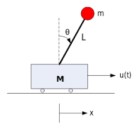

.. _`Inverted Pendulum`:

倒立摆
------------------

小车倒立摆由质量为 :math:`m` 的质点构成，它位于长度为 :math:`l` 的摆杆顶端，
摆杆铰接在一个水平运动的底座上，如相邻图所示。

控制系统的目标是，通过对摆所连接的小车施加力，使倒立摆保持平衡。

建模
~~~~~~~~~~~~

- :math:`M`：小车质量
- :math:`m`：杆顶端载荷的质量
- :math:`l`：杆长
- :math:`u`：施加在小车上的力
- :math:`x`：小车位置坐标
- :math:`\theta`：摆杆相对竖直方向的角度

使用拉格朗日方程：

.. math::
    & (M + m)\ddot{x} - ml\ddot{\theta}cos{\theta} + ml\dot{\theta^2}\sin{\theta} = u \\
    & l\ddot{\theta} - g\sin{\theta} = \ddot{x}\cos{\theta}

更多细节见此 `链接 <https://en.wikipedia.org/wiki/Inverted_pendulum#From_Lagrange's_equations>`__。

因此

.. math::
    & \ddot{x} =  \frac{m(gcos{\theta} - \dot{\theta}^2l)sin{\theta} + u}{M + m - mcos^2{\theta}} \\
    & \ddot{\theta} = \frac{g(M + m)sin{\theta} - \dot{\theta}^2lmsin{\theta}cos{\theta} + ucos{\theta}}{l(M + m - mcos^2{\theta})}

当 :math:`\theta` 较小时的线性化模型，:math:`cos{\theta} \approx 1`，:math:`sin{\theta} \approx \theta`，:math:`\dot{\theta}^2 \approx 0`。

.. math::
    & \ddot{x} =  \frac{gm}{M}\theta + \frac{1}{M}u\\
    & \ddot{\theta} = \frac{g(M + m)}{Ml}\theta + \frac{1}{Ml}u

状态空间：

.. math::
    & \dot{x} = Ax + Bu \\
    & y = Cx + Du

其中

.. math::
    & x = [x, \dot{x}, \theta,\dot{\theta}]\\
    & A = \begin{bmatrix}  0 & 1 & 0 & 0\\0 & 0 & \frac{gm}{M} & 0\\0 & 0 & 0 & 1\\0 & 0 & \frac{g(M + m)}{Ml} & 0 \end{bmatrix}\\
    & B = \begin{bmatrix}  0 \\ \frac{1}{M} \\ 0 \\ \frac{1}{Ml} \end{bmatrix}

若只控制 \theta

.. math::
    & C = \begin{bmatrix} 0 & 0 & 1 & 0 \end{bmatrix}\\
    & D = [0]

若同时控制 x 与 \theta

.. math::
    & C = \begin{bmatrix} 1 & 0 & 0 & 0\\0 & 0 & 1 & 0 \end{bmatrix}\\
    & D = \begin{bmatrix} 0 \\ 0 \end{bmatrix}

线性二次调节器（LQR）控制
~~~~~~~~~~~~~~~~~~~~~~~~~~~

LQR 控制器最小化如下定义的代价函数：

.. math::  J = x^T Q x + u^T R u

使代价值最小的反馈控制律为：

.. math::  u = -K x

其中：

.. math::  K = (B^T P B + R)^{-1} B^T P A

并且 :math:`P` 是离散时间
`代数黎卡提方程 <https://en.wikipedia.org/wiki/Inverted_pendulum#From_Lagrange's_equations>`__ （DARE）的唯一正定解：

.. math::  P = A^T P A - A^T P B ( R + B^T P B )^{-1} B^T P A + Q

.. image:: https://github.com/AtsushiSakai/PythonRoboticsGifs/raw/master/Control/InvertedPendulumCart/animation_lqr.gif

代码链接
^^^^^^^^^^^

.. autofunction:: InvertedPendulum.inverted_pendulum_lqr_control.main

模型预测控制（MPC）
~~~~~~~~~~~~~~~~~~~~~~~~~~~
MPC 控制器最小化如下定义的代价函数：

.. math:: J = x^T Q x + u^T R u

约束为：

- 线性化倒立摆模型
- 初始状态

.. image:: https://github.com/AtsushiSakai/PythonRoboticsGifs/raw/master/Control/InvertedPendulumCart/animation.gif

代码链接
^^^^^^^^^^^

.. autofunction:: InvertedPendulum.inverted_pendulum_mpc_control.main
