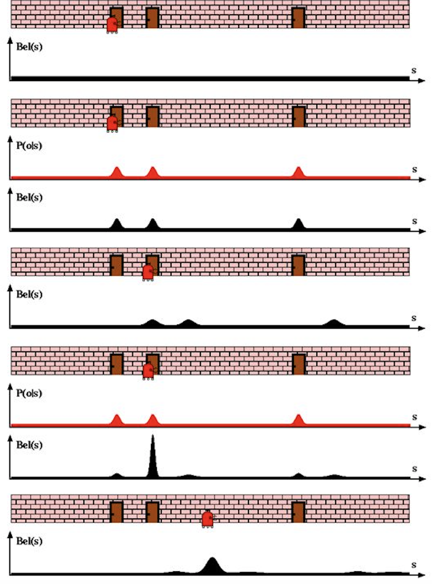

卡尔曼滤波基础（第二部分）
------------------------------

概率生成法则
~~~~~~~~~~~~~~~~

第 1 定律：
^^^^^^^^^^^^^^^

表示状态 :math:`x_{t}` 的信念，以全部过去的状态、测量和控制为条件。这可以用下面的条件概率从数学上表示：

.. math:: p(x_{t} | x_{0:t-1},z_{1:t-1},u_{1:t})

1) :math:`z_{t}` 表示\ **测量**

2) :math:`u_{t}` 表示\ **运动指令**

3) :math:`x_{t}` 表示机器人或其环境在时刻 t 的\ **状态**\ （可以是位置、速度等）。

“如果我们已知状态 :math:`x_{t-1}` 和 :math:`u_{t}`，那么根据\ **条件独立**\ 性，再知道状态 :math:`x_{0:t-2}`、:math:`z_{1:t-1}` 就无关紧要了。”状态 :math:`x_{t-1}` 在 :math:`x_{t}` 与 :math:`z_{1:t-1}`、:math:`u_{1:t-1}` 之间引入了条件独立。

因此，该定律现在成立为：

.. math:: p(x_{t} | x_{0:t-1},z_{1:t-1},u_{1:t})=p(x_{t} | x_{t-1},u_{t})

第 2 定律：
^^^^^^^^^^^^^^^

若 :math:`x_{t}` 是完备的，则：

.. math:: p(z_{t} | x-_{0:t},z_{1:t-1},u_{1:t})=p(z_{t} | x_{t})

:math:`x_{t}` **完备**\ 意味着过去的状态、控制或测量不再携带可用于预测未来的额外信息。

:math:`x_{0:t-1}`、:math:`z_{1:t-1}` 和 :math:`u_{1:t}` 在给定完备的 :math:`x_{t}` 时，与 :math:`z_{t}` **条件独立**。

滤波器分两部分工作：

:math:`p(x_{t} | x_{t-1},u_{t})` -> **状态转移概率**

:math:`p(z_{t} | x_{t})` -> **测量概率**

条件相关与条件独立的例子：
~~~~~~~~~~~~~~~~~~~~~~~~~~~~~~

:math:`\bullet`\ **相互独立，但条件相关**

假设你抛两枚公平的硬币。

A - 你的第一次抛硬币为正面

B - 你的第二次抛硬币为正面

C - 你的前两次抛出结果相同

这里 A 与 B 是独立的。然而，在给定 C 的条件下，A 与 B 条件相关，因为如果你知道 C，第一次抛硬币的结果就会告知另一次。

:math:`\bullet`\ **相互相关，但条件独立**

一个盒子里有两枚硬币：一枚普通硬币，以及一枚假的双正面硬币（P(H)=1）。我随机选一枚硬币并抛两次。定义如下事件。

A = 第一次抛硬币的结果为 H。

B = 第二次抛硬币的结果为 H。

C = 选中了硬币 1（普通硬币）。

如果我们知道 A 已经发生（也就是第一次抛硬币的结果为正面），我们会猜测选中硬币 2 的可能性大于硬币 1。这进而提高了 B 发生的条件概率。这表明 A 与 B 并不独立。另一方面，在给定 C（选中硬币 1）时，A 与 B 是独立的。

贝叶斯法则：
~~~~~~~~~~~~~~~~

后验 =

.. math:: \frac{Likelihood*Prior}{Marginal} 

这里，

**后验** = 在某些证据的基础上事件发生的概率。

**似然** = 在该事件已经发生的前提下，证据有多大可能。

**先验** = 在没有任何证据时，仅仅该事件发生的概率。

**边缘概率** = 在所有可能的事件情形下，证据出现的概率。

示例：

1% 的女性患有乳腺癌（因此 99% 没有）。当确实患有乳腺癌时，80% 的乳腺 X 线摄影能够检测出来（因此 20% 会漏诊）。当并未患癌时，9.6% 的乳腺 X 线摄影会检测出乳腺癌（因此 90.4% 正确地给出阴性结果）。

可以把上面的过程写成一个方程，这就是贝叶斯定理。方程如下：

:math:`\displaystyle{\Pr(\mathrm{A}|\mathrm{X}) = \frac{\Pr(\mathrm{X}|\mathrm{A})\Pr(\mathrm{A})}{\Pr(\mathrm{X|A})\Pr(\mathrm{A})+ \Pr(\mathrm{X | not \ A})\Pr(\mathrm{not \ A})}}`

:math:`\bullet`\ Pr(A|X) = 在检测为阳性（X）的条件下患有癌症（A）的概率。这正是我们想知道的：阳性结果下患癌的可能性有多大？在本例中是 7.8%。

:math:`\bullet`\ Pr(X|A) = 在你患有癌症（A）的条件下检测为阳性（X）的概率。这是真阳性的概率，在本例中为 80%。

:math:`\bullet`\ Pr(A) = 患有癌症的概率（1%）。

:math:`\bullet`\ Pr(not A) = 没有癌症的概率（99%）。

:math:`\bullet`\ Pr(X|not A) = 在你并未患癌（~A）的条件下检测为阳性（X）的概率。这是假阳性，在本例中为 9.6%。

贝叶斯滤波算法
~~~~~~~~~~~~~~~~~~

基本的滤波算法是：

对所有 :math:`x_{t}`：

1. :math:`\overline{bel}(x_t) = \int p(x_t | u_t, x_{t-1}) bel(x_{t-1})dx`

2. :math:`bel(x_t) = \eta p(z_t | x_t) \overline{bel}(x_t)`

结束。

:math:`\rightarrow`\ 滤波的第一步是计算下一步中使用贝叶斯定理时所需的先验。这是\ **预测**\ 步骤。信念 :math:`\overline{bel}(x_t)` 是在时刻 t=t 纳入测量（:math:`z_{t}`）**之前**\ 的信念。这一步发生运动，信息会损失，因为高斯分布的均值与协方差被相加。方程右端利用全概率定律来计算先验。

:math:`\rightarrow` 这是\ **校正**\ 或更新步骤，计算机器人在计入时刻 t=t 的测量（:math:`z_{t}`）**之后**\ 的信念。这里我们纳入传感器信息，以确定机器人身在何处。由于高斯分布在这里相乘，我们获得了信息。（高斯值相乘使结果落在这些数值之间，并且所得协方差更小。）

贝叶斯滤波定位示例：
~~~~~~~~~~~~~~~~~~~~~~~~

.. code-block:: ipython3

    from IPython.display import Image
    Image(filename="bayes_filter.png",width=400)

已知：一个带有传感器的机器人，传感器用于检测走廊沿途的门。机器人知道走廊是什么样子，但不知道自己在地图中的位置。

1. 初始时（第一种情形），它不知道自己相对于地图的位置，因此信念给地图上的每个位置赋予相等的概率。

2. 纳入第一次传感器读数，结果显示存在一扇门。现在机器人知道地图的样子，但还不能定位，因为地图上有 3 扇门。因此它给每一扇门赋予相等的概率。

3. 机器人现在向前运动。这是预测步骤，运动使机器人损失一部分信息，因此高斯分布的方差增大（图 4）。最终信念是上一步后验与运动之后当前状态的\ **卷积**。同时，由于运动，均值向右移动。

4. 再次纳入测量，传感器感知到一扇门，这一次，三扇门各自对应一扇门的可能性仍然相等。滤波的“魔力”就在这里发挥作用。对于最终信念（图 5），感知之后计算出的后验是先前的后验与测量的混合，即\ **卷积**。它提高了机器人在靠近第二扇门的位置上的信念。方差\ **减小**\ 并形成\ **峰值**。

5. 最后，经过一系列运动与校正的迭代，机器人能够相对于环境确定自己的位置。（图 6）

请注意，机器人知道地图，但不知道自己在地图上的确切位置。

贝叶斯滤波与卡尔曼滤波的结构
~~~~~~~~~~~~~~~~~~~~~~~~~~~~~~~~

对于卡尔曼滤波，基本结构和概念与贝叶斯滤波保持相同。唯一的关键区别是卡尔曼滤波的数学表示。卡尔曼滤波不过是使用高斯分布的贝叶斯滤波。

要使贝叶斯滤波成为卡尔曼滤波，**信念的每一项现在都是高斯分布**，而不再是直方图。**贝叶斯滤波**\ 算法的基本形式为：

.. math::

   \begin{aligned} 
   \bar {\mathbf x} &= \mathbf x \ast f_{\mathbf x}(\bullet)\, \, &\text{Prediction} \\
   \mathbf x &= \mathcal L \cdot \bar{\mathbf x}\, \, &\text{Correction}
   \end{aligned}

:math:`\bar{\mathbf x}` 是\ *先验*

:math:`\mathcal L` 是在给定先验 :math:`\bar{\mathbf x}` 时一次测量的\ *似然*

:math:`f_{\mathbf x}(\bullet)` 是\ *过程模型*，也就是帮助预测下一状态的高斯项，例如用速度跟踪位置，或用加速度。

:math:`\ast` 表示\ *卷积*。

卡尔曼增益
~~~~~~~~~~~~~~

.. math::  x = (\mathcal L \bar x)

其中 x 是后验，:math:`\mathcal L` 与 :math:`\bar x` 都是高斯分布。

因此，后验的均值由下式给出：

.. math::

   \mu=\frac{\bar\sigma^2\, \mu_z + \sigma_z^2 \, \bar\mu} {\bar\sigma^2 + \sigma_z^2}

.. math:: \mu = \left( \frac{\bar\sigma^2}{\bar\sigma^2 + \sigma_z^2}\right) \mu_z + \left(\frac{\sigma_z^2}{\bar\sigma^2 + \sigma_z^2}\right)\bar\mu

写成这种形式后容易看出，我们在用权重对测量和先验进行缩放：

.. math:: \mu = W_1 \mu_z + W_2 \bar\mu

这些权重之和为 1，因为分母是归一化项。我们引入一个新项 :math:`K=W_1`，于是得到：

.. math::

   \begin{aligned}
   \mu &= K \mu_z + (1-K) \bar\mu\\
   &= \bar\mu + K(\mu_z - \bar\mu)
   \end{aligned}

其中

.. math:: K = \frac {\bar\sigma^2}{\bar\sigma^2 + \sigma_z^2}

用卡尔曼增益表示的方差：

.. math::

   \begin{aligned}
   \sigma^2 &= \frac{\bar\sigma^2 \sigma_z^2 } {\bar\sigma^2 + \sigma_z^2} \\
   &= K\sigma_z^2 \\
   &= (1-K)\bar\sigma^2 
   \end{aligned}

:math:`K` 是\ *卡尔曼增益*。它是卡尔曼滤波的核心。它是一个缩放项，在 :math:`\mu_z` 与 :math:`\bar\mu` 之间选取一个中间值。

卡尔曼滤波：一元与多元
~~~~~~~~~~~~~~~~~~~~~~~~~~

\ **预测**\ 

:math:`\begin{array}{|l|l|l|} \hline \text{Univariate} & \text{Univariate} & \text{Multivariate}\\ & \text{(Kalman form)} & \\ \hline \bar \mu = \mu + \mu_{f_x} & \bar x = x + dx & \bar{\mathbf x} = \mathbf{Fx} + \mathbf{Bu}\\ \bar\sigma^2 = \sigma_x^2 + \sigma_{f_x}^2 & \bar P = P + Q & \bar{\mathbf P} = \mathbf{FPF}^\mathsf T + \mathbf Q \\ \hline \end{array}`

:math:`\mathbf x,\, \mathbf P` 是状态的均值和协方差。它们对应于 :math:`x` 和 :math:`\sigma^2`。

:math:`\mathbf F` 是\ *状态转移函数*。它与 :math:`\bf x` 相乘，即可算出先验。

:math:`\mathbf Q` 是过程协方差。它对应于 :math:`\sigma^2_{f_x}`。

:math:`\mathbf B` 和 :math:`\mathbf u` 是系统的模型控制输入。

\ **校正**\ 

:math:`\begin{array}{|l|l|l|} \hline \text{Univariate} & \text{Univariate} & \text{Multivariate}\\ & \text{(Kalman form)} & \\ \hline & y = z - \bar x & \mathbf y = \mathbf z - \mathbf{H\bar x} \\ & K = \frac{\bar P}{\bar P+R}& \mathbf K = \mathbf{\bar{P}H}^\mathsf T (\mathbf{H\bar{P}H}^\mathsf T + \mathbf R)^{-1} \\ \mu=\frac{\bar\sigma^2\, \mu_z + \sigma_z^2 \, \bar\mu} {\bar\sigma^2 + \sigma_z^2} & x = \bar x + Ky & \mathbf x = \bar{\mathbf x} + \mathbf{Ky} \\ \sigma^2 = \frac{\sigma_1^2\sigma_2^2}{\sigma_1^2+\sigma_2^2} & P = (1-K)\bar P & \mathbf P = (\mathbf I - \mathbf{KH})\mathbf{\bar{P}} \\ \hline \end{array}`

:math:`\mathbf H` 是测量函数。

:math:`\mathbf z,\, \mathbf R` 是测量的均值和噪声协方差。它们对应于一元滤波中的 :math:`z` 和 :math:`\sigma_z^2`。:math:`\mathbf y` 和 :math:`\mathbf K` 是残差和卡尔曼增益。

细节会与一元滤波不同，因为这里是向量和矩阵，但概念完全相同：

-  用高斯分布表示我们对状态及其误差的估计
-  用高斯分布表示测量及其误差
-  用高斯分布表示过程模型
-  用过程模型预测下一状态（先验）
-  在测量与先验之间形成一个折中估计

参考文献
~~~~~~~~~~~~

1. Roger Labbe 关于卡尔曼滤波的
   `仓库 <https://github.com/rlabbe/Kalman-and-Bayesian-Filters-in-Python>`__。（笔记中的大部分文字来自该仓库）

2. Sebastian Thrun、Wolfram Burgard 与 Dieter Fox 所著 *Probabilistic Robotics*，MIT Press。
