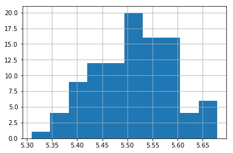
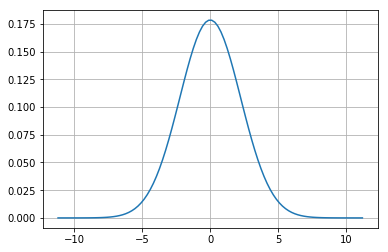
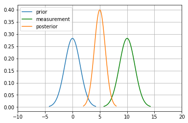
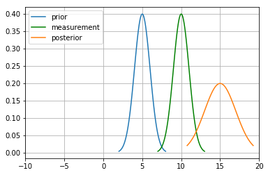
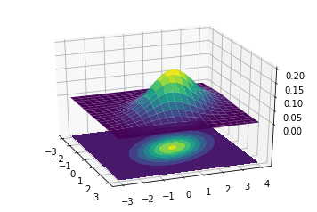
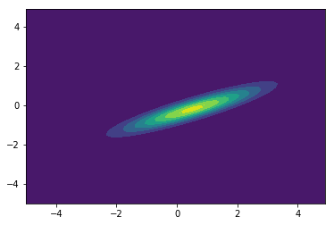

卡尔曼滤波基础（第一部分）
------------------------------

引言
~~~~

为什么需要用概率密度函数（PDF）来描述信念？
^^^^^^^^^^^^^^^^^^^^^^^^^^^^^^^^^^^^^^^^^^^^^^^

这是因为机器人所处的环境是随机的。环境里可能一边是奶牛、一边是特斯拉。也就是说，机器人及其环境无法被确定性建模（例如写成时间 t 之类变量的函数）。现实世界中的传感器也容易出错，因此读数会落在一组具有均值和方差的取值上。所以，我们始终要围绕相应的均值和方差来建模。

什么是随机变量的期望？
^^^^^^^^^^^^^^^^^^^^^^^^^^

期望就是按概率对取值做加权平均。

.. math:: \mathbb E[X] = \sum_{i=1}^n p_ix_i

连续形式为，

.. math:: \mathbb E[X] = \int_{-\infty}^\infty x\, f(x) \,dx

.. code-block:: ipython3

    import numpy as np
    import random
    x=[3,1,2]
    p=[0.1,0.3,0.4]
    E_x=np.sum(np.multiply(x,p))
    print(E_x)

.. parsed-literal::

    1.4000000000000001

把信念表示为单峰而不是多峰有什么好处？
^^^^^^^^^^^^^^^^^^^^^^^^^^^^^^^^^^^^^^^^^^

这显然是合理的，因为我们不能让一辆正在行驶的汽车同时对应两个位置上的概率。那样会过于混乱，这些信息也没有用处。

方差、协方差与相关性
~~~~~~~~~~~~~~~~~~~~~~~~

方差
^^^^

方差是数据的散布程度。均值并不能充分\ **说明**\ 数据。因此，方差告诉我们数据的\ **故事**，也就是数据的散布。

.. math:: \mathit{VAR}(X) = \frac{1}{n}\sum_{i=1}^n (x_i - \mu)^2

.. code-block:: ipython3

    x=np.random.randn(10)
    np.var(x)

.. parsed-literal::

    1.0224618077401504

协方差
^^^^^^^^^^

这针对多元分布。例如，二维空间中的机器人在 x 和 y 上都可以取值。要描述它们，需要一个在 x 和 y 上都有均值的正态分布。

对于多元分布，均值 :math:`\mu` 可以表示为一个矩阵，

.. math::

   \mu = \begin{bmatrix}\mu_1\\\mu_2\\ \vdots \\\mu_n\end{bmatrix}

同样，方差也可以这样表示。

但还有一个重要概念：正如每个变量或维度自身的取值会变化，它们\ **共同变化**\ 的程度也可以用数值来刻画。这也是衡量两个数据集如何相互关联，即\ **相关性**\ 的度量。

例如，身高增加时，体重通常也会增加。这些变量是相关的。它们呈正相关，因为一个变量变大时，另一个也会变大。

我们用\ **协方差矩阵**\ 表示多元正态分布的协方差：

.. math::

   \Sigma = \begin{bmatrix}
     \sigma_1^2 & \sigma_{12} & \cdots & \sigma_{1n} \\
     \sigma_{21} &\sigma_2^2 & \cdots & \sigma_{2n} \\
     \vdots  & \vdots  & \ddots & \vdots  \\
     \sigma_{n1} & \sigma_{n2} & \cdots & \sigma_n^2
    \end{bmatrix}

**对角线**——每个相应变量的方差。

**非对角线**——第 i 个变量与第 j 个变量之间的协方差。

.. math::

   \begin{aligned}VAR(X) = \sigma_x^2 &=  \frac{1}{n}\sum_{i=1}^n(X - \mu)^2\\
   COV(X, Y) = \sigma_{xy} &= \frac{1}{n}\sum_{i=1}^n[(X-\mu_x)(Y-\mu_y)\big]\end{aligned}

.. code-block:: ipython3

    x=np.random.random((3,3))
    np.cov(x)

.. parsed-literal::

    array([[0.08868895, 0.05064471, 0.08855629],
           [0.05064471, 0.06219243, 0.11555291],
           [0.08855629, 0.11555291, 0.21534324]])

把数据当作\ **样本**、使用 :math:`\frac{1}{N-1}` 时的协方差

.. code-block:: ipython3

    x_cor=np.random.rand(1,10)
    y_cor=np.random.rand(1,10)
    np.cov(x_cor,y_cor)

.. parsed-literal::

    array([[ 0.1571437 , -0.00766623],
           [-0.00766623,  0.13957621]])

把数据当作\ **总体**、使用 :math:`\frac{1}{N}` 时的协方差

.. code-block:: ipython3

    np.cov(x_cor,y_cor,bias=1)

.. parsed-literal::

    array([[ 0.14142933, -0.0068996 ],
           [-0.0068996 ,  0.12561859]])

高斯分布
~~~~~~~~~~~~

中心极限定理
^^^^^^^^^^^^^^^^

根据该定理，随机且相互独立的变量的 n 个样本的平均值，会随着样本量增大而趋于正态分布。（一般而言，n ≥ 30）

.. code-block:: ipython3

    import matplotlib.pyplot as plt
    import random
    a=np.zeros((100,))
    for i in range(100):
        x=[random.uniform(1,10) for _ in range(1000)]
        a[i]=np.sum(x,axis=0)/1000
    plt.hist(a)

.. parsed-literal::

    (array([ 1.,  4.,  9., 12., 12., 20., 16., 16.,  4.,  6.]),
     array([5.30943011, 5.34638597, 5.38334183, 5.42029769, 5.45725355,
            5.49420941, 5.53116527, 5.56812114, 5.605077  , 5.64203286,
            5.67898872]),
     <a list of 10 Patch objects>)

高斯分布的定义
^^^^^^^^^^^^^^

高斯分布是一种\ *连续概率分布*，由两个参数完全描述：均值（:math:`\mu`）和方差（:math:`\sigma^2`）。其定义为：

.. math::

    
   f(x, \mu, \sigma) = \frac{1}{\sigma\sqrt{2\pi}} \exp\big [{-\frac{(x-\mu)^2}{2\sigma^2} }\big ]

取值范围为 :math:`[-\inf,\inf]`

它只是均值（:math:`\mu`）和标准差（:math:`\sigma`）的函数，并由此给出正态分布特有的\ **钟形曲线**。

.. code-block:: ipython3

    import matplotlib.mlab as mlab
    import math
    import scipy.stats
    
    mu = 0
    variance = 5
    sigma = math.sqrt(variance)
    x = np.linspace(mu - 5*sigma, mu + 5*sigma, 100)
    plt.plot(x,scipy.stats.norm.pdf(x, mu, sigma))
    plt.show()

为什么需要高斯分布？
^^^^^^^^^^^^^^^^^^^^^^^^

因为在现实世界中，处理多峰分布会变得非常困难：我们无法把信念放在机器人两个分开的位置上。这会让人十分困惑，实践中也难以把握。高斯概率分布使我们只需使用单峰来驾驶机器人，峰值在均值处，并带有一定方差。

高斯分布的性质
~~~~~~~~~~~~~~~~~~

**乘法**

在贝叶斯滤波的测量更新中，算法要求把先验 P(X_t) 与测量 P(Z_t|X_t) 相乘，以计算后验：

.. math:: P(X \mid Z) = \frac{P(Z \mid X)P(X)}{P(Z)}

这里，分子中的 :math:`P(Z \mid X),P(X)` 都是高斯分布。

:math:`N(\bar\mu, \bar\sigma^1)` 与 :math:`N(\bar\mu, \bar\sigma^2)`
是它们的均值和方差。

新的均值为

.. math:: \mu_\mathtt{new} = \frac{\sigma_z^2\bar\mu + \bar\sigma^2z}{\bar\sigma^2+\sigma_z^2}

新的方差为

.. math::

   \sigma_\mathtt{new} = \frac{\sigma_z^2\bar\sigma^2}{\bar\sigma^2+\sigma_z^2}

.. code-block:: ipython3

    import matplotlib.mlab as mlab
    import math
    mu1 = 0
    variance1 = 2
    sigma = math.sqrt(variance1)
    x1 = np.linspace(mu1 - 3*sigma, mu1 + 3*sigma, 100)
    plt.plot(x1,scipy.stats.norm.pdf(x1, mu1, sigma),label='prior')
    
    mu2 = 10
    variance2 = 2
    sigma = math.sqrt(variance2)
    x2 = np.linspace(mu2 - 3*sigma, mu2 + 3*sigma, 100)
    plt.plot(x2,scipy.stats.norm.pdf(x2, mu2, sigma),"g-",label='measurement')
    
    
    mu_new=(mu1*variance2+mu2*variance1)/(variance1+variance2)
    print("New mean is at: ",mu_new)
    var_new=(variance1*variance2)/(variance1+variance2)
    print("New variance is: ",var_new)
    sigma = math.sqrt(var_new)
    x3 = np.linspace(mu_new - 3*sigma, mu_new + 3*sigma, 100)
    plt.plot(x3,scipy.stats.norm.pdf(x3, mu_new, var_new),label="posterior")
    plt.legend(loc='upper left')
    plt.xlim(-10,20)
    plt.show()

.. parsed-literal::

    New mean is at:  5.0
    New variance is:  1.0

**加法**

运动步骤涉及把概率加起来的情形（因为它必须遵守全概率定律）。这意味着要把它们的信念相加，因而涉及两个高斯分布。二者只是做算术相加。

.. math::

   \begin{gathered}\mu_x = \mu_p + \mu_z \\
   \sigma_x^2 = \sigma_z^2+\sigma_p^2\, \end{gathered}

.. code-block:: ipython3

    import matplotlib.mlab as mlab
    import math
    mu1 = 5
    variance1 = 1
    sigma = math.sqrt(variance1)
    x1 = np.linspace(mu1 - 3*sigma, mu1 + 3*sigma, 100)
    plt.plot(x1,scipy.stats.norm.pdf(x1, mu1, sigma),label='prior')
    
    mu2 = 10
    variance2 = 1
    sigma = math.sqrt(variance2)
    x2 = np.linspace(mu2 - 3*sigma, mu2 + 3*sigma, 100)
    plt.plot(x2,scipy.stats.norm.pdf(x2, mu2, sigma),"g-",label='measurement')
    
    
    mu_new=mu1+mu2
    print("New mean is at: ",mu_new)
    var_new=(variance1+variance2)
    print("New variance is: ",var_new)
    sigma = math.sqrt(var_new)
    x3 = np.linspace(mu_new - 3*sigma, mu_new + 3*sigma, 100)
    plt.plot(x3,scipy.stats.norm.pdf(x3, mu_new, var_new),label="posterior")
    plt.legend(loc='upper left')
    plt.xlim(-10,20)
    plt.show()

.. parsed-literal::

    New mean is at:  15
    New variance is:  2

.. code-block:: ipython3

    #Example from:
    #https://scipython.com/blog/visualizing-the-bivariate-gaussian-distribution/
    import numpy as np
    import matplotlib.pyplot as plt
    from matplotlib import cm
    from mpl_toolkits.mplot3d import Axes3D
    
    # Our 2-dimensional distribution will be over variables X and Y
    N = 60
    X = np.linspace(-3, 3, N)
    Y = np.linspace(-3, 4, N)
    X, Y = np.meshgrid(X, Y)
    
    # Mean vector and covariance matrix
    mu = np.array([0., 1.])
    Sigma = np.array([[ 1. , -0.5], [-0.5,  1.5]])
    
    # Pack X and Y into a single 3-dimensional array
    pos = np.empty(X.shape + (2,))
    pos[:, :, 0] = X
    pos[:, :, 1] = Y
    
    def multivariate_gaussian(pos, mu, Sigma):
        """Return the multivariate Gaussian distribution on array pos.
    
        pos is an array constructed by packing the meshed arrays of variables
        x_1, x_2, x_3, ..., x_k into its _last_ dimension.
    
        """
    
        n = mu.shape[0]
        Sigma_det = np.linalg.det(Sigma)
        Sigma_inv = np.linalg.inv(Sigma)
        N = np.sqrt((2*np.pi)**n * Sigma_det)
        # This einsum call calculates (x-mu)T.Sigma-1.(x-mu) in a vectorized
        # way across all the input variables.
        fac = np.einsum('...k,kl,...l->...', pos-mu, Sigma_inv, pos-mu)
    
        return np.exp(-fac / 2) / N
    
    # The distribution on the variables X, Y packed into pos.
    Z = multivariate_gaussian(pos, mu, Sigma)
    
    # Create a surface plot and projected filled contour plot under it.
    fig = plt.figure()
    ax = fig.gca(projection='3d')
    ax.plot_surface(X, Y, Z, rstride=3, cstride=3, linewidth=1, antialiased=True,
                    cmap=cm.viridis)
    
    cset = ax.contourf(X, Y, Z, zdir='z', offset=-0.15, cmap=cm.viridis)
    
    # Adjust the limits, ticks and view angle
    ax.set_zlim(-0.15,0.2)
    ax.set_zticks(np.linspace(0,0.2,5))
    ax.view_init(27, -21)
    
    plt.show()

这是所涉及高斯分布的三维投影，下方曲面显示的是上方三维图形的二维投影。最内层椭圆表示最高峰，也就是给定 (X, Y) 取值处的最大概率。

\*\* numpy einsum 示例 \*\*

.. code-block:: ipython3

    a = np.arange(25).reshape(5,5)
    b = np.arange(5)
    c = np.arange(6).reshape(2,3)
    print(a)
    print(b)
    print(c)

.. parsed-literal::

    [[ 0  1  2  3  4]
     [ 5  6  7  8  9]
     [10 11 12 13 14]
     [15 16 17 18 19]
     [20 21 22 23 24]]
    [0 1 2 3 4]
    [[0 1 2]
     [3 4 5]]

.. code-block:: ipython3

    #this is the diagonal sum, i repeated means the diagonal
    np.einsum('ij', a)
    #this takes the output ii which is the diagonal and outputs to a
    np.einsum('ii->i',a)
    #this takes in the array A represented by their axes 'ij' and  B by its only axes'j' 
    #and multiples them element wise
    np.einsum('ij,j',a, b)

.. parsed-literal::

    array([ 30,  80, 130, 180, 230])

.. code-block:: ipython3

    A = np.arange(3).reshape(3,1)
    B = np.array([[ 0,  1,  2,  3],
                  [ 4,  5,  6,  7],
                  [ 8,  9, 10, 11]])
    C=np.multiply(A,B)
    np.sum(C,axis=1)

.. parsed-literal::

    array([ 0, 22, 76])

.. code-block:: ipython3

    D = np.array([0,1,2])
    E = np.array([[ 0,  1,  2,  3],
                  [ 4,  5,  6,  7],
                  [ 8,  9, 10, 11]])
    
    np.einsum('i,ij->i',D,E)

.. parsed-literal::

    array([ 0, 22, 76])

.. code-block:: ipython3

    from scipy.stats import multivariate_normal
    x, y = np.mgrid[-5:5:.1, -5:5:.1]
    pos = np.empty(x.shape + (2,))
    pos[:, :, 0] = x; pos[:, :, 1] = y
    rv = multivariate_normal([0.5, -0.2], [[2.0, 0.9], [0.9, 0.5]])
    plt.contourf(x, y, rv.pdf(pos))
    

.. parsed-literal::

    <matplotlib.contour.QuadContourSet at 0x139196438>

参考文献
~~~~~~~~~~~~

1. Roger Labbe 关于卡尔曼滤波的
   `仓库 <https://github.com/rlabbe/Kalman-and-Bayesian-Filters-in-Python>`__。（笔记中的大部分示例来自该仓库）

2. Sebastian Thrun、Wolfram Burgard 与 Dieter Fox 所著 *Probabilistic Robotics*，MIT Press。

3. SciPy
   `文档 <https://scipython.com/blog/visualizing-the-bivariate-gaussian-distribution/>`__
