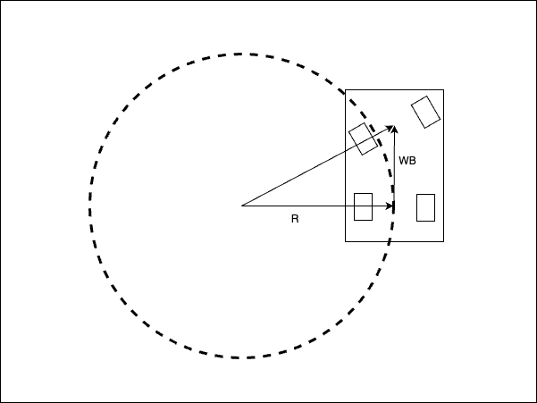
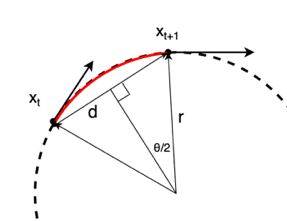

转向运动模型
-----------------------

基于转向运动模型计算转弯半径
~~~~~~~~~~~~~~~~~~~~~~~~~~~~~~~~~~~~~~~~~~~~~~~~~~~~~

转弯半径表示机器人转弯时所走圆的半径，如下图所示。

当转向角偏转 :math:`\delta` 时，
可以基于轴距（WB，即后轮中心与前轮中心之间的距离）
与上图中转弯半径圆经过后轮中心这一假设之间的几何关系，
用下面的方程计算转弯半径 :math:`R`。

:math:`R = \frac{WB}{tan\delta}`

曲率 :math:`\kappa` 是转弯半径的倒数：

:math:`\kappa = \frac{tan\delta}{WB}`

在上图中，转弯半径 :math:`R` 上两点之间车辆航向角的角度差 :math:`\Delta \theta`，
与从转弯中心连接这两点的向量的夹角相同。

由弧长与半径的公式，

:math:`\Delta \theta = \frac{s}{R}`

这里，:math:`s` 是转弯半径上两点之间的距离。

因此，航向角速度 :math:`\omega` 可以如下计算。

:math:`\omega = \frac{v}{R}`

以及

:math:`\omega = v\kappa`

这里，:math:`v` 是车辆的速度。

由机器人轨迹上连续两个位姿计算转弯半径
~~~~~~~~~~~~~~~~~~~~~~~~~~~~~~~~~~~~~~~~~~~~~~~~~~~~~~~~~~~~~~~~~~~~~~~~~~~~~~~~

本节将由机器人轨迹上连续两个位姿推导转弯半径的公式。

如上图上方所示，机器人从时刻 :math:`t` 的点运动到时刻 :math:`t+1` 的点。
每个点由二维位置 :math:`(x_t, y_t)` 和航向角 :math:`\theta_t` 表示。

两点之间的距离为 :math:`d = \sqrt{(x_{t+1} - x_t)^2 + (y_{t+1} - y_t)^2}`。

从转弯中心指向这两点的两个向量之间的夹角为 :math:`\theta = \theta_{t+1} - \theta_t`。
这里，从转弯半径的中心向连接两点、长度为 :math:`d` 的直线作垂线，
可以由所得的直角三角形推导出下面的方程。

:math:`sin\frac{\theta}{2} = \frac{d}{2R}`

因此，转弯半径 :math:`R` 可以如下计算。

:math:`R = \frac{d}{2sin\frac{\theta}{2}}`

曲率 :math:`\kappa` 是转弯半径的倒数。
因此，曲率可以如下计算。

:math:`\kappa = \frac{2sin\frac{\theta}{2}}{d}`

由最大转向速度确定目标速度
~~~~~~~~~~~~~~~~~~~~~~~~~~~~~~~~~~~~~~~~~~~~~~~~~~~~~~~~~

如果最大转向速度给定为 :math:`\dot{\delta}_{max}`，
最大曲率变化率 :math:`\dot{\kappa}_{max}` 可以如下计算：

:math:`\dot{\kappa}_{max} = \frac{tan\dot{\delta}_{max}}{WB}`

根据由机器人轨迹上连续两个位姿计算曲率的方法，

最大曲率变化率 :math:`\dot{\kappa}_{max}` 可以如下计算：

:math:`\dot{\kappa}_{max} = \frac{\kappa_{t+1}-\kappa_{t}}{\Delta t}`

如果可以假设车辆不会超过最大曲率变化率，

目标最小速度 :math:`v_{min}` 可以如下计算：

:math:`v_{min} = \frac{d_{t+1}+d_{t}}{\Delta t} = \frac{d_{t+1}+d_{t}}{(\kappa_{t+1}-\kappa_{t})}\frac{tan\dot{\delta}_{max}}{WB}`

参考文献
~~~~~~~~~~~

- `Vehicle Dynamics and Control <https://link.springer.com/book/10.1007/978-1-4614-1433-9>`_
