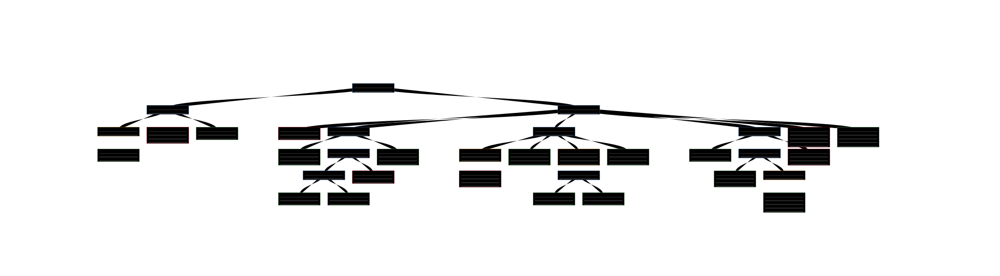

行为树
-------------

行为树是一种模块化、分层的决策模型，广泛用于机器人控制和游戏开发。
它与分层状态机有一些相似之处，关键区别在于行为的主要构建块是任务而不是状态。
已有研究表明，行为树能够概括若干其他控制架构（https://ieeexplore.ieee.org/document/7790863）

代码链接
~~~~~~~~~~~~~

控制节点
++++++++++++

.. autoclass:: MissionPlanning.BehaviorTree.behavior_tree.ControlNode

.. autoclass:: MissionPlanning.BehaviorTree.behavior_tree.SequenceNode

.. autoclass:: MissionPlanning.BehaviorTree.behavior_tree.SelectorNode

.. autoclass:: MissionPlanning.BehaviorTree.behavior_tree.WhileDoElseNode

动作节点
++++++++++++

.. autoclass:: MissionPlanning.BehaviorTree.behavior_tree.ActionNode

.. autoclass:: MissionPlanning.BehaviorTree.behavior_tree.EchoNode

.. autoclass:: MissionPlanning.BehaviorTree.behavior_tree.SleepNode

装饰节点
++++++++++++++

.. autoclass:: MissionPlanning.BehaviorTree.behavior_tree.DecoratorNode

.. autoclass:: MissionPlanning.BehaviorTree.behavior_tree.InverterNode

.. autoclass:: MissionPlanning.BehaviorTree.behavior_tree.TimeoutNode

.. autoclass:: MissionPlanning.BehaviorTree.behavior_tree.DelayNode

.. autoclass:: MissionPlanning.BehaviorTree.behavior_tree.ForceSuccessNode

.. autoclass:: MissionPlanning.BehaviorTree.behavior_tree.ForceFailureNode

行为树工厂
+++++++++++++++++++++

.. autoclass:: MissionPlanning.BehaviorTree.behavior_tree.BehaviorTreeFactory
  :members:

行为树
+++++++++++++

.. autoclass:: MissionPlanning.BehaviorTree.behavior_tree.BehaviorTree
  :members:

示例
~~~~~~~

使用 `xml-tree-visual <https://xml-tree-visual.vercel.app/>`_ 可视化行为树。

打印行为树

.. code-block:: text

    Behavior Tree
    [Robot Main Controller]
        [Battery Management]
            (Low Battery Detection)
                <Check Battery>
            <Low Battery Warning>
            <Charge Battery>
        [Patrol Task]
            <Start Task>
            [Move to Position A]
                <Move to A>
                [Obstacle Handling A]
                    [Obstacle Present]
                        <Detect Obstacle>
                        <Avoid Obstacle>
                    <No Obstacle>
                <Position A Task>
            [Move to Position B]
                (Short Wait)
                    <Prepare Movement>
                <Move to B>
                (Limited Time Obstacle Handling)
                    [Obstacle Present]
                        <Detect Obstacle>
                        <Avoid Obstacle>
                <Position B Task>
            [Conditional Move to C]
                <Check Sufficient Battery>
                [Perform Position C Task]
                    <Move to C>
                    (Ensure Completion)
                        <Position C Task>
                <Skip Position C>
            <Complete Patrol>
            <Return to Charging Station>
    Behavior Tree
