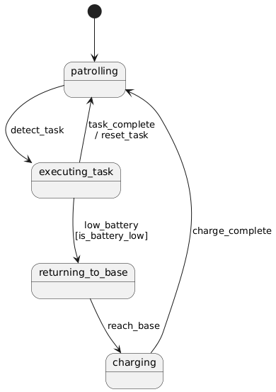

状态机
-------------

状态机是一种用于描述对象在不同状态之间转移的模型。它清楚地表明对象如何根据事件改变状态，并可能触发相应的动作。

核心概念
~~~~~~~~~~~~~

- **状态**：系统的一种明确模式或条件（例如 “Idle”、“Running”）。由 State 类管理，可选 on_enter/on_exit 回调
- **事件**：可能引起状态转移的触发信号（例如 “start”、“stop”）
- **转移**：由事件触发的、从源状态到目标状态的状态变化路径
- **动作**：在转移期间执行的操作（在进入新状态之前）
- **守卫条件**：允许转移之前必须满足的前提条件

代码链接
~~~~~~~~~~~

.. autoclass:: MissionPlanning.StateMachine.state_machine.StateMachine
   :members: add_transition, process, register_state
   :special-members: __init__

PlantUML 支持
~~~~~~~~~~~~~~~~

``generate_plantuml()`` 方法生成的图展示：

- 当前状态（用 [*] 箭头标出）
- 所有可能的转移
- 方括号 [] 中的守卫条件
- 以 / 为前缀的动作

示例
~~~~~~~

状态机图：
+++++++++++++++++++++++

状态转移表：
+++++++++++++++++++++++
.. list-table:: 状态转移
   :header-rows: 1
   :widths: 20 15 20 20 20

   * - 源状态
     - 事件
     - 目标状态
     - 守卫条件
     - 动作
   * - patrolling
     - detect_task
     - executing_task
     - 
     - 
   * - executing_task
     - task_complete
     - patrolling
     - 
     - reset_task
   * - executing_task
     - low_battery
     - returning_to_base
     - is_battery_low
     - 
   * - returning_to_base
     - reach_base
     - charging
     - 
     - 
   * - charging
     - charge_complete
     - patrolling
     - 
     - 
