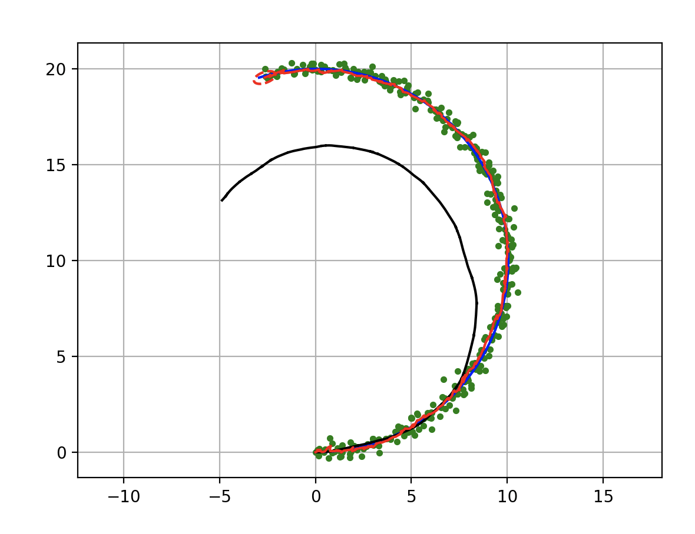
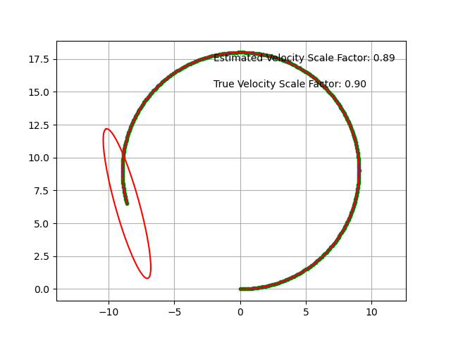

扩展卡尔曼滤波（EKF）定位
-------------------------

位置估计卡尔曼滤波
^^^^^^^^^^^^^^^^^^

.. figure:: https://github.com/AtsushiSakai/PythonRoboticsGifs/raw/master/Localization/extended_kalman_filter/animation.gif

这是使用扩展卡尔曼滤波（EKF）的传感器融合定位。

蓝线是真实轨迹，黑线是航位推算轨迹，

绿点是定位观测（例如 GPS），红线是扩展卡尔曼滤波（EKF）估计轨迹。

红色椭圆是扩展卡尔曼滤波（EKF）估计的协方差椭圆。

代码链接
~~~~~~~~

.. autofunction:: Localization.extended_kalman_filter.extended_kalman_filter.ekf_estimation

扩展卡尔曼滤波（EKF）算法
~~~~~~~~~~~~~~~~~~~~~~~~~

使用扩展卡尔曼滤波（EKF）的定位过程为

=== 预测 ===

:math:`x_{Pred} = Fx_t+Bu_t`

:math:`P_{Pred} = J_f P_t J_f^T + Q`

=== 更新 ===

:math:`z_{Pred} = Hx_{Pred}`

:math:`y = z - z_{Pred}`

:math:`S = J_g P_{Pred}.J_g^T + R`

:math:`K = P_{Pred}.J_g^T S^{-1}`

:math:`x_{t+1} = x_{Pred} + Ky`

:math:`P_{t+1} = ( I - K J_g) P_{Pred}`

滤波器设计
~~~~~~~~~~

在本仿真中，机器人在时刻 :math:`t` 的状态向量包含 4 个状态。

.. math:: \textbf{x}_t=[x_t, y_t, \phi_t, v_t]

x、y 是二维 x-y 位置，:math:`\phi` 是朝向，v 是速度。

在代码中，“xEst”表示状态向量。
`代码 <https://github.com/AtsushiSakai/PythonRobotics/blob/916b4382de090de29f54538b356cef1c811aacce/Localization/extended_kalman_filter/extended_kalman_filter.py#L168>`__

并且，:math:`P_t` 是状态的协方差矩阵，

:math:`Q` 是过程噪声的协方差矩阵，

:math:`R` 是时刻 :math:`t` 的观测噪声协方差矩阵

机器人具有速度传感器和陀螺仪。

因此，每个时间步可以使用如下输入向量

.. math:: \textbf{u}_t=[v_t, \omega_t]

此外，机器人具有 GNSS 传感器，也就是机器人在每个时刻可以观测 x-y 位置。

.. math:: \textbf{z}_t=[x_t,y_t]

输入向量和观测向量都包含传感器噪声。

在代码中，“observation”函数生成带噪声的输入向量和观测向量
`代码 <https://github.com/AtsushiSakai/PythonRobotics/blob/916b4382de090de29f54538b356cef1c811aacce/Localization/extended_kalman_filter/extended_kalman_filter.py#L34-L50>`__

运动模型
~~~~~~~~

机器人模型为

.. math::  \dot{x} = v \cos(\phi)

.. math::  \dot{y} = v \sin(\phi)

.. math::  \dot{\phi} = \omega

因此，运动模型为

.. math:: \textbf{x}_{t+1} = f(\textbf{x}_t, \textbf{u}_t) = F\textbf{x}_t+B\textbf{u}_t

其中

:math:`\begin{equation*} F= \begin{bmatrix} 1 & 0 & 0 & 0\\ 0 & 1 & 0 & 0\\ 0 & 0 & 1 & 0 \\ 0 & 0 & 0 & 0 \\ \end{bmatrix} \end{equation*}`

:math:`\begin{equation*} B= \begin{bmatrix} cos(\phi) \Delta t & 0\\ sin(\phi) \Delta t & 0\\ 0 & \Delta t\\ 1 & 0\\ \end{bmatrix} \end{equation*}`

:math:`\Delta t` 是时间间隔。

实现见
`代码 <https://github.com/AtsushiSakai/PythonRobotics/blob/916b4382de090de29f54538b356cef1c811aacce/Localization/extended_kalman_filter/extended_kalman_filter.py#L53-L67>`__

运动函数为

:math:`\begin{equation*} \begin{bmatrix} x' \\ y' \\ w' \\ v' \end{bmatrix} = f(\textbf{x}, \textbf{u}) = \begin{bmatrix} x + v\cos(\phi)\Delta t \\ y + v\sin(\phi)\Delta t \\ \phi + \omega \Delta t \\ v \end{bmatrix} \end{equation*}`

其雅可比矩阵为

:math:`\begin{equation*} J_f = \begin{bmatrix} \frac{\partial x'}{\partial x}& \frac{\partial x'}{\partial y} & \frac{\partial x'}{\partial \phi} & \frac{\partial x'}{\partial v}\\ \frac{\partial y'}{\partial x}& \frac{\partial y'}{\partial y} & \frac{\partial y'}{\partial \phi} & \frac{\partial y'}{\partial v}\\ \frac{\partial \phi'}{\partial x}& \frac{\partial \phi'}{\partial y} & \frac{\partial \phi'}{\partial \phi} & \frac{\partial \phi'}{\partial v}\\ \frac{\partial v'}{\partial x}& \frac{\partial v'}{\partial y} & \frac{\partial v'}{\partial \phi} & \frac{\partial v'}{\partial v} \end{bmatrix} \end{equation*}`

:math:`\begin{equation*} 　= \begin{bmatrix} 1& 0 & -v \sin(\phi) \Delta t & \cos(\phi) \Delta t\\ 0 & 1 & v \cos(\phi) \Delta t & \sin(\phi) \Delta t\\ 0 & 0 & 1 & 0 \\ 0 & 0 & 0 & 1 \end{bmatrix} \end{equation*}`

观测模型
~~~~~~~~

机器人可以从 GPS 获取 x-y 位置信息。

因此，GPS 观测模型为

.. math:: \textbf{z}_{t} = g(\textbf{x}_t) = H \textbf{x}_t

其中

:math:`\begin{equation*} H = \begin{bmatrix} 1 & 0 & 0 & 0 \\ 0 & 1 & 0 & 0 \\ \end{bmatrix} \end{equation*}`

观测函数表明

:math:`\begin{equation*} \begin{bmatrix} x' \\ y' \end{bmatrix} = g(\textbf{x}) = \begin{bmatrix} x \\ y \end{bmatrix} \end{equation*}`

其雅可比矩阵为

:math:`\begin{equation*} J_g = \begin{bmatrix} \frac{\partial x'}{\partial x} & \frac{\partial x'}{\partial y} & \frac{\partial x'}{\partial \phi} & \frac{\partial x'}{\partial v}\\ \frac{\partial y'}{\partial x}& \frac{\partial y'}{\partial y} & \frac{\partial y'}{\partial \phi} & \frac{\partial y'}{ \partial v}\\ \end{bmatrix} \end{equation*}`

:math:`\begin{equation*} 　= \begin{bmatrix} 1& 0 & 0 & 0\\ 0 & 1 & 0 & 0\\ \end{bmatrix} \end{equation*}`

带速度尺度因子校正的卡尔曼滤波
^^^^^^^^^^^^^^^^^^^^^^^^^^^^^^
这是带速度校正的扩展卡尔曼滤波（EKF）定位。

它用于校正因车轮磨损等因素引起的尺度因子误差所造成的车速测量值。

在本仿真中，机器人在时刻 :math:`t` 的状态向量包含 5 个状态。

.. math:: \textbf{x}_t=[x_t, y_t, \phi_t, v_t, s_t]

x、y 是二维 x-y 位置，:math:`\phi` 是朝向，v 是速度，s 是速度的尺度因子。

在代码中，“xEst”表示状态向量。
`代码 <https://github.com/AtsushiSakai/PythonRobotics/blob/916b4382de090de29f54538b356cef1c811aacce/Localization/extended_kalman_filter/extended_kalman_ekf_with_velocity_correctionfilter.py#L163>`__

其余部分与位置估计卡尔曼滤波相同。

代码链接
~~~~~~~~

.. autofunction:: Localization.extended_kalman_filter.ekf_with_velocity_correction.ekf_estimation

运动模型
~~~~~~~~

机器人模型为

.. math::  \dot{x} = v s \cos(\phi)

.. math::  \dot{y} = v s \sin(\phi)

.. math::  \dot{\phi} = \omega

因此，运动模型为

.. math:: \textbf{x}_{t+1} = f(\textbf{x}_t, \textbf{u}_t) = F\textbf{x}_t+B\textbf{u}_t

其中

:math:`\begin{equation*} F= \begin{bmatrix} 1 & 0 & 0 & 0 & 0\\ 0 & 1 & 0 & 0 & 0\\ 0 & 0 & 1 & 0  & 0\\ 0 & 0 & 0 & 0  & 0\\ 0 & 0 & 0 & 0  & 1\\ \end{bmatrix} \end{equation*}`

:math:`\begin{equation*} B= \begin{bmatrix} cos(\phi) \Delta t s & 0\\ sin(\phi) \Delta t s & 0\\ 0 & \Delta t\\ 1 & 0\\ 0 & 0\\ \end{bmatrix} \end{equation*}`

:math:`\Delta t` 是时间间隔。

实现见
`代码 <https://github.com/AtsushiSakai/PythonRobotics/blob/916b4382de090de29f54538b356cef1c811aacce/Localization/extended_kalman_filter/extended_kalman_filter.py#L61-L76>`__

运动函数为

:math:`\begin{equation*} \begin{bmatrix} x' \\ y' \\ w' \\ v' \end{bmatrix} = f(\textbf{x}, \textbf{u}) = \begin{bmatrix} x + v s \cos(\phi)\Delta t \\ y + v s \sin(\phi)\Delta t \\ \phi + \omega \Delta t \\ v \end{bmatrix} \end{equation*}`

其雅可比矩阵为

:math:`\begin{equation*} J_f = \begin{bmatrix} \frac{\partial x'}{\partial x}& \frac{\partial x'}{\partial y} & \frac{\partial x'}{\partial \phi} & \frac{\partial x'}{\partial v} & \frac{\partial x'}{\partial s}\\ \frac{\partial y'}{\partial x}& \frac{\partial y'}{\partial y} & \frac{\partial y'}{\partial \phi} & \frac{\partial y'}{\partial v} & \frac{\partial y'}{\partial s}\\ \frac{\partial \phi'}{\partial x}& \frac{\partial \phi'}{\partial y} & \frac{\partial \phi'}{\partial \phi} & \frac{\partial \phi'}{\partial v} & \frac{\partial \phi'}{\partial s}\\ \frac{\partial v'}{\partial x}& \frac{\partial v'}{\partial y} & \frac{\partial v'}{\partial \phi} & \frac{\partial v'}{\partial v} & \frac{\partial v'}{\partial s} \\ \frac{\partial s'}{\partial x}& \frac{\partial s'}{\partial y} & \frac{\partial s'}{\partial \phi} & \frac{\partial s'}{\partial v} & \frac{\partial s'}{\partial s} \end{bmatrix} \end{equation*}`

:math:`\begin{equation*} 　= \begin{bmatrix} 1& 0 & -v s \sin(\phi) \Delta t & s \cos(\phi) \Delta t & \cos(\phi) v \Delta t\\ 0 & 1 & v s \cos(\phi) \Delta t & s \sin(\phi) \Delta t & v \sin(\phi) \Delta t\\ 0 & 0 & 1 & 0  & 0 \\ 0 & 0 & 0 & 1 & 0 \end{bmatrix} \end{equation*}`

观测模型
~~~~~~~~

机器人可以从 GPS 获取 x-y 位置信息。

因此，GPS 观测模型为

.. math:: \textbf{z}_{t} = g(\textbf{x}_t) = H \textbf{x}_t

其中

:math:`\begin{equation*} H = \begin{bmatrix} 1 & 0 & 0 & 0 & 0 \\ 0 & 1 & 0 & 0 & 0  \\ \end{bmatrix} \end{equation*}`

观测函数表明

:math:`\begin{equation*} \begin{bmatrix} x' \\ y' \end{bmatrix} = g(\textbf{x}) = \begin{bmatrix} x \\ y \end{bmatrix} \end{equation*}`

其雅可比矩阵为

:math:`\begin{equation*} J_g = \begin{bmatrix} \frac{\partial x'}{\partial x} & \frac{\partial x'}{\partial y} & \frac{\partial x'}{\partial \phi} & \frac{\partial x'}{\partial v} & \frac{\partial x'}{\partial s}\\ \frac{\partial y'}{\partial x}& \frac{\partial y'}{\partial y} & \frac{\partial y'}{\partial \phi} & \frac{\partial y'}{ \partial v} & \frac{\partial y'}{ \partial s}\\ \end{bmatrix} \end{equation*}`

:math:`\begin{equation*} 　= \begin{bmatrix} 1& 0 & 0 & 0 & 0\\ 0 & 1 & 0 & 0 & 0\\ \end{bmatrix} \end{equation*}`

参考文献
^^^^^^^^

-  `PROBABILISTIC-ROBOTICS.ORG <http://www.probabilistic-robotics.org/>`__
