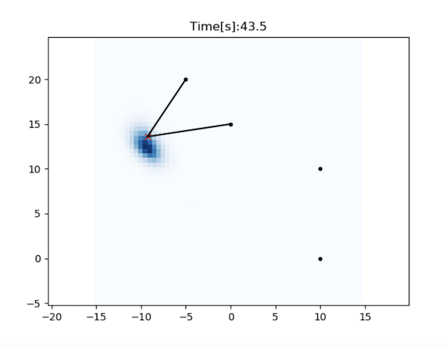
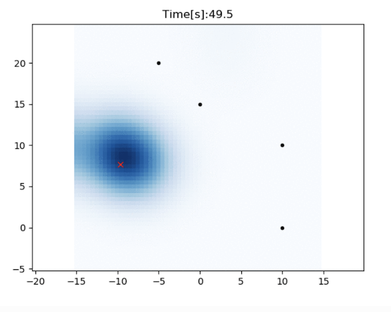
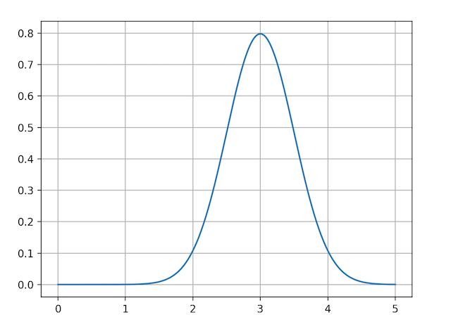
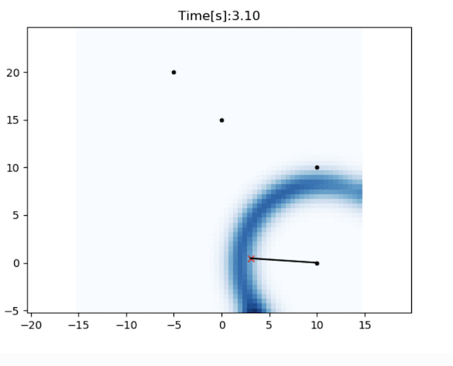

直方图滤波定位
--------------

.. image:: https://github.com/AtsushiSakai/PythonRoboticsGifs/raw/master/Localization/histogram_filter/animation.gif

这是使用直方图滤波的二维定位示例。

红色十字是真实位置，黑点是 RFID 位置。

蓝色栅格表示直方图滤波的位置概率。

在本仿真中，假设机器人的航向角以及 RFID 的位置已知，但 x、y 位置未知。

滤波器使用速度输入以及来自 RFID 的距离观测进行定位。

不需要初始位置信息。

代码链接
~~~~~~~~

.. autofunction:: Localization.histogram_filter.histogram_filter.histogram_filter_localization

滤波算法
~~~~~~~~

直方图滤波是连续空间中的离散贝叶斯滤波。

它使用规则栅格来管理机器人存在的概率。

若某个栅格的概率较高，则表示机器人很可能位于该处。

在仿真中要估计 x-y 位置，因此使用二维栅格数据。

直方图滤波估计概率分布分为 4 个步骤。

步骤 1：滤波器初始化
^^^^^^^^^^^^^^^^^^^^

直方图滤波不需要初始位置信息。

此时，可以将每个栅格的概率初始化为相同的值。

若可以使用初始位置信息，则可以据此设置初始概率。

当初始位置信息以高斯分布给出时，:ref:`gaussian_grid_map` 可能会有用。

步骤 2：由运动预测概率
^^^^^^^^^^^^^^^^^^^^^^

在直方图滤波中，当机器人移动到下一栅格时，每个栅格的全部概率信息都沿运动方向平移。

该过程表示机器人运动时概率分布的变化。

机器人移动之后，概率分布需要反映由运动引起的估计误差。

例如，有观测时位置概率呈尖峰：

但在没有观测时，概率会变得更加不确定：

仿真中使用\ `高斯滤波 <https://docs.scipy.org/doc/scipy/reference/generated/scipy.ndimage.gaussian_filter.html>`_\ 来添加噪声。

步骤 3：由观测更新概率
^^^^^^^^^^^^^^^^^^^^^^
在此步骤中，所有概率都由观测更新，这是贝叶斯滤波的更新步骤。

概率更新公式因所使用的传感器模型而不同。

本仿真使用距离观测模型。

每个栅格的概率按下列公式更新：

.. math:: p_t=p_{t-1}*h(z)

.. math:: h(z)=\frac{\exp \left(-(d - z)^{2} / 2\right)}{\sqrt{2 \pi}}

- :math:`p_t` 是时刻 `t` 的概率。

- :math:`h(z)` 是观测 `z` 对应的观测概率。

- :math:`d` 是从 RFID 到栅格中心的已知距离。

当 `d` 为 3.0 时，`h(z)` 的分布为：

观测到 RFID 时，观测概率分布呈圆形：

步骤 4：由概率估计位置
^^^^^^^^^^^^^^^^^^^^^^
在每个时间步，可以根据当前概率分布计算最终的机器人位置。
计算最终位置有两种方法：

1. 使用概率最大的栅格位置。

2. 使用按概率加权的栅格位置的平均值。

参考文献
~~~~~~~~

- `_PROBABILISTIC ROBOTICS: <http://www.probabilistic-robotics.org>`_
- `Robust Vehicle Localization in Urban Environments Using Probabilistic Maps <http://driving.stanford.edu/papers/ICRA2010.pdf>`_
