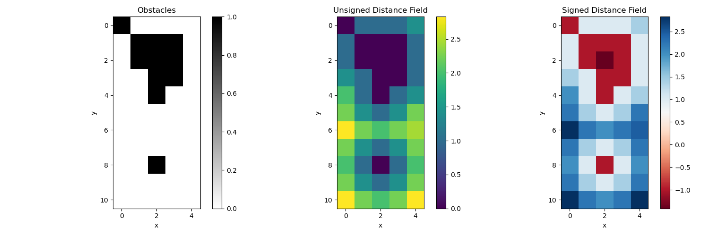

距离地图
--------

这是用于路径规划的距离地图算法实现。

距离地图算法根据表示障碍物的布尔场，计算无符号距离场（UDF）和有符号距离场（SDF）。

无符号距离场（UDF）给出每个点到最近障碍物的距离。有符号距离场（SDF）对障碍物外部的点给出正距离，对障碍物内部的点给出负距离。

示例
~~~~

该算法在带有障碍物的简单二维栅格上演示：

代码链接
^^^^^^^^

.. autofunction:: Mapping.DistanceMap.distance_map.compute_sdf

.. autofunction:: Mapping.DistanceMap.distance_map.compute_udf

参考文献
~~~~~~~~

- `Distance Transforms of Sampled Functions <https://cs.brown.edu/people/pfelzens/papers/dt-final.pdf>`_，Pedro F. Felzenszwalb 与 Daniel P. Huttenlocher 的论文。
