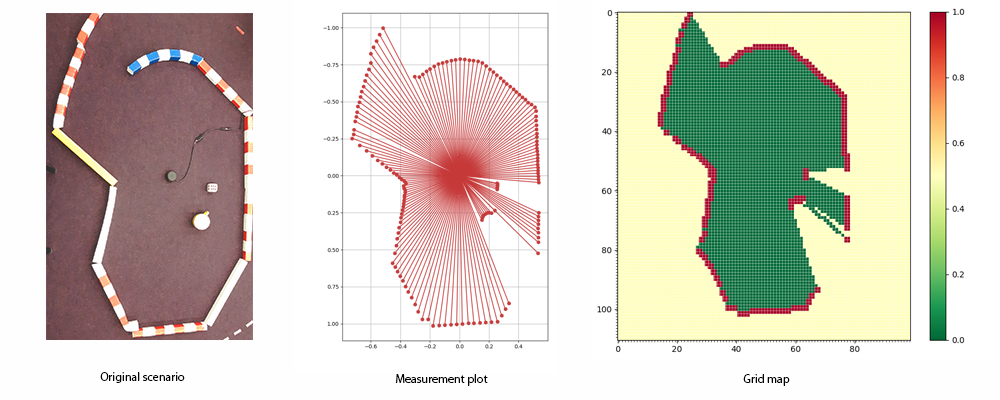
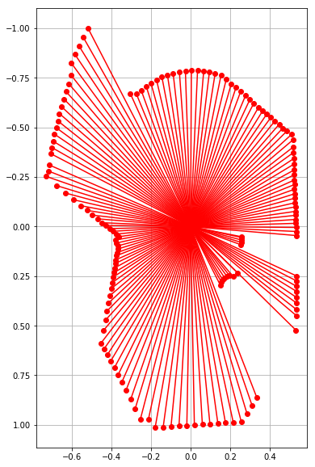
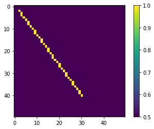
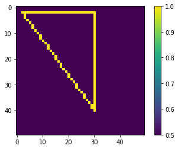
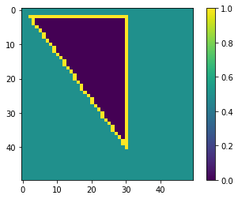
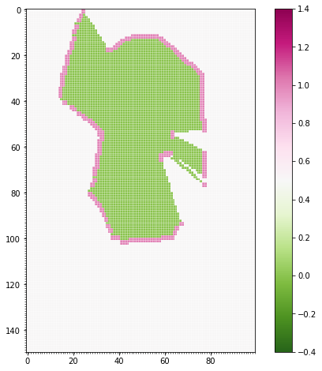

激光雷达到栅格地图
------------------

.. image:: https://github.com/AtsushiSakai/PythonRoboticsGifs/raw/master/Mapping/lidar_to_grid_map/animation.gif

本简要教程说明如何从文件中读取激光雷达（距离）测量，并将其转换为占据栅格。

占据栅格地图（*Hans Moravec, A.E. Elfes: High resolution maps from wide angle sonar, Proc. IEEE Int. Conf. Robotics Autom. (1985)*）是一种常用的、以概率表示环境的方法。栅格本质上是环境的离散表示，用来表明某个栅格单元是否被占据。这里地图表示为 ``numpy array``，接近 1 的数值表示该单元被占据（*在下一幅图中以红色标出*），接近 0 的数值表示空闲（*以绿色标出*）。栅格能够表示未知（未观测）区域，这些区域的数值接近 0.5。

为了由测量构建栅格地图，需要对数值进行离散化。不过，首先需要 ``import`` 一些必要的包。

.. code:: ipython3

    import math
    import numpy as np
    import matplotlib.pyplot as plt
    from math import cos, sin, radians, pi

测量文件以 ``csv``（逗号分隔值）格式包含距离以及对应的角度。下面编写 ``file_read`` 方法：

.. code:: ipython3

    def file_read(f):
        """
        Reading LIDAR laser beams (angles and corresponding distance data)
        """
        measures = [line.split(",") for line in open(f)]
        angles = []
        distances = []
        for measure in measures:
            angles.append(float(measure[0]))
            distances.append(float(measure[1]))
        angles = np.array(angles)
        distances = np.array(distances)
        return angles, distances

由距离和角度，可以用 ``sin`` 和 ``cos`` 求出 ``x`` 和 ``y`` 坐标。为了显示结果，使用 ``matplotlib.pyplot``（``plt``）。

.. code:: ipython3

    ang, dist = file_read("lidar01.csv")
    ox = np.sin(ang) * dist
    oy = np.cos(ang) * dist
    plt.figure(figsize=(6,10))
    plt.plot([oy, np.zeros(np.size(oy))], [ox, np.zeros(np.size(oy))], "ro-") # lines from 0,0 to the 
    plt.axis("equal")
    bottom, top = plt.ylim()  # return the current ylim
    plt.ylim((top, bottom)) # rescale y axis, to match the grid orientation
    plt.grid(True)
    plt.show()

``lidar_to_grid_map.py`` 包含一些便于使用的函数，可以把二维距离测量转换为栅格地图。例如，``bresenham`` 给出栅格地图中两点之间的直线。下面看它如何工作。

.. code:: ipython3

    import lidar_to_grid_map as lg
    map1 = np.ones((50, 50)) * 0.5
    line = lg.bresenham((2, 2), (40, 30))
    for l in line:
        map1[l[0]][l[1]] = 1
    plt.imshow(map1)
    plt.colorbar()
    plt.show()

.. code:: ipython3

    line = lg.bresenham((2, 30), (40, 30))
    for l in line:
        map1[l[0]][l[1]] = 1
    line = lg.bresenham((2, 30), (2, 2))
    for l in line:
        map1[l[0]][l[1]] = 1
    plt.imshow(map1)
    plt.colorbar()
    plt.show()

为了填充空白区域，可以使用一种基于队列的算法，它作用于已经初始化的占据地图。给定中心点后，算法在每次迭代中检查相邻单元，并在障碍物和空闲边界处停止扩展。

.. code:: ipython3

    from collections import deque
    def flood_fill(cpoint, pmap):
        """
        cpoint: starting point (x,y) of fill
        pmap: occupancy map generated from Bresenham ray-tracing
        """
        # Fill empty areas with queue method
        sx, sy = pmap.shape
        fringe = deque()
        fringe.appendleft(cpoint)
        while fringe:
            n = fringe.pop()
            nx, ny = n
            # West
            if nx > 0:
                if pmap[nx - 1, ny] == 0.5:
                    pmap[nx - 1, ny] = 0.0
                    fringe.appendleft((nx - 1, ny))
            # East
            if nx < sx - 1:
                if pmap[nx + 1, ny] == 0.5:
                    pmap[nx + 1, ny] = 0.0
                    fringe.appendleft((nx + 1, ny))
            # North
            if ny > 0:
                if pmap[nx, ny - 1] == 0.5:
                    pmap[nx, ny - 1] = 0.0
                    fringe.appendleft((nx, ny - 1))
            # South
            if ny < sy - 1:
                if pmap[nx, ny + 1] == 0.5:
                    pmap[nx, ny + 1] = 0.0
                    fringe.appendleft((nx, ny + 1))

该算法将从中心点（例如 (10, 20)）出发，把黄线围成的区域填充为零：

.. code:: ipython3

    flood_fill((10, 20), map1)
    map_float = np.array(map1)/10.0
    plt.imshow(map1)
    plt.colorbar()
    plt.show()

下面在实际数据上使用这一泛洪填充：

.. code:: ipython3

    xyreso = 0.02  # x-y grid resolution
    yawreso = math.radians(3.1)  # yaw angle resolution [rad]
    ang, dist = file_read("lidar01.csv")
    ox = np.sin(ang) * dist
    oy = np.cos(ang) * dist
    pmap, minx, maxx, miny, maxy, xyreso = lg.generate_ray_casting_grid_map(ox, oy, xyreso, False)
    xyres = np.array(pmap).shape
    plt.figure(figsize=(20,8))
    plt.subplot(122)
    plt.imshow(pmap, cmap = "PiYG_r") 
    plt.clim(-0.4, 1.4)
    plt.gca().set_xticks(np.arange(-.5, xyres[1], 1), minor = True)
    plt.gca().set_yticks(np.arange(-.5, xyres[0], 1), minor = True)
    plt.grid(True, which="minor", color="w", linewidth = .6, alpha = 0.5)
    plt.colorbar()
    plt.show()

.. parsed-literal::

    The grid map is  150 x 100 .

代码链接
^^^^^^^^

.. autofunction:: Mapping.lidar_to_grid_map.lidar_to_grid_map.main
