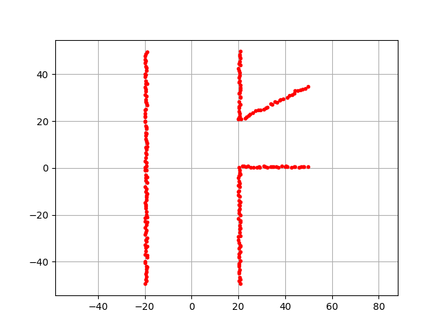
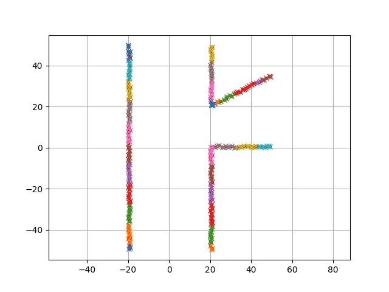
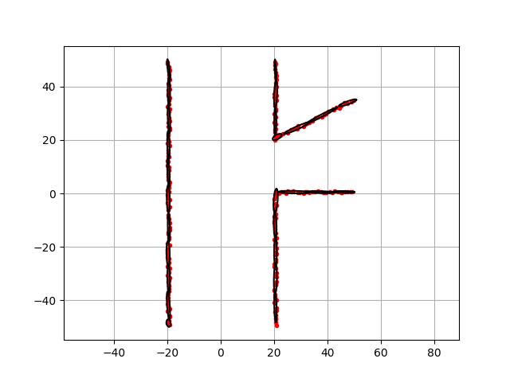
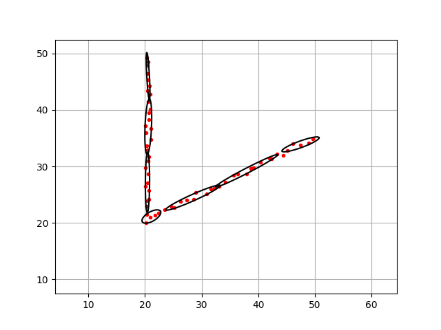

.. _ndt_map:

正态分布变换（NDT）地图
------------------------

这是一个正态分布变换（NDT）建图示例。

正态分布变换（NDT）是一种地图表示，它使用正态分布对观测点建模。

正态分布
~~~~~~~~

正态分布由两个参数组成：均值 :math:`\mu` 和协方差 :math:`\Sigma`。

:math:`\mathbf{X} \sim \mathcal{N}(\boldsymbol{\mu}, \boldsymbol{\Sigma})`

在二维情形下，:math:`\boldsymbol{\mu}` 是二维向量，:math:`\boldsymbol{\Sigma}` 是 2×2 矩阵。

正态分布概率密度函数的矩阵形式为：

:math:`X=\frac{1}{\sqrt{(2 \pi)^2|\Sigma|}} \exp \left\{-\frac{1}{2}^t(x-\mu) \sum^{-1}(x-\mu)\right\}`

正态分布变换建图步骤
~~~~~~~~~~~~~~~~~~~~

正态分布变换（NDT）建图包含两个步骤：

当得到如下新观测时：

首先需要对观测点进行聚类。
这通过基于栅格的聚类算法完成。

结果为：

然后，需要对每个栅格聚类拟合一个正态分布。

黑色椭圆如下表示每个正态分布变换（NDT）栅格：

接口
~~~~~

.. autoclass:: Mapping.ndt_map.ndt_map.NDTMap
    :members:
    :class-doc-from: class
