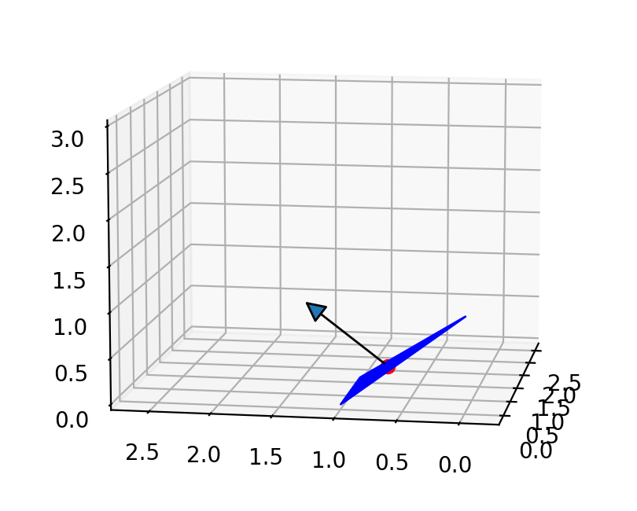
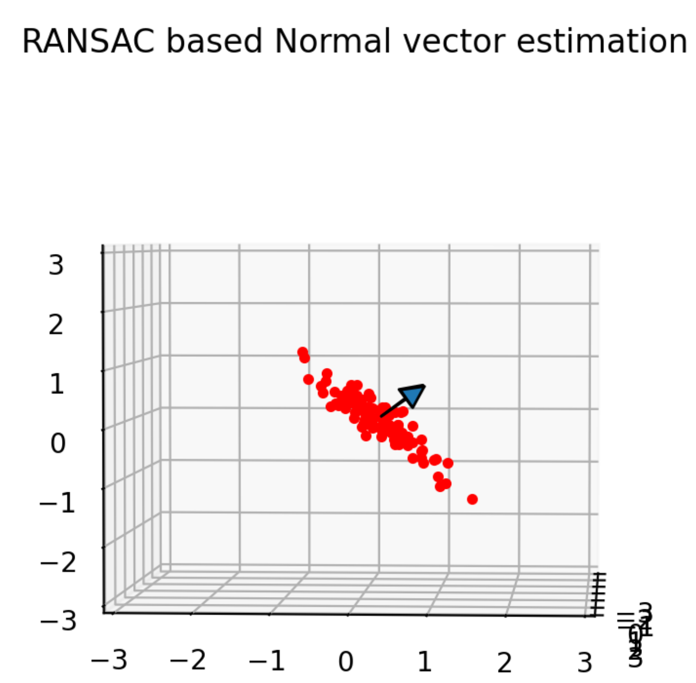

法向量估计
----------

三维三角形的法向量计算
~~~~~~~~~~~~~~~~~~~~~~

三维点可以表示为向量：

.. math:: p = [x, y, z]

当三维空间中有 3 个点 :math:`p_1, p_2, p_3` 时，

可以计算由这些点构成的三维三角形的法向量 n。

.. math:: n = \frac{v1 \times v2}{|v1 \times v2|}

其中

.. math:: v1 = p2 - p1

.. math:: v2 = p3 - p1

这是法向量计算的一个示例：

代码链接
========

.. autofunction:: Mapping.normal_vector_estimation.normal_vector_estimation.calc_normal_vector

基于随机抽样一致性（RANSAC）的法向量估计
~~~~~~~~~~~~~~~~~~~~~~~~~~~~~~~~~~~~~~~~~~

考虑根据一组可以观测到平面的 N 个三维点，估计该平面法向量的问题。

有一种方法使用全部点云数据，通过\ `最小二乘法 <https://stackoverflow.com/a/44315221/8387766>`_\ 估计平面和法向量。

然而，该方法容易受点云噪声的影响。

本文使用\ `随机抽样一致性（RANSAC） <https://en.wikipedia.org/wiki/Random_sample_consensus>`_\ 来估计平面和法向量。

随机抽样一致性（RANSAC）是针对含离群点数据集的鲁棒估计方法。

基于随机抽样一致性（RANSAC）的法向量估计方法如下：

#. 从点云中随机选取 3 个点。

#. 计算由这 3 个采样点所构成平面的法向量。

#. 计算该平面与全部点云之间的距离。

#. 若距离小于阈值，则将该点视为内点。

#. 重复上述步骤，直到内点比例大于阈值。

这是基于随机抽样一致性（RANSAC）的法向量估计示例：

代码链接
========

.. autofunction:: Mapping.normal_vector_estimation.normal_vector_estimation.ransac_normal_vector_estimation
