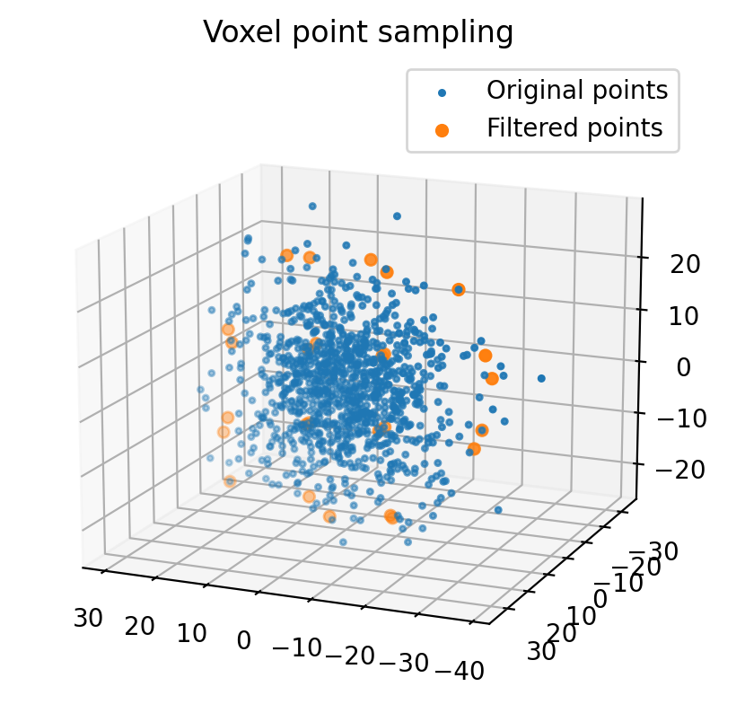
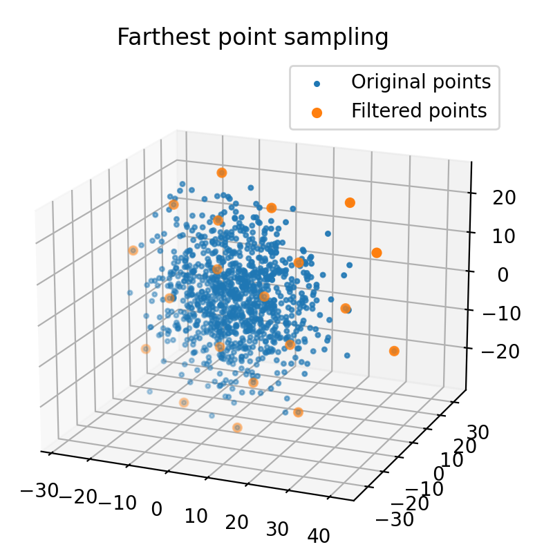
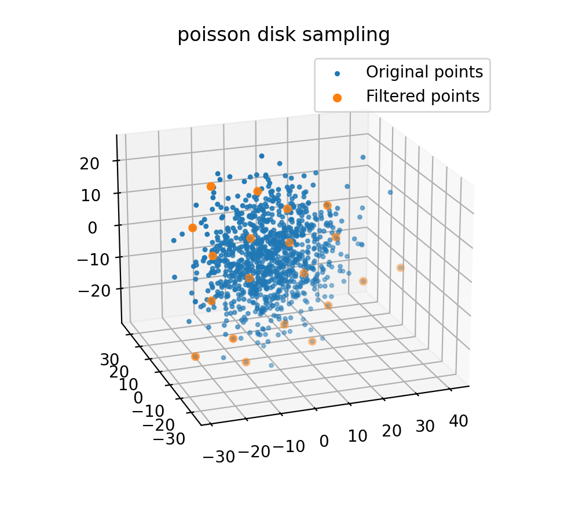

.. _point_cloud_sampling:

点云采样
--------

本节介绍 PythonRobotics 中的点云采样算法。

点云是由激光雷达、相机等外部传感器获取的二维和三维数据。
一般来说，点云的数据量很大。
因此，若处理全部数据，计算时间可能成为问题。

点云采样通过只提取有代表性的点、对点云数据抽稀，来解决这一计算复杂度问题，同时不降低使用这些点云数据进行处理时的性能。

体素点采样
~~~~~~~~~~

体素栅格采样利用\ `体素栅格 <https://en.wikipedia.org/wiki/Voxel>`_\ 来减少点云数据。体素栅格是三维空间中的规则栅格。

该方法判断每个点落在哪个栅格中，并把位于同一体素内的点云替换为其平均值，从而减少点数。

代码链接
========

.. autofunction:: Mapping.point_cloud_sampling.point_cloud_sampling.voxel_point_sampling

最远点采样
~~~~~~~~~~

最远点采样是一种按指定点数进行的点云采样方法，使点与点之间的距离尽可能远。

该方法适用于机器学习，以及其他希望从点云中取得指定数量点的场合。

接口
=====

.. autofunction:: Mapping.point_cloud_sampling.point_cloud_sampling.farthest_point_sampling

泊松盘采样
~~~~~~~~~~

泊松盘采样是一种按指定点数进行的点云采样方法：算法选取与已选点之间的距离大于某一距离的点。

与各点彼此相距更远的最远点采样相比，该方法的分布效果较差，但由于计算时间短，适合实时处理。

代码链接
========

.. autofunction:: Mapping.point_cloud_sampling.point_cloud_sampling.poisson_disk_sampling
