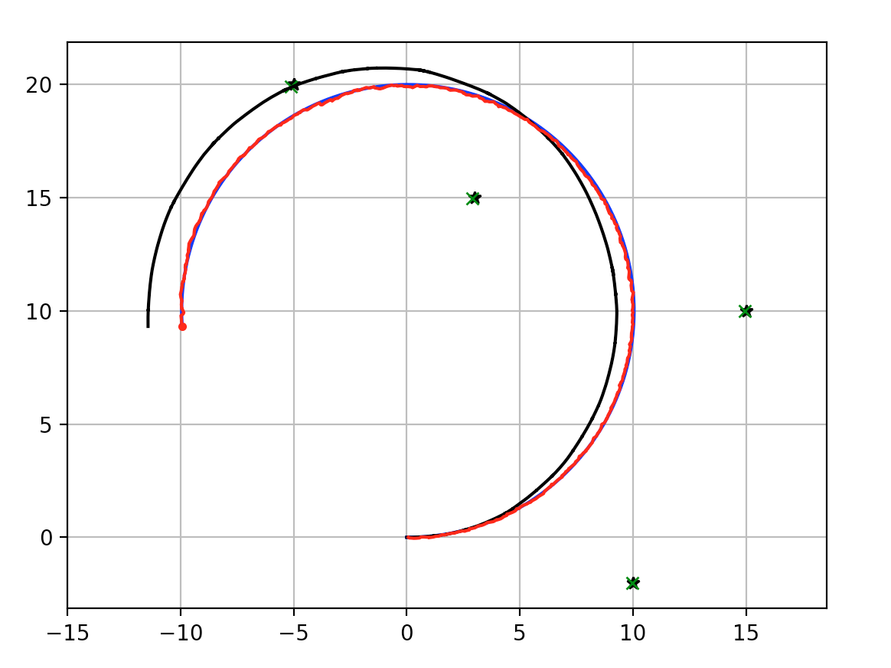

基于扩展卡尔曼滤波的 SLAM
---------------------------

这是基于扩展卡尔曼滤波（EKF）的同步定位与建图（SLAM）示例。

蓝线是真值，黑线是航位推算，红线是 EKF SLAM 估计轨迹。

绿色叉号是估计得到的路标。

.. image:: https://github.com/AtsushiSakai/PythonRoboticsGifs/raw/master/SLAM/EKFSLAM/animation.gif

仿真
~~~~~~~~~~~~~~~~~~~~~~~~~~~~~

这是 EKF SLAM 的仿真。

-  黑色星号：路标
-  绿色叉号：路标位置的估计
-  黑线：航位推算
-  蓝线：真值
-  红线：EKF SLAM 的位置估计

代码链接
~~~~~~~~~~~~~~~~~~~~~~~~~~~~~

.. autofunction:: SLAM.EKFSLAM.ekf_slam.ekf_slam

引言
~~~~~~~~~~~~~~~~~~~~~~~~~~~~~

EKF SLAM 在单个 EKF 中为 SLAM 问题建模。所建模的状态同时包含位姿 :math:`(x, y, \theta)`，以及 :math:`n` 个路标组成的数组 :math:`[(x_1, y_1), (x_2, y_2), ... , (x_n, y_n)]`。各个位置与各路标之间的协方差也一并跟踪。

:math:`\begin{equation} X = \begin{bmatrix} x \\ y \\ \theta \\ x_1 \\ y_1 \\ x_2 \\ y_2 \\ \dots \\ x_n \\ y_n \end{bmatrix} \end{equation}`

:math:`\begin{equation} P = \begin{bmatrix} \sigma_{xx} & \sigma_{xy} & \sigma_{x\theta} & \sigma_{xx_1} & \sigma_{xy_1} & \sigma_{xx_2} & \sigma_{xy_2} & \dots & \sigma_{xx_n} & \sigma_{xy_n} \\ \sigma_{yx} & \sigma_{yy} & \sigma_{y\theta} & \sigma_{yx_1} & \sigma_{yy_1} & \sigma_{yx_2} & \sigma_{yy_2} & \dots & \sigma_{yx_n} & \sigma_{yy_n} \\  & & & & \vdots & & & & & \\ \sigma_{x_nx} & \sigma_{x_ny} & \sigma_{x_n\theta} & \sigma_{x_nx_1} & \sigma_{x_ny_1} & \sigma_{x_nx_2} & \sigma_{x_ny_2} & \dots & \sigma_{x_nx_n} & \sigma_{x_ny_n} \end{bmatrix} \end{equation}`

滤波器随时间跟踪单一的位姿估计，位姿的置信度由协方差矩阵 :math:`P` 跟踪。:math:`P` 是对称方阵，其中每个元素对应系统两部分之间的协方差。例如，:math:`\sigma_{xy}` 表示对 :math:`x` 与 :math:`y` 的信念之间的协方差，并且等于 :math:`\sigma_{yx}`。

状态可以更紧凑地表示如下。

:math:`\begin{equation} X = \begin{bmatrix} x \\ m \end{bmatrix} \end{equation}`
:math:`\begin{equation} P = \begin{bmatrix} \Sigma_{xx} & \Sigma_{xm}\\ \Sigma_{mx} & \Sigma_{mm}\\ \end{bmatrix} \end{equation}`

这里状态简化为位姿（:math:`x`）与地图（:math:`m`）的组合。协方差矩阵因此更容易理解，可以直接读成：机器人位姿的不确定性（:math:`\Sigma_{xx}`）、地图的不确定性（:math:`\Sigma_{mm}`），以及机器人位姿相对于地图的不确定性，反之亦然（:math:`\Sigma_{xm}`、:math:`\Sigma_{mx}`）。

请注意区分 :math:`X` （状态）与 :math:`x` （位姿）。

.. code:: ipython3

    """
    Extended Kalman Filter SLAM example
    original author: Atsushi Sakai (@Atsushi_twi)
    notebook author: Andrew Tu (drewtu2)
    """

    import math
    import numpy as np
    %matplotlib notebook
    import matplotlib.pyplot as plt

    # EKF state covariance
    Cx = np.diag([0.5, 0.5, np.deg2rad(30.0)])**2 # Change in covariance

    #  Simulation parameter
    Qsim = np.diag([0.2, np.deg2rad(1.0)])**2  # Sensor Noise
    Rsim = np.diag([1.0, np.deg2rad(10.0)])**2 # Process Noise

    DT = 0.1  # time tick [s]
    SIM_TIME = 50.0  # simulation time [s]
    MAX_RANGE = 20.0  # maximum observation range
    M_DIST_TH = 2.0  # Threshold of Mahalanobis distance for data association.
    STATE_SIZE = 3  # State size [x,y,yaw]
    LM_SIZE = 2  # LM state size [x,y]

    show_animation = True

算法流程
~~~~~~~~~~~~~~~~~~~~~~~~~~~~~

每个时间步做下面两件事：用控制函数预测新的状态；根据估计状态与测量，更新对路标位置的信念。

.. code:: ipython3

    def ekf_slam(xEst, PEst, u, z):
        """
        Performs an iteration of EKF SLAM from the available information.

        :param xEst: the belief in last position
        :param PEst: the uncertainty in last position
        :param u:    the control function applied to the last position
        :param z:    measurements at this step
        :returns:    the next estimated position and associated covariance
        """

        # Predict
        xEst, PEst = predict(xEst, PEst, u)
        initP = np.eye(2)

        # Update
        xEst, PEst = update(xEst, PEst, z, initP)

        return xEst, PEst

1- 预测
~~~~~~~~~~~~~~~~~~~~~~~~~~~~~

**预测状态更新：** 下列方程描述只给出控制量 :math:`(v,w)` 时机器人的预测运动模型，二者分别是线速度与角速度。

:math:`\begin{equation*} F= \begin{bmatrix} 1 & 0 & 0 \\ 0 & 1 & 0 \\ 0 & 0 & 1 \end{bmatrix} \end{equation*}`

:math:`\begin{equation*} B= \begin{bmatrix} \Delta t cos(\theta) & 0\\ \Delta t sin(\theta) & 0\\ 0 & \Delta t \end{bmatrix} \end{equation*}`

:math:`\begin{equation*} U= \begin{bmatrix} v_t\\ w_t\\ \end{bmatrix} \end{equation*}`

:math:`\begin{equation*} X = FX + BU \end{equation*}`

:math:`\begin{equation*} \begin{bmatrix} x_{t+1} \\ y_{t+1} \\ \theta_{t+1} \end{bmatrix}= \begin{bmatrix} 1 & 0 & 0 \\ 0 & 1 & 0 \\ 0 & 0 & 1 \end{bmatrix}\begin{bmatrix} x_{t} \\ y_{t} \\ \theta_{t} \end{bmatrix}+ \begin{bmatrix} \Delta t cos(\theta) & 0\\ \Delta t sin(\theta) & 0\\ 0 & \Delta t \end{bmatrix} \begin{bmatrix} v_{t} + \sigma_v\\ w_{t} + \sigma_w\\ \end{bmatrix} \end{equation*}`

请注意，虽然 :math:`U` 只由 :math:`v_t` 与 :math:`w_t` 定义，实际计算中却会出现 :math:`+\sigma_v` 与 :math:`+\sigma_w`。这些量表示给定控制输入与实际控制输入之间的误差。

因此仿真按下面的方式设置。:math:`R` 表示加到控制输入上的过程噪声，用来模拟真实世界中的噪声。一组真值由原始控制量算出，航位推算则把该误差计入估计。

:math:`\begin{equation*} R= \begin{bmatrix} \sigma_v\\ \sigma_w\\ \end{bmatrix} \end{equation*}`

:math:`\begin{equation*} X_{true} = FX + B(U) \end{equation*}`

:math:`\begin{equation*} X_{DR} = FX + B(U + R) \end{equation*}`

运动模型预测的实现见 ``motion_model``。``observation`` 函数展示仿真如何使用（或不使用）过程噪声 ``Rsim``，以求出位姿的真值与航位推算估计。

**预测协方差：** 把状态协方差加到 EKF 当前的不确定性上。每个时间步，系统的不确定性按位姿的协方差 :math:`Cx` 增长。

:math:`P = G^TPG + Cx`

请注意，这里增长的不确定性只相对于位姿，路标对应的部分并不增长。

.. code:: ipython3

    def predict(xEst, PEst, u):
        """
        Performs the prediction step of EKF SLAM

        :param xEst: nx1 state vector
        :param PEst: nxn covariance matrix
        :param u:    2x1 control vector
        :returns:    predicted state vector, predicted covariance, jacobian of control vector, transition fx
        """
        G, Fx = jacob_motion(xEst, u)
        xEst[0:STATE_SIZE] = motion_model(xEst[0:STATE_SIZE], u)
        # Fx is an an identity matrix of size (STATE_SIZE)
        # sigma = G*sigma*G.T + Noise
        PEst = G.T @ PEst @ G + Fx.T @ Cx @ Fx
        return xEst, PEst

.. code:: ipython3

    def motion_model(x, u):
        """
        Computes the motion model based on current state and input function. 

        :param x: 3x1 pose estimation
        :param u: 2x1 control input [v; w]
        :returns: the resulting state after the control function is applied
        """
        F = np.array([[1.0, 0, 0],
                      [0, 1.0, 0],
                      [0, 0, 1.0]])

        B = np.array([[DT * math.cos(x[2, 0]), 0],
                      [DT * math.sin(x[2, 0]), 0],
                      [0.0, DT]])

        x = (F @ x) + (B @ u)
        return x

2 - 更新
~~~~~~~~~~~~~~~~~~~~~~~~~~~~~

在更新阶段，用附近路标的观测来修正位置估计。

对每一个观测到的路标，把它与已知地图中的某个路标做数据关联。如果该位置附近不存在路标，就把它当作新路标。一个路标必须离最近的已知路标多远才被看成新路标，这个距离阈值由 ``M_DIST_TH`` 设定。

观测已经关联到相应路标之后，就可以计算**新息**。新息（:math:`y`）是实际观测，与“假如从预测阶段得到的位姿进行观测、所应当得到的观测”之差。

:math:`y = z_t - h(X)`

算出新息之后，需要决定更信任观测还是更信任预测。为此计算卡尔曼增益：根据预测步与更新步的不确定性，它给出应当把多大比例的新息加到预测上。

:math:`K = \bar{P_t}H_t^T(H_t\bar{P_t}H_t^T + Q_t)^{-1}`
在这些方程中，:math:`H` 是测量函数的雅可比矩阵。乘以 :math:`H^T` 与 :math:`H`，表示把该增量作用到测量协方差上。直观地看，这个方程是把下面的单变量卡尔曼公式写成多变量形式，也就是求过程不确定性相对于测量不确定性的比值。

K = :math:`\frac{\bar{P_t}}{\bar{P_t} + Q_t}`

若 :math:`Q_t << \bar{P_t}` （即测量协方差相对于当前估计较低），卡尔曼增益将为 :math:`~1`。这时会把全部新息加到估计上，从而完全采信该测量。

若 :math:`Q_t >> \bar{P_t}`，卡尔曼增益趋于 0，表示对过程模型高度信任，对测量则很少信任。

更新由下式给出。

:math:`xUpdate = xEst + (K * y)`

协方差也必须一并更新，以反映变化后的不确定性。

:math:`P_{t} = (I-K_tH_t)\bar{P_t}`

.. code:: ipython3

    def update(xEst, PEst, z, initP):
        """
        Performs the update step of EKF SLAM

        :param xEst:  nx1 the predicted pose of the system and the pose of the landmarks
        :param PEst:  nxn the predicted covariance
        :param z:     the measurements read at new position
        :param initP: 2x2 an identity matrix acting as the initial covariance
        :returns:     the updated state and covariance for the system
        """
        for iz in range(len(z[:, 0])):  # for each observation
            minid = search_correspond_LM_ID(xEst, PEst, z[iz, 0:2]) # associate to a known landmark

            nLM = calc_n_LM(xEst) # number of landmarks we currently know about

            if minid == nLM: # Landmark is a NEW landmark
                print("New LM")
                # Extend state and covariance matrix
                xAug = np.vstack((xEst, calc_LM_Pos(xEst, z[iz, :])))
                PAug = np.vstack((np.hstack((PEst, np.zeros((len(xEst), LM_SIZE)))),
                                  np.hstack((np.zeros((LM_SIZE, len(xEst))), initP))))
                xEst = xAug
                PEst = PAug

            lm = get_LM_Pos_from_state(xEst, minid)
            y, S, H = calc_innovation(lm, xEst, PEst, z[iz, 0:2], minid)

            K = (PEst @ H.T) @ np.linalg.inv(S) # Calculate Kalman Gain
            xEst = xEst + (K @ y)
            PEst = (np.eye(len(xEst)) - (K @ H)) @ PEst

        xEst[2] = pi_2_pi(xEst[2])
        return xEst, PEst

.. code:: ipython3

    def calc_innovation(lm, xEst, PEst, z, LMid):
        """
        Calculates the innovation based on expected position and landmark position

        :param lm:   landmark position
        :param xEst: estimated position/state
        :param PEst: estimated covariance
        :param z:    read measurements
        :param LMid: landmark id
        :returns:    returns the innovation y, and the jacobian H, and S, used to calculate the Kalman Gain
        """
        delta = lm - xEst[0:2]
        q = (delta.T @ delta)[0, 0]
        zangle = math.atan2(delta[1, 0], delta[0, 0]) - xEst[2, 0]
        zp = np.array([[math.sqrt(q), pi_2_pi(zangle)]])
        # zp is the expected measurement based on xEst and the expected landmark position

        y = (z - zp).T # y = innovation
        y[1] = pi_2_pi(y[1])

        H = jacobH(q, delta, xEst, LMid + 1)
        S = H @ PEst @ H.T + Cx[0:2, 0:2]

        return y, S, H

    def jacobH(q, delta, x, i):
        """
        Calculates the jacobian of the measurement function

        :param q:     the range from the system pose to the landmark
        :param delta: the difference between a landmark position and the estimated system position
        :param x:     the state, including the estimated system position
        :param i:     landmark id + 1
        :returns:     the jacobian H
        """
        sq = math.sqrt(q)
        G = np.array([[-sq * delta[0, 0], - sq * delta[1, 0], 0, sq * delta[0, 0], sq * delta[1, 0]],
                      [delta[1, 0], - delta[0, 0], - q, - delta[1, 0], delta[0, 0]]])

        G = G / q
        nLM = calc_n_LM(x)
        F1 = np.hstack((np.eye(3), np.zeros((3, 2 * nLM))))
        F2 = np.hstack((np.zeros((2, 3)), np.zeros((2, 2 * (i - 1))),
                        np.eye(2), np.zeros((2, 2 * nLM - 2 * i))))

        F = np.vstack((F1, F2))

        H = G @ F

        return H

观测步骤
~~~~~~~~~~~~~~~~~~~~~~~~~~~~~

这里描述的观测步骤在 EKF SLAM 主过程之外，主要用来驱动仿真。观测函数负责计算机器人位姿如何随时间变化并累积误差，以及每次测量所对应的理论测量。

观测基于机器人的真实位置。航位推算与控制函数中的误差也在这里一并传入。

.. code:: ipython3

    def observation(xTrue, xd, u, RFID):
        """
        :param xTrue: the true pose of the system
        :param xd:    the current noisy estimate of the system
        :param u:     the current control input
        :param RFID:  the true position of the landmarks

        :returns:     Computes the true position, observations, dead reckoning (noisy) position,
                      and noisy control function
        """
        xTrue = motion_model(xTrue, u)

        # add noise to gps x-y
        z = np.zeros((0, 3))

        for i in range(len(RFID[:, 0])): # Test all beacons, only add the ones we can see (within MAX_RANGE)

            dx = RFID[i, 0] - xTrue[0, 0]
            dy = RFID[i, 1] - xTrue[1, 0]
            d = math.sqrt(dx**2 + dy**2)
            angle = pi_2_pi(math.atan2(dy, dx) - xTrue[2, 0])
            if d <= MAX_RANGE:
                dn = d + np.random.randn() * Qsim[0, 0]  # add noise
                anglen = angle + np.random.randn() * Qsim[1, 1]  # add noise
                zi = np.array([dn, anglen, i])
                z = np.vstack((z, zi))

        # add noise to input
        ud = np.array([[
            u[0, 0] + np.random.randn() * Rsim[0, 0],
            u[1, 0] + np.random.randn() * Rsim[1, 1]]]).T

        xd = motion_model(xd, ud)
        return xTrue, z, xd, ud

.. code:: ipython3

    def calc_n_LM(x):
        """
        Calculates the number of landmarks currently tracked in the state
        :param x: the state
        :returns: the number of landmarks n
        """
        n = int((len(x) - STATE_SIZE) / LM_SIZE)
        return n

    def jacob_motion(x, u):
        """
        Calculates the jacobian of motion model.

        :param x: The state, including the estimated position of the system
        :param u: The control function
        :returns: G:  Jacobian
                  Fx: STATE_SIZE x (STATE_SIZE + 2 * num_landmarks) matrix where the left side is an identity matrix
        """

        # [eye(3) [0 x y; 0 x y; 0 x y]]
        Fx = np.hstack((np.eye(STATE_SIZE), np.zeros(
            (STATE_SIZE, LM_SIZE * calc_n_LM(x)))))

        jF = np.array([[0.0, 0.0, -DT * u[0] * math.sin(x[2, 0])],
                       [0.0, 0.0, DT * u[0] * math.cos(x[2, 0])],
                       [0.0, 0.0, 0.0]],dtype=object)

        G = np.eye(STATE_SIZE) + Fx.T @ jF @ Fx
        if calc_n_LM(x) > 0:
            print(Fx.shape)
        return G, Fx,

.. code:: ipython3

    def calc_LM_Pos(x, z):
        """
        Calculates the pose in the world coordinate frame of a landmark at the given measurement.

        :param x: [x; y; theta]
        :param z: [range; bearing]
        :returns: [x; y] for given measurement
        """
        zp = np.zeros((2, 1))

        zp[0, 0] = x[0, 0] + z[0] * math.cos(x[2, 0] + z[1])
        zp[1, 0] = x[1, 0] + z[0] * math.sin(x[2, 0] + z[1])
        #zp[0, 0] = x[0, 0] + z[0, 0] * math.cos(x[2, 0] + z[0, 1])
        #zp[1, 0] = x[1, 0] + z[0, 0] * math.sin(x[2, 0] + z[0, 1])

        return zp

    def get_LM_Pos_from_state(x, ind):
        """
        Returns the position of a given landmark

        :param x:   The state containing all landmark positions
        :param ind: landmark id
        :returns:   The position of the landmark
        """
        lm = x[STATE_SIZE + LM_SIZE * ind: STATE_SIZE + LM_SIZE * (ind + 1), :]

        return lm

    def search_correspond_LM_ID(xAug, PAug, zi):
        """
        Landmark association with Mahalanobis distance.

        If this landmark is at least M_DIST_TH units away from all known landmarks,
        it is a NEW landmark.

        :param xAug: The estimated state
        :param PAug: The estimated covariance
        :param zi:   the read measurements of specific landmark
        :returns:    landmark id
        """

        nLM = calc_n_LM(xAug)

        mdist = []

        for i in range(nLM):
            lm = get_LM_Pos_from_state(xAug, i)
            y, S, H = calc_innovation(lm, xAug, PAug, zi, i)
            mdist.append(y.T @ np.linalg.inv(S) @ y)

        mdist.append(M_DIST_TH)  # new landmark

        minid = mdist.index(min(mdist))

        return minid

    def calc_input():
        v = 1.0  # [m/s]
        yawrate = 0.1  # [rad/s]
        u = np.array([[v, yawrate]]).T
        return u

    def pi_2_pi(angle):
        return (angle + math.pi) % (2 * math.pi) - math.pi

.. code:: ipython3

    def main():
        print(" start!!")

        time = 0.0

        # RFID positions [x, y]
        RFID = np.array([[10.0, -2.0],
                         [15.0, 10.0],
                         [3.0, 15.0],
                         [-5.0, 20.0]])

        # State Vector [x y yaw v]'
        xEst = np.zeros((STATE_SIZE, 1))
        xTrue = np.zeros((STATE_SIZE, 1))
        PEst = np.eye(STATE_SIZE)

        xDR = np.zeros((STATE_SIZE, 1))  # Dead reckoning

        # history
        hxEst = xEst
        hxTrue = xTrue
        hxDR = xTrue

        while SIM_TIME >= time:
            time += DT
            u = calc_input()

            xTrue, z, xDR, ud = observation(xTrue, xDR, u, RFID)

            xEst, PEst = ekf_slam(xEst, PEst, ud, z)

            x_state = xEst[0:STATE_SIZE]

            # store data history
            hxEst = np.hstack((hxEst, x_state))
            hxDR = np.hstack((hxDR, xDR))
            hxTrue = np.hstack((hxTrue, xTrue))

            if show_animation:  # pragma: no cover
                plt.cla()

                plt.plot(RFID[:, 0], RFID[:, 1], "*k")
                plt.plot(xEst[0], xEst[1], ".r")

                # plot landmark
                for i in range(calc_n_LM(xEst)):
                    plt.plot(xEst[STATE_SIZE + i * 2],
                             xEst[STATE_SIZE + i * 2 + 1], "xg")

                plt.plot(hxTrue[0, :],
                         hxTrue[1, :], "-b")
                plt.plot(hxDR[0, :],
                         hxDR[1, :], "-k")
                plt.plot(hxEst[0, :],
                         hxEst[1, :], "-r")
                plt.axis("equal")
                plt.grid(True)
                plt.pause(0.001)

.. code:: ipython3

    %matplotlib notebook
    main()

.. parsed-literal::

     start!!
    New LM
    New LM
    New LM

参考文献
~~~~~~~~~~~~~~~~~~~~~~~~~~~~~

- `PROBABILISTIC ROBOTICS <http://www.probabilistic-robotics.org/>`_
