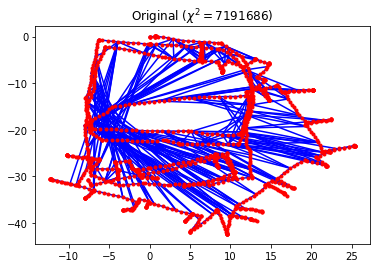
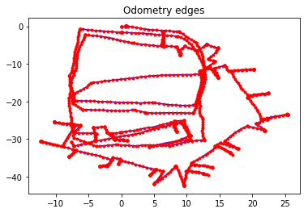
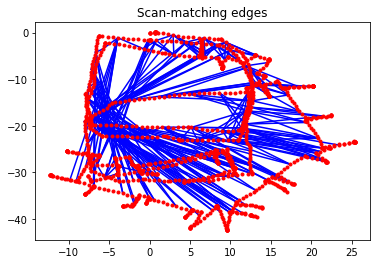
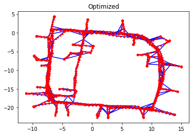
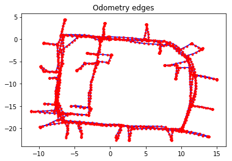
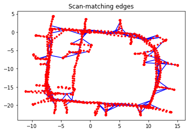

真实世界 SE(2) 数据集上的基于图的 SLAM
~~~~~~~~~~~~~~~~~~~~~~~~~~~~~~~~~~~~~~~~~

.. code:: ipython3

    from graphslam.graph import Graph
    from graphslam.load import load_g2o_se2

引言
^^^^^^^^^^^^

基于图的 SLAM 算法的完整推导见 `Graph SLAM Formulation`_。

本笔记演示对一个真实世界 :math:`SE(2)` 数据集的迭代优化。代码位于 ``graphslam`` 文件夹。为了简便，用数值微分代替解析雅可比矩阵。该代码源自 `python-graphslam <https://github.com/JeffLIrion/python-graphslam>`__ 仓库，这是一个功能完整的基于图的 SLAM 求解器。本例中的数据集经 Luca Carlone 许可使用，并从他的 `网站 <https://lucacarlone.mit.edu/datasets/>`__ 下载。

数据集
^^^^^^^^^^^^

.. code:: ipython3

    g = load_g2o_se2("data/input_INTEL.g2o")
    
    print("Number of edges:    {}".format(len(g._edges)))
    print("Number of vertices: {}".format(len(g._vertices)))

.. parsed-literal::

    Number of edges:    1483
    Number of vertices: 1228

.. code:: ipython3

    g.plot(title=r"Original ($\chi^2 = {:.0f}$)".format(g.calc_chi2()))

该数据集中的每条边都是一条约束，它把两个位姿之间测得的 :math:`SE(2)` 变换，与根据当前位姿估计计算出的期望 :math:`SE(2)` 变换相比较。这些边可以分成两类：

1. 里程计边约束两个相邻顶点，:math:`SE(2)` 变换的测量直接来自里程计数据。
2. 扫描匹配边约束两个不相邻的顶点。这些扫描匹配可以用例如二维激光雷达数据或路标来计算；这些约束如何确定，超出本例的范围。在基于图的 SLAM 文献中，这常称为*闭环*。

可以方便地从该数据集中分离出这两类边，并分别画出来。

.. code:: ipython3

    def parse_edges(g):
        """Split the graph `g` into two graphs, one with only odometry edges and the other with only scan-matching edges.
    
        Parameters
        ----------
        g : graphslam.graph.Graph
            The input graph
    
        Returns
        -------
        g_odom : graphslam.graph.Graph
            A graph consisting of the vertices and odometry edges from `g`
        g_scan : graphslam.graph.Graph
            A graph consisting of the vertices and scan-matching edges from `g`
    
        """
        edges_odom = []
        edges_scan = []
        
        for e in g._edges:
            if abs(e.vertex_ids[1] - e.vertex_ids[0]) == 1:
                edges_odom.append(e)
            else:
                edges_scan.append(e)
    
        g_odom = Graph(edges_odom, g._vertices)
        g_scan = Graph(edges_scan, g._vertices)
    
        return g_odom, g_scan

.. code:: ipython3

    g_odom, g_scan = parse_edges(g)
    
    print("Number of odometry edges:      {:4d}".format(len(g_odom._edges)))
    print("Number of scan-matching edges: {:4d}".format(len(g_scan._edges)))
    
    print("\nχ^2 error from odometry edges:       {:11.3f}".format(g_odom.calc_chi2()))
    print("χ^2 error from scan-matching edges:  {:11.3f}".format(g_scan.calc_chi2()))

.. parsed-literal::

    Number of odometry edges:      1227
    Number of scan-matching edges:  256
    
    χ^2 error from odometry edges:             0.232
    χ^2 error from scan-matching edges:  7191686.151

.. code:: ipython3

    g_odom.plot(title="Odometry edges")

.. code:: ipython3

    g_scan.plot(title="Scan-matching edges")

优化
^^^^^^^^^^^^

一开始，位姿估计与采集到的里程计测量一致，里程计边对 :math:`\chi^2` 误差的贡献几乎为零。扫描匹配约束与初始位姿估计之间则有很大偏差。这并不意外：里程计读数里的小误差随时间传播，会使机器人轨迹出现很大误差。Graph SLAM 有效，是因为它能把多种不同的数据源放进同一个优化问题。

.. code:: ipython3

    g.optimize()

.. parsed-literal::

    
    Iteration                chi^2        rel. change
    ---------                -----        -----------
            0         7191686.3825
            1       320031728.8624          43.500234
            2       125083004.3299          -0.609154
            3          338155.9074          -0.997297
            4             735.1344          -0.997826
            5             215.8405          -0.706393
            6             215.8405          -0.000000

.. image:: https://github.com/AtsushiSakai/PythonRoboticsGifs/raw/master/SLAM/GraphBasedSLAM/Graph_SLAM_optimization.gif

.. code:: ipython3

    g.plot(title="Optimized")

.. code:: ipython3

    print("\nχ^2 error from odometry edges:       {:7.3f}".format(g_odom.calc_chi2()))
    print("χ^2 error from scan-matching edges:  {:7.3f}".format(g_scan.calc_chi2()))

.. parsed-literal::

    
    χ^2 error from odometry edges:       142.189
    χ^2 error from scan-matching edges:   73.652

.. code:: ipython3

    g_odom.plot(title="Odometry edges")

.. code:: ipython3

    g_scan.plot(title="Scan-matching edges")

