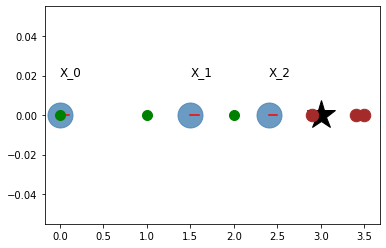
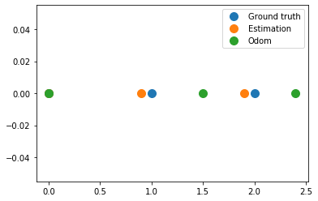
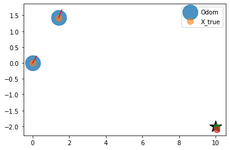
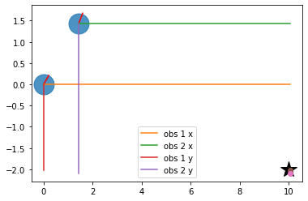
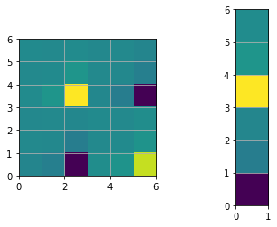

基于图的 SLAM
~~~~~~~~~~~~~

.. code:: ipython3

    import copy
    import math
    import itertools
    import numpy as np 
    import matplotlib.pyplot as plt
    from graph_based_slam import calc_rotational_matrix, calc_jacobian, cal_observation_sigma, \
                                 calc_input, observation, motion_model, Edge, pi_2_pi
    
    %matplotlib inline
    np.set_printoptions(precision=3, suppress=True)
    np.random.seed(0)

引言
^^^^^^^^^^^^

图方法把同步定位与建图（SLAM）表述成一个优化问题。扩展卡尔曼滤波（EKF）、无迹卡尔曼滤波（UKF）、粒子滤波等则属于求解 SLAM 的概率方法。图方法多用来以离线方式求解完全 SLAM 问题，也就是在路径走完之后，优化机器人的全部位姿。也有一些变体用基于图的方法做在线估计，或只求解一部分位姿。

GraphSLAM 同时利用运动信息和环境观测，构造一个可以用标准优化方法求解的最小二乘问题。

最小示例
^^^^^^^^^^^^^^^

下面的例子说明 graphSLAM 的主要想法。考虑一个只能沿一个方向运动的一维机器人。机器人被命令以控制输入 :math:`u_t=1` 向前运动，但运动并不理想，测得的里程计会偏离真实路径。每个时间步机器人都可以观测环境；在这个简单情形里，只有一个位于坐标 :math:`x=3` 的路标。测得的观测是机器人与路标之间的距离。这些测量同样带有噪声。因为这是一维问题，不需要方位角信息。

为了求解它，graphSLAM 构造所谓的系统信息矩阵 :math:`\Omega`，也称作 :math:`H`，以及信息向量 :math:`\xi`，也称作 :math:`b`。矩阵和向量中的元素根据运动信息与观测信息填写。

.. code:: ipython3

    R = 0.2
    Q = 0.2
    N = 3
    graphics_radius = 0.1
    
    odom = np.empty((N,1))
    obs = np.empty((N,1))
    x_true = np.empty((N,1))
    
    landmark = 3
    # Simulated readings of odometry and observations
    x_true[0], odom[0], obs[0] = 0.0, 0.0, 2.9
    x_true[1], odom[1], obs[1] = 1.0, 1.5, 2.0
    x_true[2], odom[2], obs[2] = 2.0, 2.4, 1.0
    
    hxDR = copy.deepcopy(odom)
    # Visualization
    plt.plot(landmark,0, '*k', markersize=30)
    for i in range(N):
        plt.plot(odom[i], 0, '.', markersize=50, alpha=0.8, color='steelblue')
        plt.plot([odom[i], odom[i] + graphics_radius],
                 [0,0], 'r')
        plt.text(odom[i], 0.02, "X_{}".format(i), fontsize=12)
        plt.plot(obs[i]+odom[i],0,'.', markersize=25, color='brown')
        plt.plot(x_true[i],0,'.g', markersize=20)
    plt.grid()    
    plt.show()
    
    
    # Defined as a function to facilitate iteration
    def get_H_b(odom, obs):
        """
        Create the information matrix and information vector. This implementation is 
        based on the concept of virtual measurement i.e. the observations of the
        landmarks are converted into constraints (edges) between the nodes that
        have observed this landmark.
        """
        measure_constraints = {}
        omegas = {}
        zids = list(itertools.combinations(range(N),2))
        H = np.zeros((N,N))
        b = np.zeros((N,1))
        for (t1, t2) in zids:
            x1 = odom[t1]
            x2 = odom[t2]
            z1 = obs[t1]
            z2 = obs[t2]
            
            # Adding virtual measurement constraint
            measure_constraints[(t1,t2)] = (x2-x1-z1+z2)
            omegas[(t1,t2)] = (1 / (2*Q))
            
            # populate system's information matrix and vector
            H[t1,t1] += omegas[(t1,t2)]
            H[t2,t2] += omegas[(t1,t2)]
            H[t2,t1] -= omegas[(t1,t2)]
            H[t1,t2] -= omegas[(t1,t2)]
    
            b[t1] += omegas[(t1,t2)] * measure_constraints[(t1,t2)]
            b[t2] -= omegas[(t1,t2)] * measure_constraints[(t1,t2)]
    
        return H, b
    
    
    H, b = get_H_b(odom, obs)
    print("The determinant of H: ", np.linalg.det(H))
    H[0,0] += 1 # np.inf ?
    print("The determinant of H after anchoring constraint: ", np.linalg.det(H))
    
    for i in range(5):
        H, b = get_H_b(odom, obs)
        H[(0,0)] += 1
        
        # Recover the posterior over the path
        dx = np.linalg.inv(H) @ b
        odom += dx
        # repeat till convergence
    print("Running graphSLAM ...")    
    print("Odometry values after optimzation: \n", odom)
    
    plt.figure()
    plt.plot(x_true, np.zeros(x_true.shape), '.', markersize=20, label='Ground truth')
    plt.plot(odom, np.zeros(x_true.shape), '.', markersize=20, label='Estimation')
    plt.plot(hxDR, np.zeros(x_true.shape), '.', markersize=20, label='Odom')
    plt.legend()
    plt.grid()
    plt.show()

.. parsed-literal::

    The determinant of H:  0.0
    The determinant of H after anchoring constraint:  18.750000000000007
    Running graphSLAM ...
    Odometry values after optimzation: 
     [[-0. ]
     [ 0.9]
     [ 1.9]]

具体而言，这些任务分成两部分：图的构建与图的优化。

图的构建
^^^^^^^^^^^^^^^

首先定义节点 :math:`\boldsymbol{x} = \boldsymbol{x}_{1:n}`，使每个节点是机器人在时刻 :math:`t_i` 的位姿。其次按下列条件构造边，也就是约束：

-  机器人从 :math:`\boldsymbol{x}_i` 运动到 :math:`\boldsymbol{x}_j`。这条边对应里程计测量，即相对运动约束（前面的最小示例没有包含这一项）。
-  测量约束可以用两种方式建立：

   -  把信息矩阵设置成同时包含地图中的路标。这样就可以在节点 :math:`\boldsymbol{x}_i` 与某个路标 :math:`m_k` 之间直接写入约束。
   -  在所有观测过同一路标的节点之间建立虚拟测量。更具体地说，机器人从 :math:`\boldsymbol{x}_i` 与 :math:`\boldsymbol{x}_j` 观测同一路标，从而得到相对测量约束。“虚拟测量” :math:`\boldsymbol{z}_{ij}` 是从节点 :math:`\boldsymbol{x}_i` 看去、对 :math:`\boldsymbol{x}_j` 的估计位姿。随后可以按与运动约束相同的方式，把虚拟测量写入信息矩阵和信息向量。

一条边由误差的取值（写入信息向量的项）和局部信息矩阵（写入系统信息矩阵的项）完全刻画。局部信息矩阵越大（:math:`Q` 或 :math:`R` 越小），这条边所贡献的数值就越大。

要点：

-  加到信息矩阵和信息向量上的量，是累加到已有数值之上的。
-  对于二维机器人，约束是非线性的，因此在更新 :math:`H` 与 :math:`b` 时，需要误差相对于状态的雅可比矩阵。
-  需要锚定约束，以免信息矩阵奇异。

图优化
^^^^^^^^^^^^^^^^^^

这一表述得到一个超定方程组。构建该图之后的目标是求
:math:`x^*=\underset{x}{\mathrm{argmin}}~\underset{ij}\Sigma~f(e_{ij})`,
其中 :math:`f` 是某种误差函数，它依赖于相关的两个节点 :math:`i` 与 :math:`j` 之间的边。参考文献中的推导得到解 :math:`x^* = H^{-1}b`。

平面示例
^^^^^^^^^^^^^^^

下面讨论更接近实际的情形：一个具有三个自由度的二维机器人，即 :math:`[x, y, \theta]^T`。

.. code:: ipython3

    #  Simulation parameter
    Qsim = np.diag([0.01, np.deg2rad(0.010)])**2 # error added to range and bearing
    Rsim = np.diag([0.1, np.deg2rad(1.0)])**2 # error added to [v, w]
    
    DT = 2.0  # time tick [s]
    SIM_TIME = 100.0  # simulation time [s]
    MAX_RANGE = 30.0  # maximum observation range
    STATE_SIZE = 3  # State size [x,y,yaw]
    
    # TODO: Why not use Qsim ? 
    # Covariance parameter of Graph Based SLAM
    C_SIGMA1 = 0.1
    C_SIGMA2 = 0.1
    C_SIGMA3 = np.deg2rad(1.0)
    
    MAX_ITR = 20  # Maximum iteration during optimization
    timesteps = 1
    
    # consider only 2 landmarks for simplicity
    # RFID positions [x, y, yaw]
    RFID = np.array([[10.0, -2.0, 0.0],
    #                  [15.0, 10.0, 0.0],
    #                  [3.0, 15.0, 0.0],
    #                  [-5.0, 20.0, 0.0],
    #                  [-5.0, 5.0, 0.0]
                     ])
    
    # State Vector [x y yaw v]'
    xTrue = np.zeros((STATE_SIZE, 1))
    xDR = np.zeros((STATE_SIZE, 1))  # Dead reckoning
    xTrue[2] = np.deg2rad(45)
    xDR[2] = np.deg2rad(45)
    # history initial values
    hxTrue = xTrue
    hxDR = xTrue
    _, z, _, _ = observation(xTrue, xDR, np.array([[0,0]]).T, RFID)
    hz = [z]
    
    for i in range(timesteps):
        u = calc_input()
        xTrue, z, xDR, ud = observation(xTrue, xDR, u, RFID)
        hxDR = np.hstack((hxDR, xDR))
        hxTrue = np.hstack((hxTrue, xTrue))
        hz.append(z)
    
    # visualize
    graphics_radius = 0.3
    plt.plot(RFID[:, 0], RFID[:, 1], "*k", markersize=20)
    plt.plot(hxDR[0, :], hxDR[1, :], '.', markersize=50, alpha=0.8, label='Odom')
    plt.plot(hxTrue[0, :], hxTrue[1, :], '.', markersize=20, alpha=0.6, label='X_true')
    
    for i in range(hxDR.shape[1]):
        x = hxDR[0, i]
        y = hxDR[1, i]
        yaw = hxDR[2, i]
        plt.plot([x, x + graphics_radius * np.cos(yaw)],
                 [y, y + graphics_radius * np.sin(yaw)], 'r')
        d = hz[i][:, 0]
        angle = hz[i][:, 1]
        plt.plot([x + d * np.cos(angle + yaw)], [y + d * np.sin(angle + yaw)], '.',
                 markersize=20, alpha=0.7)
        plt.legend()
    plt.grid()    
    plt.show()

.. code:: ipython3

    # Copy the data to have a consistent naming with the .py file
    zlist = copy.deepcopy(hz)
    x_opt = copy.deepcopy(hxDR)
    xlist = copy.deepcopy(hxDR)
    number_of_nodes = x_opt.shape[1]
    n = number_of_nodes * STATE_SIZE

数据保存之后，通过考察每一对节点来构建图。只有当两个节点在不同时刻观测到同一路标时，才建立虚拟测量。后面几个单元逐步演示一次迭代：图的构建 → 优化 → 估计更新。

.. code:: ipython3

    # get all the possible combination of the different node
    zids = list(itertools.combinations(range(len(zlist)), 2))
    print("Node combinations: \n", zids)
    
    for i in range(xlist.shape[1]):
        print("Node {} observed landmark with ID {}".format(i, zlist[i][0, 3]))

.. parsed-literal::

    Node combinations: 
     [(0, 1)]
    Node 0 observed landmark with ID 0.0
    Node 1 observed landmark with ID 0.0

下面的代码片段将建立节点 0 与节点 1 之间、基于虚拟测量的误差。误差方程如下：
:math:`e_{ij}^x = x_j + d_j cos(\psi_j +\theta_j) - x_i - d_i cos(\psi_i + \theta_i)`

:math:`e_{ij}^y = y_j + d_j sin(\psi_j + \theta_j) - y_i - d_i sin(\psi_i + \theta_i)`

:math:`e_{ij}^{\psi} = \psi_j + \theta_j - \psi_i - \theta_i`

其中 :math:`[x_i, y_i, \psi_i]` 是节点 :math:`i` 的位姿，节点 :math:`j` 同样如此；:math:`d` 是节点 :math:`i` 与 :math:`j` 处测得的距离，:math:`\theta` 是测得的到路标的方位角。这个差由下一个单元中的图示说明。

若运动和测量都是理想的，误差应为零，因为 :math:`x_j + d_j cos(\psi_j + \theta_j)` 应当等于 :math:`x_i + d_i cos(\psi_i + \theta_i)`。

.. code:: ipython3

    # Initialize edges list
    edges = []
    
    # Go through all the different combinations
    for (t1, t2) in zids:
        x1, y1, yaw1 = xlist[0, t1], xlist[1, t1], xlist[2, t1]
        x2, y2, yaw2 = xlist[0, t2], xlist[1, t2], xlist[2, t2]
        
        # All nodes have valid observation with ID=0, therefore, no data association condition
        iz1 = 0
        iz2 = 0
        
        d1 = zlist[t1][iz1, 0]
        angle1, phi1 = zlist[t1][iz1, 1], zlist[t1][iz1, 2]
        d2 = zlist[t2][iz2, 0]
        angle2, phi2 = zlist[t2][iz2, 1], zlist[t2][iz2, 2]
        
        # find angle between observation and horizontal 
        tangle1 = pi_2_pi(yaw1 + angle1)
        tangle2 = pi_2_pi(yaw2 + angle2)
        
        # project the observations 
        tmp1 = d1 * math.cos(tangle1)
        tmp2 = d2 * math.cos(tangle2)
        tmp3 = d1 * math.sin(tangle1)
        tmp4 = d2 * math.sin(tangle2)
        
        edge = Edge()
        print(y1,y2, tmp3, tmp4)
        # calculate the error of the virtual measurement
        # node 1 as seen from node 2 throught the observations 1,2
        edge.e[0, 0] = x2 - x1 - tmp1 + tmp2
        edge.e[1, 0] = y2 - y1 - tmp3 + tmp4
        edge.e[2, 0] = pi_2_pi(yaw2 - yaw1 - tangle1 + tangle2)
    
        edge.d1, edge.d2 = d1, d2
        edge.yaw1, edge.yaw2 = yaw1, yaw2
        edge.angle1, edge.angle2 = angle1, angle2
        edge.id1, edge.id2 = t1, t2
        
        edges.append(edge)
        
        print("For nodes",(t1,t2))
        print("Added edge with errors: \n", edge.e)
        
        # Visualize measurement projections
        plt.plot(RFID[0, 0], RFID[0, 1], "*k", markersize=20)
        plt.plot([x1,x2],[y1,y2], '.', markersize=50, alpha=0.8)
        plt.plot([x1, x1 + graphics_radius * np.cos(yaw1)],
                 [y1, y1 + graphics_radius * np.sin(yaw1)], 'r')
        plt.plot([x2, x2 + graphics_radius * np.cos(yaw2)],
                 [y2, y2 + graphics_radius * np.sin(yaw2)], 'r')
        
        plt.plot([x1,x1+tmp1], [y1,y1], label="obs 1 x")
        plt.plot([x2,x2+tmp2], [y2,y2], label="obs 2 x")
        plt.plot([x1,x1], [y1,y1+tmp3], label="obs 1 y")
        plt.plot([x2,x2], [y2,y2+tmp4], label="obs 2 y")
        plt.plot(x1+tmp1, y1+tmp3, 'o')
        plt.plot(x2+tmp2, y2+tmp4, 'o')
    plt.legend()
    plt.grid()
    plt.show()

.. parsed-literal::

    0.0 1.427649841628278 -2.0126109674819155 -3.524048014922737
    For nodes (0, 1)
    Added edge with errors: 
     [[-0.02 ]
     [-0.084]
     [ 0.   ]]

前面导出的约束方程是非线性的，写入信息矩阵和信息向量之前需要线性化。两个雅可比矩阵如下。

:math:`A = \frac{\partial e_{ij}}{\partial \boldsymbol{x}_i}`，因为 :math:`\boldsymbol{x}_i` 含有 x、y 与 theta 三个变量。类似地，:math:`B = \frac{\partial e_{ij}}{\partial \boldsymbol{x}_j}`。

.. code:: ipython3

    # Initialize the system information matrix and information vector
    H = np.zeros((n, n))
    b = np.zeros((n, 1))
    x_opt = copy.deepcopy(hxDR)
    
    for edge in edges:
        id1 = edge.id1 * STATE_SIZE
        id2 = edge.id2 * STATE_SIZE
        
        t1 = edge.yaw1 + edge.angle1
        A = np.array([[-1.0, 0, edge.d1 * math.sin(t1)],
                      [0, -1.0, -edge.d1 * math.cos(t1)],
                      [0, 0, -1.0]])
    
        t2 = edge.yaw2 + edge.angle2
        B = np.array([[1.0, 0, -edge.d2 * math.sin(t2)],
                      [0, 1.0, edge.d2 * math.cos(t2)],
                      [0, 0, 1.0]])
        
        # TODO: use Qsim instead of sigma
        sigma = np.diag([C_SIGMA1, C_SIGMA2, C_SIGMA3])
        Rt1 = calc_rotational_matrix(tangle1)
        Rt2 = calc_rotational_matrix(tangle2)
        edge.omega = np.linalg.inv(Rt1 @ sigma @ Rt1.T + Rt2 @ sigma @ Rt2.T)
    
        # Fill in entries in H and b
        H[id1:id1 + STATE_SIZE, id1:id1 + STATE_SIZE] += A.T @ edge.omega @ A
        H[id1:id1 + STATE_SIZE, id2:id2 + STATE_SIZE] += A.T @ edge.omega @ B
        H[id2:id2 + STATE_SIZE, id1:id1 + STATE_SIZE] += B.T @ edge.omega @ A
        H[id2:id2 + STATE_SIZE, id2:id2 + STATE_SIZE] += B.T @ edge.omega @ B
    
        b[id1:id1 + STATE_SIZE] += (A.T @ edge.omega @ edge.e)
        b[id2:id2 + STATE_SIZE] += (B.T @ edge.omega @ edge.e)
       
    
    print("The determinant of H: ", np.linalg.det(H))
    plt.figure()
    plt.subplot(1,2,1)
    plt.imshow(H, extent=[0, n, 0, n])
    plt.subplot(1,2,2)
    plt.imshow(b, extent=[0, 1, 0, n])
    plt.show()    
    
    # Fix the origin, multiply by large number gives same results but better visualization
    H[0:STATE_SIZE, 0:STATE_SIZE] += np.identity(STATE_SIZE)
    print("The determinant of H after origin constraint: ", np.linalg.det(H))    
    plt.figure()
    plt.subplot(1,2,1)
    plt.imshow(H, extent=[0, n, 0, n])
    plt.subplot(1,2,2)
    plt.imshow(b, extent=[0, 1, 0, n])
    plt.show()

.. parsed-literal::

    The determinant of H:  0.0
    The determinant of H after origin constraint:  716.1972439134893

.. image:: graphSLAM_doc_files/graphSLAM_doc_11_1.png

.. code:: ipython3

    # Find the solution (first iteration)
    dx = - np.linalg.inv(H) @ b
    for i in range(number_of_nodes):
        x_opt[0:3, i] += dx[i * 3:i * 3 + 3, 0]
    print("dx: \n",dx)
    print("ground truth: \n ",hxTrue)
    print("Odom: \n", hxDR)
    print("SLAM: \n", x_opt)
    
    # performance will improve with more iterations, nodes and landmarks.
    print("\ngraphSLAM localization error: ", np.sum((x_opt - hxTrue) ** 2))
    print("Odom localization error: ", np.sum((hxDR - hxTrue) ** 2))

.. parsed-literal::

    dx: 
     [[-0.   ]
     [-0.   ]
     [ 0.   ]
     [ 0.02 ]
     [ 0.084]
     [-0.   ]]
    ground truth: 
      [[0.    1.414]
     [0.    1.414]
     [0.785 0.985]]
    Odom: 
     [[0.    1.428]
     [0.    1.428]
     [0.785 0.976]]
    SLAM: 
     [[-0.     1.448]
     [-0.     1.512]
     [ 0.785  0.976]]
    
    graphSLAM localization error:  0.010729072751057656
    Odom localization error:  0.0004460978857535104

参考文献
^^^^^^^^^^^^^^^

-  `The GraphSLAM Algorithm with Applications to Large-Scale Mapping of Urban Structures <http://robots.stanford.edu/papers/thrun.graphslam.pdf>`_

-  `Introduction to Mobile Robotics Graph-Based SLAM <http://ais.informatik.uni-freiburg.de/teaching/ss13/robotics/slides/16-graph-slam.pdf>`_

-  `A Tutorial on Graph-Based SLAM <http://www2.informatik.uni-freiburg.de/~stachnis/pdf/grisetti10titsmag.pdf>`_

注：还需要一个额外步骤，用估计得到的路径更新关于地图的信念。

