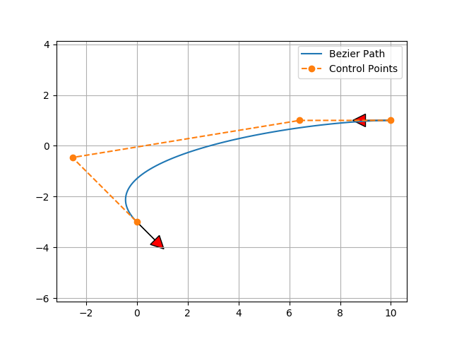
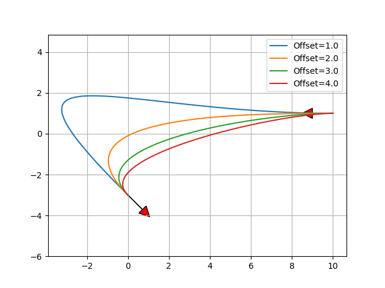

Bézier 路径规划
--------------------

Bézier 路径规划的示例代码。

它基于 4 个控制点的 Bézier 路径。

若改变相对起点和终点的偏移距离，

可以得到不同的 Bézier 路径：

代码链接
~~~~~~~~~~~~~~~

.. autofunction:: PathPlanning.BezierPath.bezier_path.calc_4points_bezier_path

参考文献
~~~~~~~~~~~~~~~

-  `Continuous Curvature Path Generation Based on Bezier Curves for
   Autonomous
   Vehicles <https://citeseerx.ist.psu.edu/document?repid=rep1&type=pdf&doi=b00b657c3e0e828c589132a14825e7119772003d>`__
