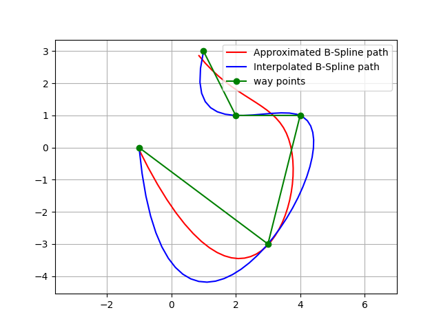
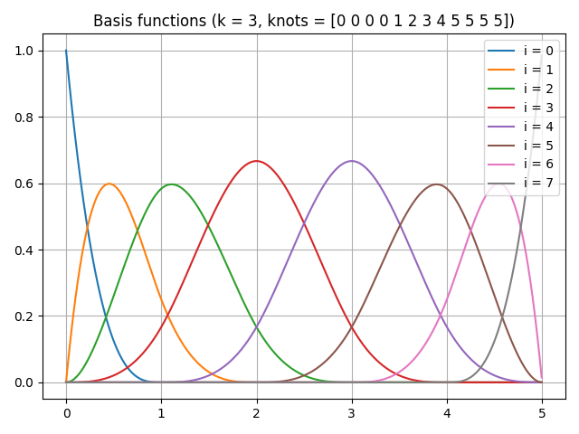
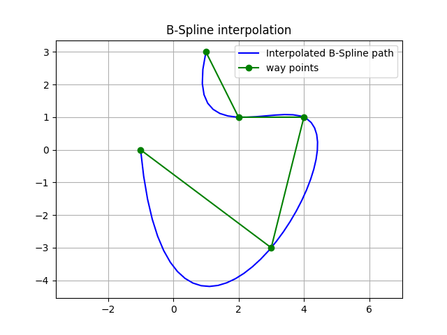
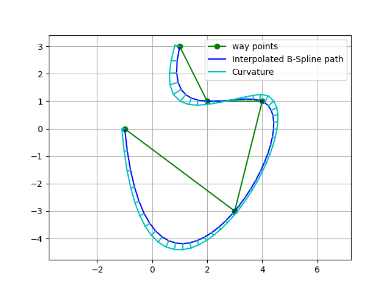
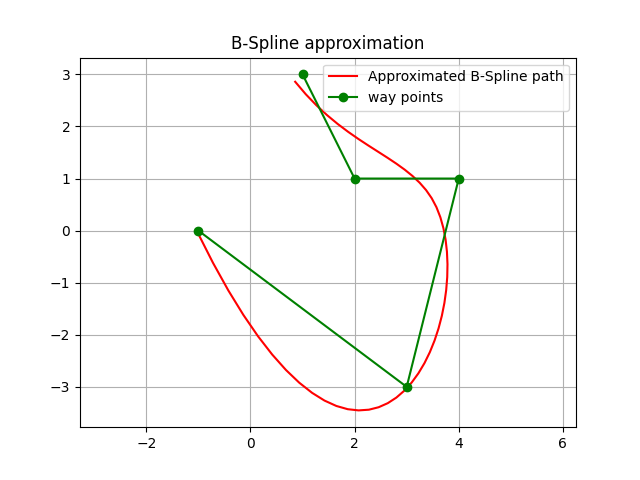
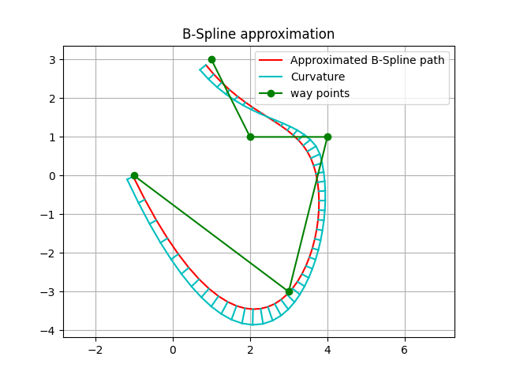

B-spline 路径规划
-----------------

这是一套 B-spline 路径规划程序。

输入路点后，它用 B-spline 曲线生成一条平滑路径。

本代码提供两种 B-spline 曲线生成方式：

1. 插值：生成一条经过所有路点的曲线。

2. 逼近：生成一条逼近路点的曲线（不必经过所有路点）。

B-spline 基础
~~~~~~~~~~~~~~

B-spline（Basis-Spline，基样条）是分段多项式样条曲线。

它由下列方程表示。

:math:`\mathbf{S}(x)=\sum_{i=k-p}^k \mathbf{c}_i B_{i, p}(x)`

其中：

* :math:`S(x)` 是样条在 x 处的曲线点。
* :math:`c_i` 是生成样条的代表点，称为控制点。
* :math:`p+1` 是 B-spline 的维数。
* :math:`k` 是节点个数。
* :math:`B_{i,p}(x)` 是称为基函数的函数。

基函数可由下述 `De Boor 递推公式 <https://en.wikipedia.org/wiki/De_Boor%27s_algorithm>`_ 计算：

:math:`B_{i, 0}(x):= \begin{cases}1 & \text { if } \quad t_i \leq x<t_{i+1} \\ 0 & \text { otherwise }\end{cases}`

:math:`B_{i, p}(x):=\frac{x-t_i}{t_{i+p}-t_i} B_{i, p-1}(x)+\frac{t_{i+p+1}-x}{t_{i+p+1}-t_{i+1}} B_{i+1, p-1}(x)`

其中：

* :math:`t_i` 是节点向量的各个元素。

下图给出每个 :math:`i` 对应的 B-spline 基函数：

注意，把所有基函数加起来，对任意 x，其和都是 1.0。

因此，各控制点按该基函数加权相加时，得到的曲线是平滑的。

下面的代码用 `scipy <https://docs.scipy.org/doc/scipy/reference/generated/scipy.interpolate.BSpline.html>`_ 生成上方的基函数图。

.. code-block:: python

	from scipy.interpolate import BSpline

	def B_orig(x, k, i, t):
		if k == 0:
			return 1.0 if t[i] <= x < t[i + 1] else 0.0
		if t[i + k] == t[i]:
			c1 = 0.0
		else:
			c1 = (x - t[i]) / (t[i + k] - t[i]) * B(x, k - 1, i, t)

		if t[i + k + 1] == t[i + 1]:
			c2 = 0.0
		else:
			c2 = (t[i + k + 1] - x) / (t[i + k + 1] - t[i + 1]) * B(x, k - 1, i + 1, t)
		return c1 + c2

	def B(x, k, i, t):
		c = np.zeros_like(t)
		c[i] = 1
		return BSpline(t, c, k)(x)

	def main():
		k = 3  # degree of the spline
		t = [0, 1, 2, 3, 4, 5]  # knots vector

		x = np.linspace(0, 5, 1000, endpoint=False)
		t = np.r_[[np.min(t)]*k, t, [np.max(t)]*k]

		n = len(t) - k - 1
		for i in range(n):
			y = np.array([B(ix, k, i, t) for ix in x])
			plt.plot(x, y, label=f'i = {i}')

		plt.title(f'Basis functions (k = {k}, knots = {t})')
		plt.show()

B-spline 插值规划
~~~~~~~~~~~~~~~~~~~~~~~~~~~~~~

:meth:`PathPlanning.BSplinePath.bspline_path.interpolate_b_spline_path` 生成一条经过所有路点的曲线。

下面是插值规划的一个简单示例：

该图还用 :ref:`utils.plot.plot_curvature <plot_curvature>` 显示各路径点的曲率。

默认样条次数为 3，因此曲率平滑变化。

代码链接
++++++++++

.. autofunction:: PathPlanning.BSplinePath.bspline_path.interpolate_b_spline_path

B-spline 逼近规划
~~~~~~~~~~~~~~~~~~~~~~~~~~~~~~

:meth:`PathPlanning.BSplinePath.bspline_path.approximate_b_spline_path`
生成一条逼近路点的曲线，也就是说曲线未必经过这些路点。

用户可以用平滑参数 `s` 调节路径的平滑程度。该值越大，路径越平滑，但越不精确。
该值越小，路径越精确，但越不平滑。

下面是逼近规划的一个简单示例：

该图还用 :ref:`utils.plot.plot_curvature <plot_curvature>` 显示各路径点的曲率。

默认样条次数为 3，因此曲率平滑变化。

代码链接
++++++++++

.. autofunction:: PathPlanning.BSplinePath.bspline_path.approximate_b_spline_path

参考文献
~~~~~~~~~~

-  `B-spline - Wikipedia <https://en.wikipedia.org/wiki/B-spline>`__
-  `scipy.interpolate.UnivariateSpline <https://docs.scipy.org/doc/scipy/reference/generated/scipy.interpolate.UnivariateSpline.html>`__