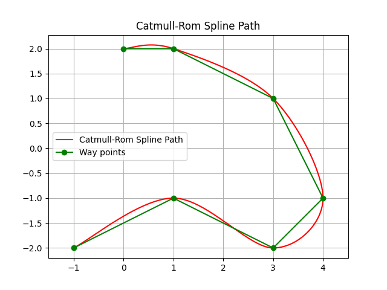
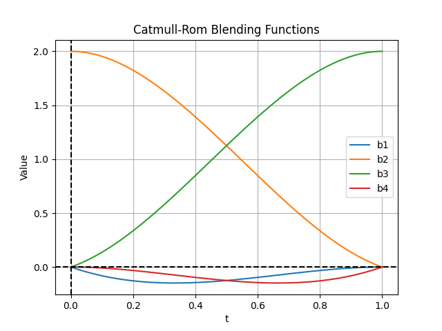

Catmull-Rom 样条路径规划
----------------------------

这是 Catmull-Rom 样条路径规划程序。

给定路点后，Catmull-Rom 样条会生成一条始终经过控制点的平滑路径，具有局部控制性，并保持 𝐶1 连续性。

Catmull-Rom 样条基础
~~~~~~~~~~~~~~~~~~~~~~~~~~~~~~~~~

Catmull-Rom 样条是一类经过给定点集（称为控制点）的三次样条。

样条上的一点由下列方程计算：

:math:`P(t) = 0.5 \times \left( 2P_1 + (-P_0 + P_2)t + (2P_0 - 5P_1 + 4P_2 - P_3)t^2 + (-P_0 + 3P_1 - 3P_2 + P_3)t^3 \right)`

其中：

* :math:`P(t)` 是参数 :math:`t` 处样条上的点。
* :math:`P_0, P_1, P_2, P_3` 是参数 :math:`t` 周围的控制点。

Catmull-Rom 样条的类型
~~~~~~~~~~~~~~~~~~~~~~~~~~~~~~~~~~

按照参数 **tau** 的取法，Catmull-Rom 样条有不同类型。该参数影响曲线相对控制点的形态：

1. **均匀 Catmull-Rom 样条**：
   标准实现，参数化是均匀的。样条的每一段被同等对待，与控制点之间的距离无关。

2. **弦长 Catmull-Rom 样条**：
   这类样条考虑控制点之间的距离。参数化基于沿样条的实际距离，从而使过渡更平滑。方程可以改写，以包含点 :math:`P_i` 与 :math:`P_{i+1}` 之间的弦长 :math:`L_i`：
   
   .. math::
       \tau_i = \sqrt{(x_{i+1} - x_i)^2 + (y_{i+1} - y_i)^2}

3. **向心 Catmull-Rom 样条**：
   这一变体在弦长样条的基础上，用距离的平方根来确定参数化，从而避免振荡并得到更自然的曲线。参数 :math:`t_i` 按下列关系调整：
   
   .. math::
       t_i = \sqrt{(x_{i+1} - x_i)^2 + (y_{i+1} - y_i)^2}

混合函数
~~~~~~~~~~~~~~~~~~~~~

在 Catmull-Rom 样条插值中，混合函数用来计算给定参数 :math:`t` 下各控制点对样条的影响。混合函数保证样条平滑、经过控制点，并保持连续性。Catmull-Rom 样条使用的四个混合函数定义如下：

1. **混合函数 1**：
   
   .. math::
       b_1(t) = -t + 2t^2 - t^3

2. **混合函数 2**：
   
   .. math::
       b_2(t) = 2 - 5t^2 + 3t^3

3. **混合函数 3**：
   
   .. math::
       b_3(t) = t + 4t^2 - 3t^3

4. **混合函数 4**：
   
   .. math::
       b_4(t) = -t^2 + t^3

这些混合函数在样条方程中组合起来，形成反映各控制点影响的平滑曲线。

下图给出区间 :math:`[0, 1]` 上的混合函数：

Catmull-Rom 样条 API
~~~~~~~~~~~~~~~~~~~~~~~

本节概述用于 Catmull-Rom 样条路径规划的函数。

代码链接
++++++++++

.. autofunction:: PathPlanning.Catmull_RomSplinePath.catmull_rom_spline_path.catmull_rom_point

.. autofunction:: PathPlanning.Catmull_RomSplinePath.catmull_rom_spline_path.catmull_rom_spline

参考文献
~~~~~~~~~~~~~~

-  `Catmull-Rom Spline - Wikipedia <https://en.wikipedia.org/wiki/Centripetal_Catmull%E2%80%93Rom_spline>`__
-  `Catmull-Rom Splines <http://graphics.cs.cmu.edu/nsp/course/15-462/Fall04/assts/catmullRom.pdf>`__