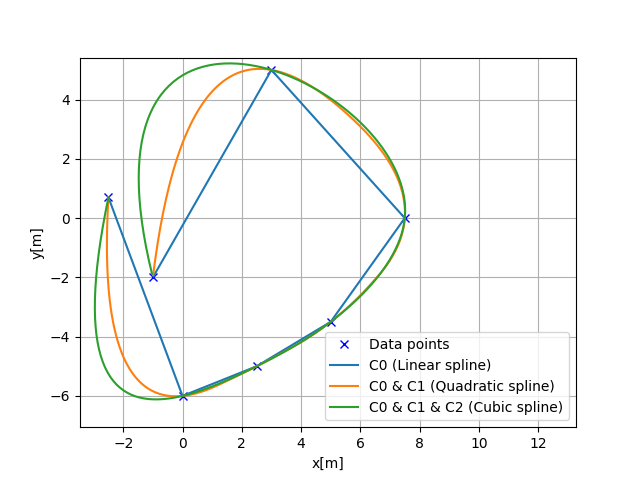
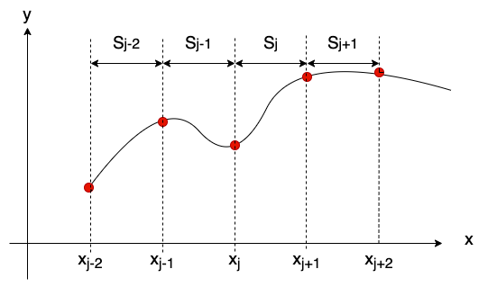

三次样条路径规划
---------------------

样条曲线的连续性
~~~~~~~~~~~~~~~~~~~~~~~~

样条曲线的平滑程度取决于所用的样条模型。

样条曲线的平滑程度用 :math:`C_0, C_1` 等记号表示。

这种记号表示曲线的连续性。
例如，对于二维空间中的样条曲线：

- :math:`C_0` 表示位置连续
- :math:`C_1` 表示切向量连续
- :math:`C_2` 表示曲率向量连续

如下图所示：

三次样条可以生成具有 :math:`C_0, C_1, C_2` 连续性的曲线。

一维三次样条
~~~~~~~~~~~~~~~~~~~

三次样条插值是在给定多个数据点时，于这些数据点之间做平滑插值的方法，如下图所示。

它把数据点之间的各个区间分开处理。

每个区间用各自的三次多项式逼近。

三次样条使用三次多项式方程进行插值：

:math:`S_j(x)=a_j+b_j(x-x_j)+c_j(x-x_j)^2+d_j(x-x_j)^3`

其中 :math:`x_j < x < x_{j+1}`，:math:`x_j` 是样条的第 j 个节点，
:math:`a_j`、:math:`b_j`、:math:`c_j`、:math:`d_j` 是样条系数。

由上式，一个区间有 4 个未知参数 :math:`(a,b,c,d)`。
若数据点个数为 :math:`N`，则插值共有 :math:`4N` 个未知参数。

用下面五个条件来确定这 :math:`4N` 个未知参数：

约束 1：端点约束
===================================

:math:`S_j(x_j)=y_j`

该约束是每个区间的端点约束。

每个区间的多项式都会经过数据点的 x、y 坐标。

约束 2：点连续约束
============================================

:math:`S_j(x_{j+1})=S_{j+1}(x_{j+1})=y_{j+1}`

该约束是各区间边界上的连续性条件。

该约束保证各区间的边界连续。

约束 3：切向量连续约束
====================================================

:math:`S'_j(x_{j+1})=S'_{j+1}(x_{j+1})`

该约束是各区间边界上一阶导数的连续性条件。

该约束使各区间边界上的切向量连续。

约束 4：曲率连续约束
==============================================

:math:`S''_j(x_{j+1})=S''_{j+1}(x_{j+1})`

该约束是各区间边界上二阶导数的连续性条件。

该约束使各区间边界上的曲率连续。

约束 5：端点曲率约束
========================================================

:math:`S''_0(0)=S''_{n+1}(x_{n})=0`.

该约束是起点和终点二阶导数的边界条件。

示例代码假定这些端点曲率为 0，即通常所说的自然三次样条（Natural Cubic Spline）。

如何计算未知参数 :math:`a_j, b_j, c_j, d_j`
===================================================================

步骤 1：计算 :math:`a_j`
+++++++++++++++++++++++++++++

样条系数 :math:`a_j` 可由数据点的 y 坐标计算：

:math:`a_j = y_i`.

步骤 2：计算 :math:`c_j`
+++++++++++++++++++++++++++++

样条系数 :math:`c_j` 可通过求解线性方程得到：

:math:`Ac_j = B`.

矩阵 :math:`A` 和 :math:`B` 定义如下：

.. math::
	A=\left[\begin{array}{cccccc}
	1 & 0 & 0 & 0 & \cdots & 0 \\
	h_{0} & 2\left(h_{0}+h_{1}\right) & h_{1} & 0 & \cdots & 0 \\
	0 & h_{1} & 2\left(h_{1}+h_{2}\right) & h_{2} & \cdots & 0 \\
	0 & 0 & h_{2} & 2\left(h_{2}+h_{3}\right) & \cdots & 0 \\
	0 & 0 & 0 & h_{3} & \ddots & \\
	\vdots & \vdots & & & & \\
	0 & 0 & 0 & \cdots & 0 & 1
	\end{array}\right]

.. math::
	B=\left[\begin{array}{c}
	0 \\
	\frac{3}{h_{1}}\left(a_{2}-a_{1}\right)-\frac{3}{h_{0}}\left(a_{1}-a_{0}\right) \\
	\vdots \\
	\frac{3}{h_{n-1}}\left(a_{n}-a_{n-1}\right)-\frac{3}{h_{n-2}}\left(a_{n-1}-a_{n-2}\right) \\
	0
	\end{array}\right]

其中 :math:`h_{i}` 是第 i 个与第 (i+1) 个数据点之间的 x 方向距离。

步骤 3：计算 :math:`d_j`
+++++++++++++++++++++++++++++

样条系数 :math:`d_j` 可由下列方程计算：

:math:`d_{j}=\frac{c_{j+1}-c_{j}}{3 h_{j}}`

步骤 4：计算 :math:`b_j`
+++++++++++++++++++++++++++++

样条系数 :math:`b_j` 可由下列方程计算：

:math:`b_{i}=\frac{1}{h_i}(a_{i+1}-a_{i})-\frac{h_i}{3}(2c_{i}+c_{i+1})`

如何计算样条曲线的一阶导数和二阶导数
======================================================================

得到样条曲线的系数之后，可以计算

一阶导数：

:math:`y^{\prime}(x)=b+2cx+3dx^2`

二阶导数：

:math:`y^{\prime \prime}(x)=2c+6dx`

这些方程可由三次多项式求导得到。

代码链接
==========

这是一维三次样条类的 API：

.. autoclass:: PathPlanning.CubicSpline.cubic_spline_planner.CubicSpline1D
	:members:

二维三次样条
~~~~~~~~~~~~~~~~~~~

一维三次样条要求数据的 x 坐标单调递增。

因此不能直接用于二维路径规划。

二维三次样条对 x 和 y 两个方向分别使用一条一维三次样条，自变量是从起点起算的路径距离。

这样可以基于 x-y 路点生成曲率连续的路径。

各点的航向角可以解析地计算：

:math:`\theta=\tan ^{-1} \frac{y’}{x’}`

各点的曲率也可以解析地计算：

:math:`\kappa=\frac{y^{\prime \prime} x^{\prime}-x^{\prime \prime} y^{\prime}}{\left(x^{\prime2}+y^{\prime2}\right)^{\frac{2}{3}}}`

代码链接
==========

.. autoclass:: PathPlanning.CubicSpline.cubic_spline_planner.CubicSpline2D
	:members:

参考文献
~~~~~~~~~~
-  `Cubic Splines James Keesling <https://people.clas.ufl.edu/kees/files/CubicSplines.pdf>`__
-  `Curves and Splines <http://www.cs.cmu.edu/afs/cs/academic/class/15462-s10/www/lec-slides/lec06.pdf>`__

