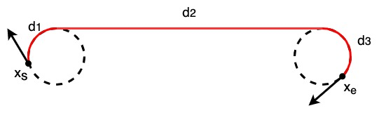
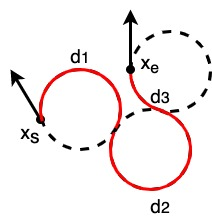

Dubins 路径规划
--------------------

Dubins 路径规划的示例代码。

.. image:: https://github.com/AtsushiSakai/PythonRoboticsGifs/raw/master/PathPlanning/DubinsPath/animation.gif?raw=True

Dubins 路径
~~~~~~~~~~~~
Dubins 路径是针对简单车辆模型的解析路径规划算法。

它可以在最大曲率约束和切向（航向角）约束下，生成两个二维位姿 (x, y, yaw) 之间的最短路径。

生成的路径由 3 段组成，每一段是最大曲率曲线或直线段。

每一段可分为三类：‘右转（R）’、‘左转（L）’和‘直线（S）’。

可能的路径至少是这六种类型之一：RSR、RSL、LSR、LSL、RLR、LRL。

Dubins 路径规划器可以输出每一段的类型以及各段路程。

例如，一条 RSR 型 Dubins 路径为：

各段长度可由下列公式计算：

:math:`\alpha = mod(-\theta)`

:math:`\beta = mod(x_{e, yaw} - \theta)`

:math:`p^2 = 2 + d ^ 2 - 2\cos(\alpha-\beta) + 2d(\sin\alpha - \sin\beta)`

:math:`t = atan2(\cos\beta - \cos\alpha, d + \sin\alpha - \sin\beta)`

:math:`d_1 = mod(-\alpha + t)`

:math:`d_2 = p`

:math:`d_3 = mod(\beta - t)`

其中 :math:`\theta` 为切向，d 为从 :math:`x_s` 到 :math:`x_e` 的距离。

一条 RLR 型 Dubins 路径为：

各段长度可由下列公式计算：

:math:`t = (6.0 - d^2 + 2\cos(\alpha-\beta) + 2d(\sin\alpha - \sin\beta)) / 8.0`

:math:`d_2 = mod(2\pi - acos(t))`

:math:`d_1 = mod(\alpha - atan2(\cos\beta - \cos\alpha, d + \sin\alpha - \sin\beta) + d_2 / 2.0)`

:math:`d_3 = mod(\alpha - \beta - d_1 + d_2)`

可以根据这些信息以及最大曲率信息生成路径。

在六种类型中选择路程最短的类型，再按所选类型及其各段长度构造路径。

代码链接
~~~~~~~~~~~~~~~~~~~~

.. autofunction:: PathPlanning.DubinsPath.dubins_path_planner.plan_dubins_path

参考文献
~~~~~~~~~~~~~~~~~~~~
-  `On Curves of Minimal Length with a Constraint on Average Curvature, and with Prescribed Initial and Terminal Positions and Tangents <https://www.jstor.org/stable/2372560?origin=crossref>`__
-  `Dubins path - Wikipedia <https://en.wikipedia.org/wiki/Dubins_path>`__
-  `15.3.1 Dubins Curves <https://lavalle.pl/planning/node821.html>`__
-  `A Comprehensive, Step-by-Step Tutorial to Computing Dubin’s Paths <https://gieseanw.wordpress.com/2012/10/21/a-comprehensive-step-by-step-tutorial-to-computing-dubins-paths/>`__
