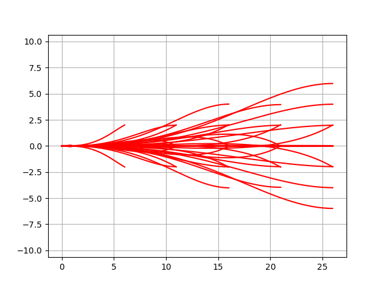

模型预测轨迹生成器
-------------------------------------

这是模型预测轨迹生成器上的路径优化示例。

该算法用于状态格规划器。

代码链接
~~~~~~~~~~~~~

.. autofunction:: PathPlanning.ModelPredictiveTrajectoryGenerator.trajectory_generator.optimize_trajectory

路径优化示例
~~~~~~~~~~~~~~~~~~~~~~~~

.. image:: https://github.com/AtsushiSakai/PythonRoboticsGifs/raw/master/PathPlanning/ModelPredictiveTrajectoryGenerator/kn05animation.gif

查找表示例
~~~~~~~~~~~~~~~~~~~~~~~~~~~~~~

参考文献
~~~~~~~~~~~~

-  `Optimal rough terrain trajectory generation for wheeled mobile
   robots <https://journals.sagepub.com/doi/pdf/10.1177/0278364906075328>`__
