Reeds-Shepp 路径规划
--------------------

Reeds-Shepp 路径规划的示例代码。

.. image:: https://github.com/AtsushiSakai/PythonRoboticsGifs/raw/master/PathPlanning/ReedsSheppPath/animation.gif?raw=true

代码链接
==============

.. autofunction:: PathPlanning.ReedsSheppPath.reeds_shepp_path_planning.reeds_shepp_path_planning

各路径类型的数学描述
=================================================
下面概述各路径类型公式的数学推导。

在以下全部推导中，假定车辆曲率半径为单位长度，且起点位姿位于原点。（*在代码中，会先去掉起点位置带来的偏移，并对长度做归一化，再把数值传入这些函数。*）

另外，(t, u, v) 表示所需的各段运动量。因此，对转弯机动，它们表示转弯圆圆心处所对的角；对直线机动，它们表示需要行驶的距离。 

1. **左转-直线-左转（Left-Straight-Left）**

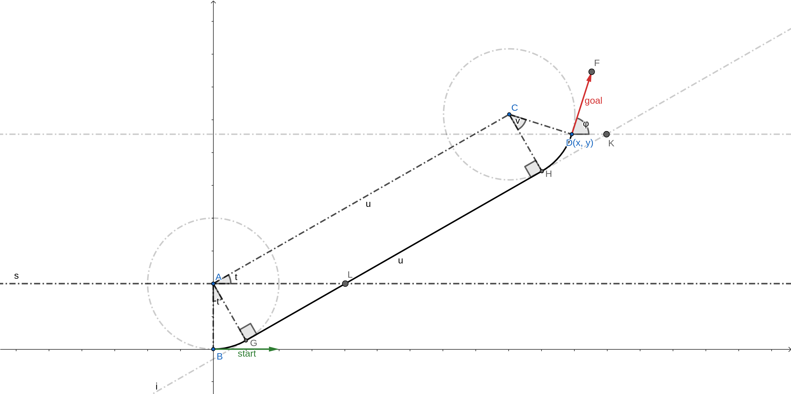

利用几何关系可以推出下列事实。

- AGHC 是矩形。
- :math:`∠LAC = ∠BAG = t`
- :math:`t + v = φ`
- :math:`C(x - sin(φ), y + cos(φ))`
- :math:`A(0, 1)`
- :math:`u, t = polar(vector<AC>)`

因此有：

- :math:`u, t = polar(x - sin(φ), y + cos(φ) - 1)`
- :math:`v = φ - t`

2. **左转-直线-右转（Left-Straight-Right）**

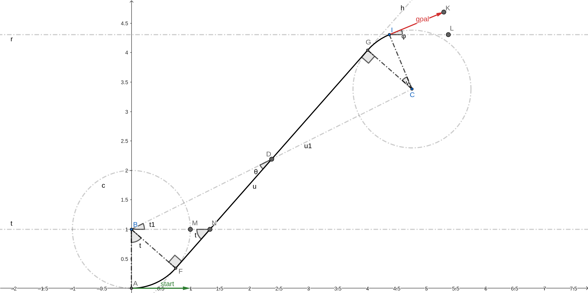

采用下列记号：

- :math:`∠MBD = t1`
- :math:`∠BDF = θ`
- :math:`BC = u1`

利用几何关系可以推出下列事实。

- D 是 BC 与 FG 的中点。
- :math:`t - v = φ`
- :math:`C(x + sin(φ), y - cos(φ))`
- :math:`A(0, 1)`
- :math:`u1, t1 = polar(vector<AC>)`
- :math:`\frac{u1^2}{4} = 1 + \frac{u^2}{4}`
- :math:`BF = 1` [曲率半径]
- :math:`FD = \frac{u}{2}`
- :math:`θ = arctan(\frac{BF}{FD})`
- :math:`t1 + θ = t`

因此有：

- :math:`u1, t1 = polar(x + sin(φ), y - cos(φ) - 1)`
- :math:`u = \sqrt{u1^2 - 4}`
- :math:`θ = arctan(\frac{2}{u})`
- :math:`t = t1 + θ`
- :math:`v = t - φ`

3. **左转×右转×左转（LeftxRightxLeft）**

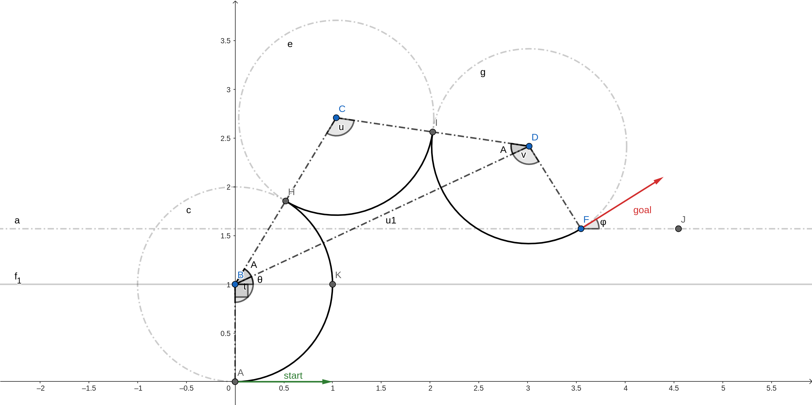

采用下列记号：

- :math:`∠CBD = ∠CDB = A` [BCD 是等腰三角形]
- :math:`∠DBK = θ`
- :math:`BD = u1`

利用几何关系可以推出下列事实。

- :math:`t + u + v = φ`
- :math:`D(x - sin(φ), y + cos(φ))`
- :math:`B(0, 1)`
- :math:`u1, θ = polar(vector<BD>)`
- :math:`A = arccos(\frac{BD/2}{CD})`
- :math:`u = (π - 2*A)`
- :math:`∠ABK = \frac{π}{2}`
- :math:`∠KBD = θ`
- :math:`t = ∠ABK + ∠KBD + ∠DBC`

因此有：

- :math:`u1, θ = polar(x - sin(φ), y + cos(φ) - 1)`
- :math:`A = arccos(\frac{u1/2}{2})`
- :math:`t = \frac{π}{2} + θ + A`
- :math:`u = (π - 2*A)`
- :math:`v = (φ - t - u)`

4. **左转×右转-左转（LeftxRight-Left）**

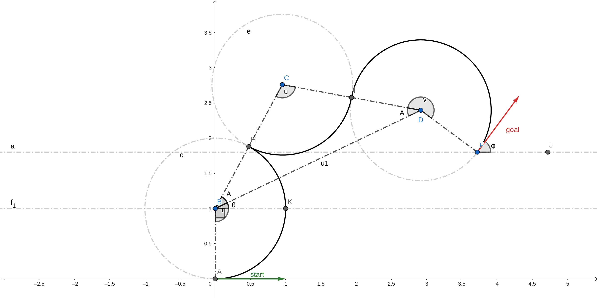

采用下列记号：

- :math:`∠CBD = ∠CDB = A` [BCD 是等腰三角形]
- :math:`∠DBK = θ`
- :math:`BD = u1`

利用几何关系可以推出下列事实。

- :math:`t + u - v = φ`
- :math:`D(x - sin(φ), y + cos(φ))`
- :math:`B(0, 1)`
- :math:`u1, θ = polar(vector<BD>)`
- :math:`A = arccos(\frac{BD/2}{CD})`
- :math:`u = (π - 2*A)`
- :math:`∠ABK = \frac{π}{2}`
- :math:`∠KBD = θ`
- :math:`t = ∠ABK + ∠KBD + ∠DBC`

因此有：

- :math:`u1, θ = polar(x - sin(φ), y + cos(φ) - 1)`
- :math:`A = arccos(\frac{u1/2}{2})`
- :math:`t = \frac{π}{2} + θ + A`
- :math:`u = (π - 2*A)`
- :math:`v = (-φ + t + u)`

5. **左转-右转×左转（Left-RightxLeft）**

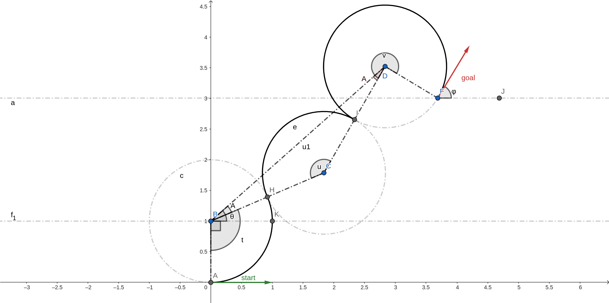

采用下列记号：

- :math:`∠CBD = ∠CDB = A` [BCD 是等腰三角形]
- :math:`∠DBK = θ`
- :math:`BD = u1`

利用几何关系可以推出下列事实。

- :math:`t - u - v = φ`
- :math:`D(x - sin(φ), y + cos(φ))`
- :math:`B(0, 1)`
- :math:`u1, θ = polar(vector<BD>)`
- :math:`BC = CD = 2` [2 × 曲率半径]
- :math:`cos(2π - u) = \frac{BC^2 + CD^2 - BD^2}{2 * BC * CD}` [余弦定理]
- :math:`\frac{sin(A)}{BC} = \frac{sin(u)}{u1}` [正弦定理]
- :math:`∠ABK = \frac{π}{2}`
- :math:`∠KBD = θ`
- :math:`t = ∠ABK + ∠KBD - ∠DBC`

因此有：

- :math:`u1, θ = polar(x - sin(φ), y + cos(φ) - 1)`
- :math:`u = arccos(1 - \frac{u1^2}{8})`
- :math:`A = arcsin(\frac{sin(u)}{u1}*2)`
- :math:`t = \frac{π}{2} + θ - A`
- :math:`v = (t - u - φ)`

6. **左转-右转×左转-右转（Left-RightxLeft-Right）**

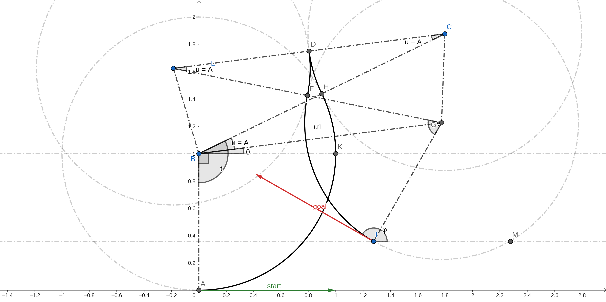

采用下列记号：

- :math:`∠CLG = ∠BCL = ∠CBG = ∠LGB = A = u` [BGCL 是等腰梯形]
- :math:`∠KBG = θ`
- :math:`BG = u1`

利用几何关系可以推出下列事实。

- :math:`t - 2u + v = φ`
- :math:`G(x + sin(φ), y - cos(φ))`
- :math:`B(0, 1)`
- :math:`u1, θ = polar(vector<BG>)`
- :math:`BC = CL = LG = 2` [2 × 曲率半径]
- :math:`CG^2 = CL^2 + LG^2 - 2*CL*LG*cos(A)` [在 LGC 中使用余弦定理]
- :math:`CG^2 = CL^2 + LG^2 - 2*CL*LG*cos(A)` [在 LGC 中使用余弦定理]
- 由前面两个方程：:math:`A = arccos(\frac{u1 + 2}{4})`
- :math:`∠ABK = \frac{π}{2}`
- :math:`t = ∠ABK + ∠KBG + ∠GBC`

因此有：

- :math:`u1, θ = polar(x + sin(φ), y - cos(φ) - 1)`
- :math:`u = arccos(\frac{u1 + 2}{4})`
- :math:`t = \frac{π}{2} + θ + u`
- :math:`v = (φ - t + 2u)`

7. **左转×右转-左转×右转（LeftxRight-LeftxRight）**

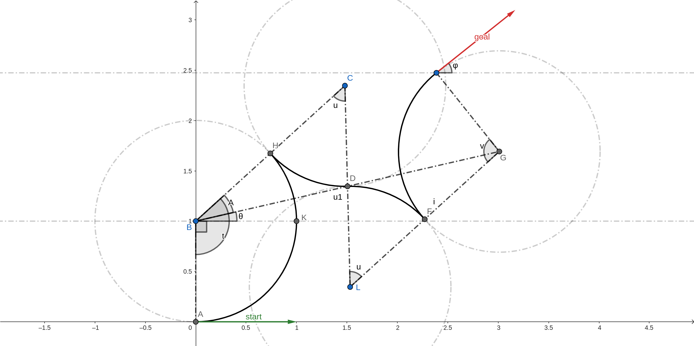

采用下列记号：

- :math:`∠GBC = A` [BGCL 是等腰梯形]
- :math:`∠KBG = θ`
- :math:`BG = u1`

利用几何关系可以推出下列事实。

- :math:`t - v = φ`
- :math:`G(x + sin(φ), y - cos(φ))`
- :math:`B(0, 1)`
- :math:`u1, θ = polar(vector<BG>)`
- :math:`BC = CL = LG = 2` [2 × 曲率半径]
- :math:`CD = 1` [曲率半径]
- D 是 BG 的中点
- :math:`BD = \frac{u1}{2}`
- :math:`cos(u) = \frac{BC^2 + CD^2 - BD^2}{2*BC*CD}` [在 BCD 中使用余弦定理]
- :math:`sin(A) = CD*\frac{sin(u)}{BD}` [在 BCD 中使用正弦定理]
- :math:`∠ABK = \frac{π}{2}`
- :math:`t = ∠ABK + ∠KBG + ∠GBC`

因此有：

- :math:`u1, θ = polar(x + sin(φ), y - cos(φ) - 1)`
- :math:`u = arccos(\frac{20 - u1^2}{16})`
- :math:`A = arcsin(2*\frac{sin(u)}{u1})`
- :math:`t = \frac{π}{2} + θ + A`
- :math:`v = (t - φ)`

8. **左转×右转90-直线-左转（LeftxRight90-Straight-Left）**

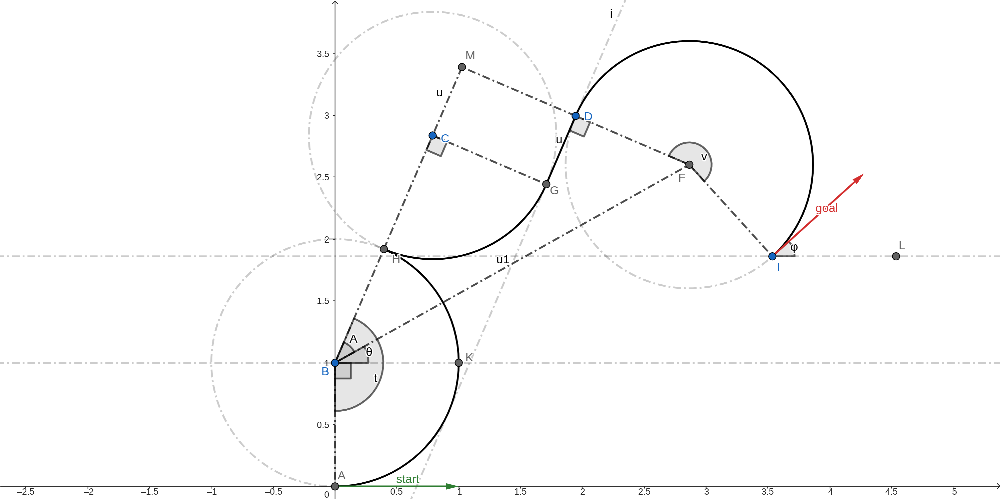

采用下列记号：

- :math:`∠FBM = A` [BGCL 是等腰梯形]
- :math:`∠KBF = θ`
- :math:`BF = u1`

利用几何关系可以推出下列事实。

- :math:`t + \frac{π}{2} - v = φ`
- :math:`F(x - sin(φ), y + cos(φ))`
- :math:`B(0, 1)`
- :math:`u1, θ = polar(vector<BF>)`
- :math:`BM = CB = 2` [2 × 曲率半径]
- :math:`MD = CD = 1` [CGDM 是矩形]
- :math:`MC = GD = u` [CGDM 是矩形]
- :math:`MF = MD + DF = 2`
- :math:`BM = \sqrt{BF^2 - MF^2}` [在 BFM 上使用勾股定理]
- :math:`tan(A) = \frac{MF}{BM}`
- :math:`u = MC = BM - CB` 
- :math:`t = ∠ABK + ∠KBF + ∠FBC`

因此有：

- :math:`u1, θ = polar(x - sin(φ), y + cos(φ) - 1)`
- :math:`u = arccos(\sqrt{u1^2 - 4} - 2)`
- :math:`A = arctan(\frac{2}{\sqrt{u1^2 - 4}})`
- :math:`t = \frac{π}{2} + θ + A`
- :math:`v = (t - φ + \frac{π}{2})`

9. **左转-直线-右转90×左转（Left-Straight-Right90xLeft）**

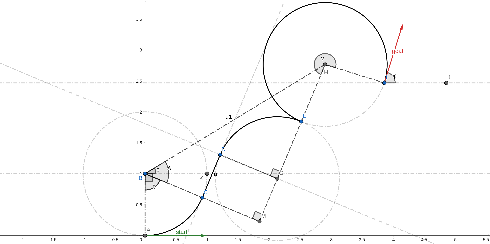

采用下列记号：

- :math:`∠MBH = A` [BGCL 是等腰梯形]
- :math:`∠KBH = θ`
- :math:`BH = u1`

利用几何关系可以推出下列事实。

- :math:`t - \frac{π}{2} - v = φ`
- :math:`H(x - sin(φ), y + cos(φ))`
- :math:`B(0, 1)`
- :math:`u1, θ = polar(vector<BH>)`
- :math:`GH = 2` [2 × 曲率半径]
- :math:`CM = DG = 1` [CGDM 是矩形]
- :math:`CD = MG = u` [CGDM 是矩形]
- :math:`BM = BC + CM = 2`
- :math:`MH = \sqrt{BH^2 - BM^2}` [在 BHM 上使用勾股定理]
- :math:`tan(A) = \frac{HM}{BM}`
- :math:`u = MC = BM - CB` 
- :math:`t = ∠ABK + ∠KBH - ∠HBC`

因此有：

- :math:`u1, θ = polar(x - sin(φ), y + cos(φ) - 1)`
- :math:`u = arccos(\sqrt{u1^2 - 4} - 2)`
- :math:`A = arctan(\frac{2}{\sqrt{u1^2 - 4}})`
- :math:`t = \frac{π}{2} + θ - A`
- :math:`v = (t - φ - \frac{π}{2})`

10. **左转×右转90-直线-右转（LeftxRight90-Straight-Right）**

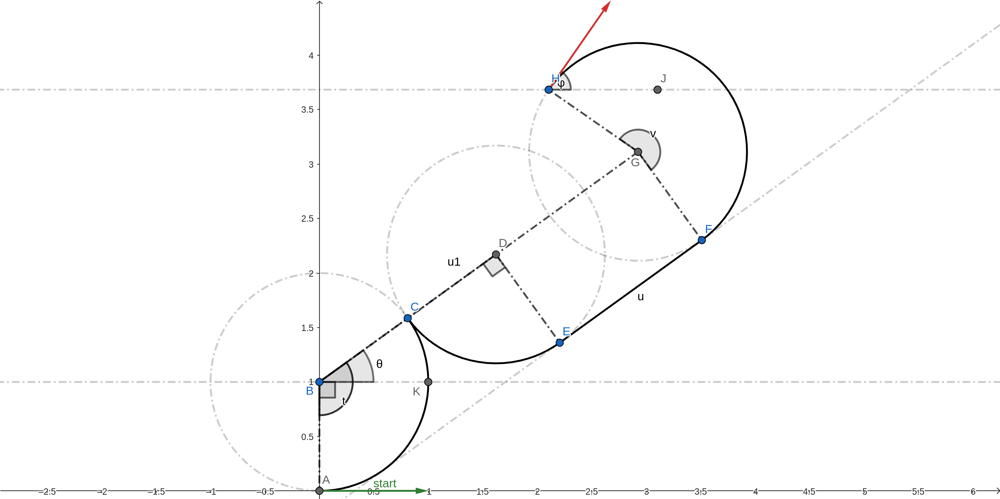

采用下列记号：

- :math:`∠KBG = θ`
- :math:`BG = u1`

利用几何关系可以推出下列事实。

- :math:`t - \frac{π}{2} - v = φ`
- :math:`G(x + sin(φ), y - cos(φ))`
- :math:`B(0, 1)`
- :math:`u1, θ = polar(vector<BG>)`
- :math:`BD = 2` [2 × 曲率半径]
- :math:`DG = EF = u` [DGFE 是矩形]
- :math:`DG = BG - BD = 2`
- :math:`∠ABK = \frac{π}{2}`
- :math:`t = ∠ABK + ∠KBG`

因此有：

- :math:`u1, θ = polar(x + sin(φ), y - cos(φ) - 1)`
- :math:`u = u1 - 2`
- :math:`t = \frac{π}{2} + θ`
- :math:`v = (t - φ - \frac{π}{2})`

11. **左转-直线-左转90×右转（Left-Straight-Left90xRight）**

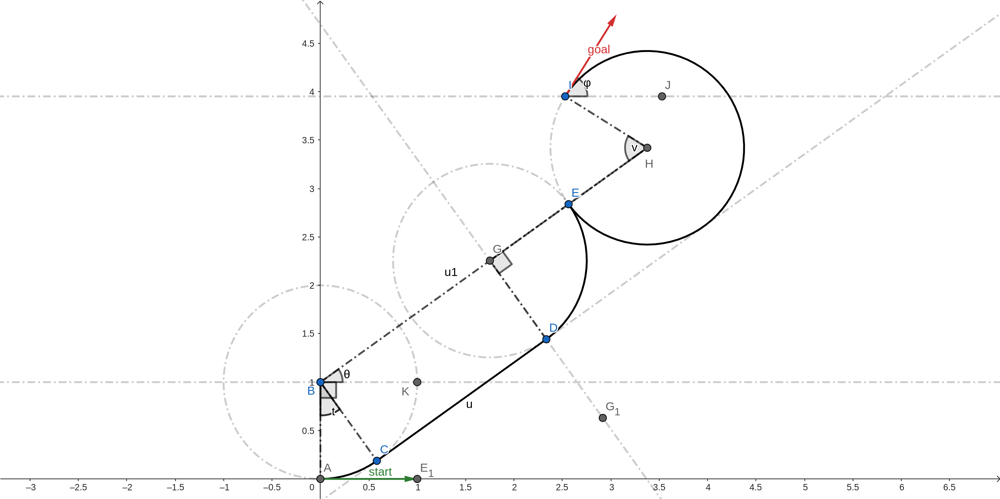

采用下列记号：

- :math:`∠KBH = θ`
- :math:`BH = u1`

利用几何关系可以推出下列事实。

- :math:`t + \frac{π}{2} + v = φ`
- :math:`H(x + sin(φ), y - cos(φ))`
- :math:`B(0, 1)`
- :math:`u1, θ = polar(vector<BH>)`
- :math:`GH = 2` [2 × 曲率半径]
- :math:`DC = BG = u` [DGBC 是矩形]
- :math:`BG = BH - GH`
- :math:`∠ABC= ∠KBH`

因此有：

- :math:`u1, θ = polar(x + sin(φ), y - cos(φ) - 1)`
- :math:`u = u1 - 2`
- :math:`t = θ`
- :math:`v = (φ - t - \frac{π}{2})`

12. **左转×右转90-直线-左转90×右转（LeftxRight90-Straight-Left90xRight）**

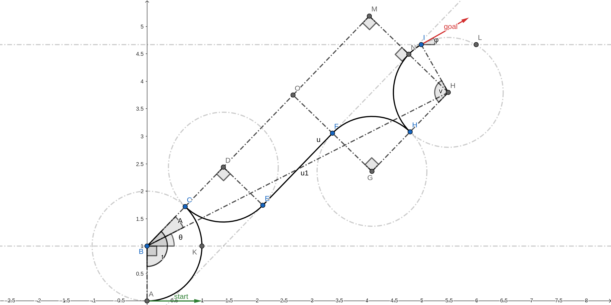

采用下列记号：

- :math:`∠KBH = θ`
- :math:`∠HBM = A`
- :math:`BH = u1`

利用几何关系可以推出下列事实。

- :math:`t - v = φ`
- :math:`H(x + sin(φ), y - cos(φ))`
- :math:`B(0, 1)`
- :math:`u1, θ = polar(vector<BH>)`
- :math:`GF = ED = 1` [曲率半径]
- :math:`BD = GH = 2` [2 × 曲率半径]
- :math:`FN = GH = 2` [ENMD 是矩形]
- :math:`NH = GF = 1` [FNHG 是矩形]
- :math:`MN = ED = 1` [ENMD 是矩形]
- :math:`DO = EF = u` [DOFE 是矩形]
- :math:`MH = MN + NH = 2`
- :math:`BM = \sqrt{BH^2 - MH^2}` [在 BHM 上使用勾股定理]
- :math:`DO = BM - BD - OM`
- :math:`tan(A) = \frac{MH}{BM}`
- :math:`∠ABC = ∠ABK + ∠KBH + ∠HBM`

因此有：

- :math:`u1, θ = polar(x + sin(φ), y - cos(φ) - 1)`
- :math:`u = /sqrt{u1^2 - 4} - 4`
- :math:`A = arctan(\frac{2}{u1^2 - 4})`
- :math:`t = \frac{π}{2} + θ + A`
- :math:`v = (t - φ)`

参考文献
=============

-  `15.3.2 Reeds-Shepp
   Curves <https://lavalle.pl/planning/node822.html>`__

-  `optimal paths for a car that goes both forwards and
   backwards <https://pdfs.semanticscholar.org/932e/c495b1d0018fd59dee12a0bf74434fac7af4.pdf>`__

-  `ghliu/pyReedsShepp: Implementation of Reeds Shepp
   curve. <https://github.com/ghliu/pyReedsShepp>`__
