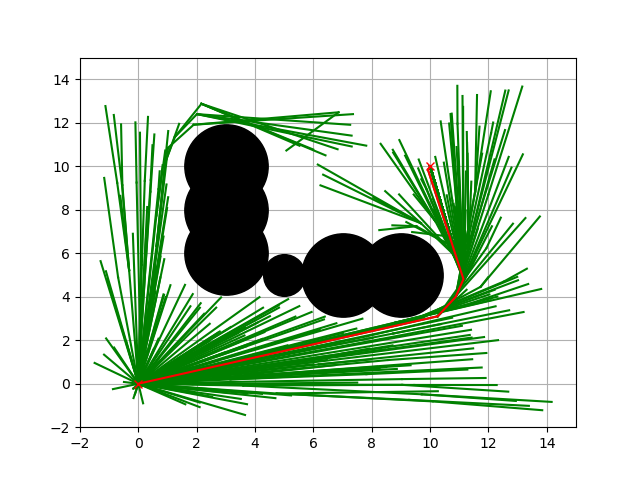

RRT\*
~~~~~

.. figure:: https://github.com/AtsushiSakai/PythonRoboticsGifs/raw/master/PathPlanning/RRTstar/animation.gif

这是 RRT\* 路径规划代码。

黑圆是障碍物，绿线是搜索树，红叉是起点和目标点。

代码链接
^^^^^^^^^^

.. autoclass:: PathPlanning.RRTStar.rrt_star.RRTStar

仿真
^^^^^^^^^^

参考文献
^^^^^^^^
-  `Sampling-based Algorithms for Optimal Motion Planning <https://arxiv.org/pdf/1105.1186>`__
-  `Incremental Sampling-based Algorithms for Optimal Motion Planning <https://arxiv.org/abs/1005.0416>`__
