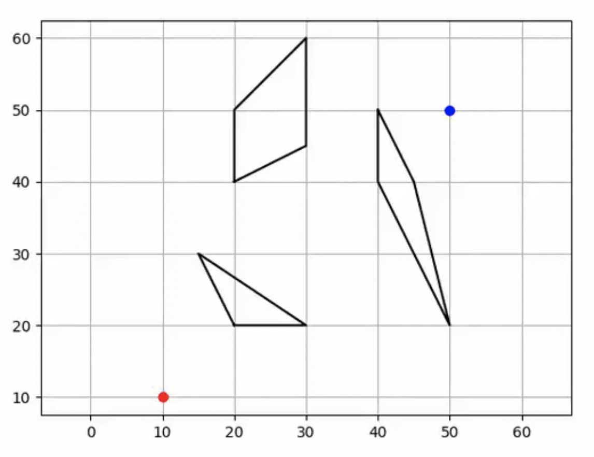
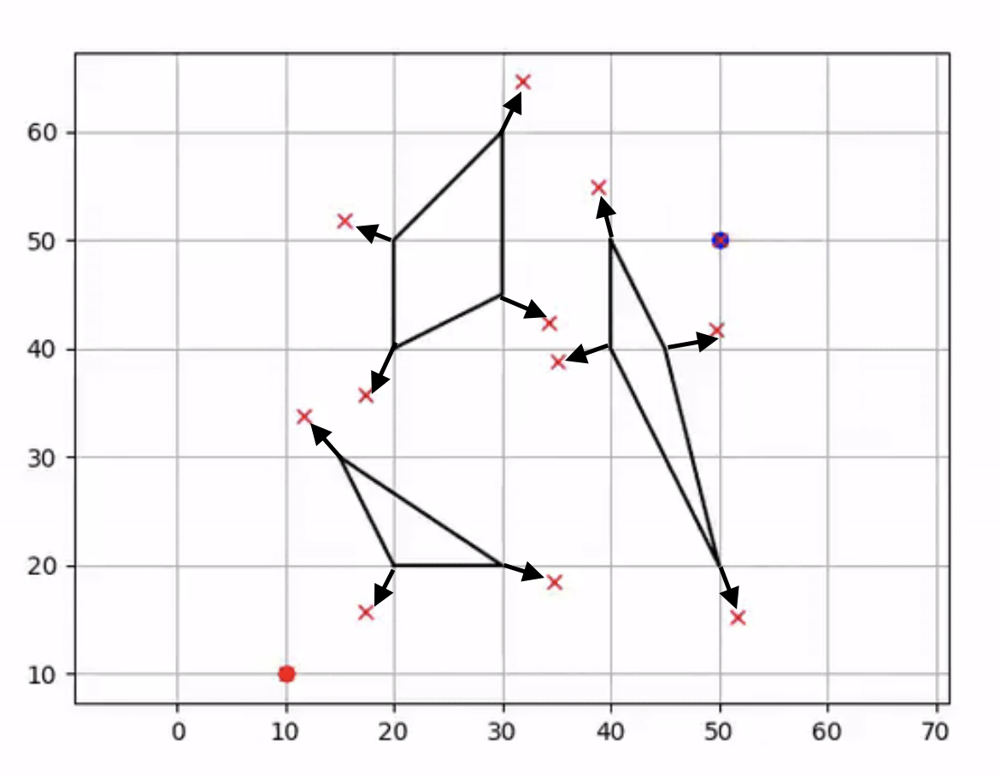
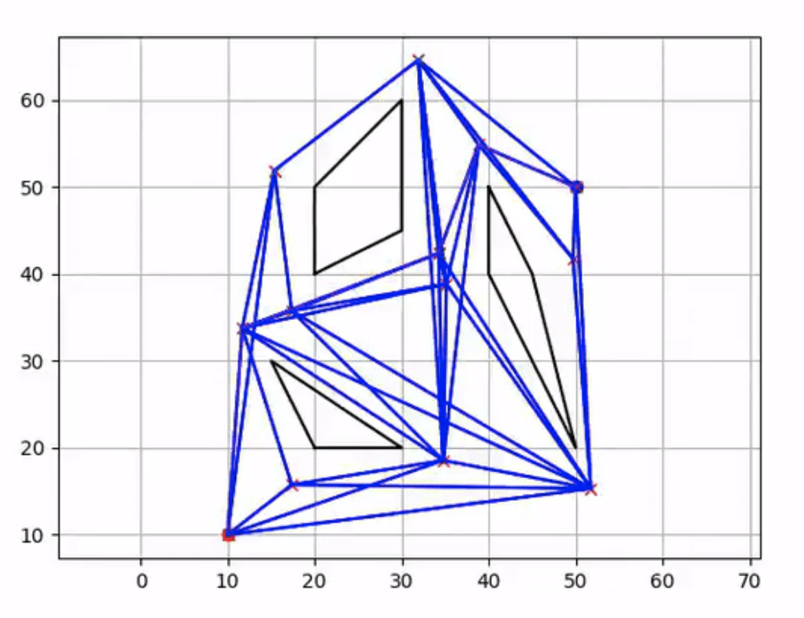
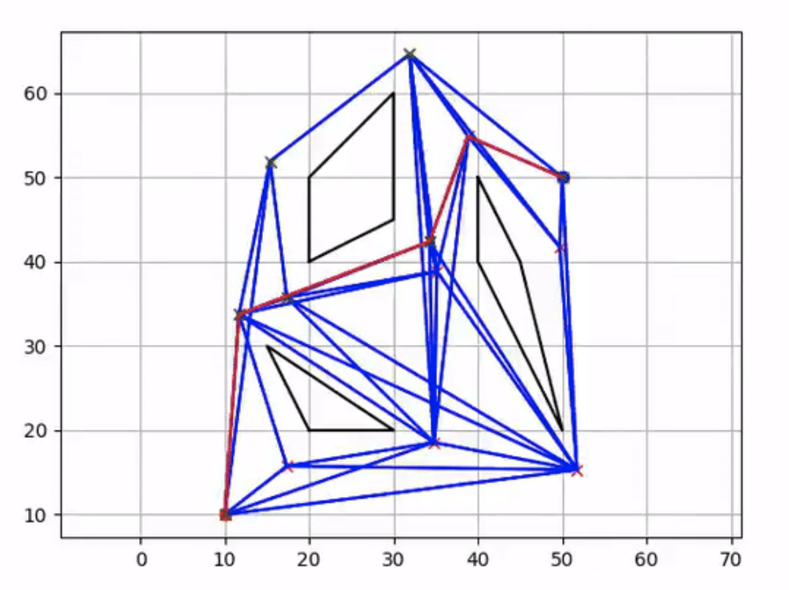

可视图路线图规划器
---------------------------

.. image:: https://github.com/AtsushiSakai/PythonRoboticsGifs/raw/master/PathPlanning/VisibilityRoadMap/animation.gif

`[代码] <https://github.com/AtsushiSakai/PythonRobotics/blob/master/PathPlanning/VisibilityRoadMap/visibility_road_map.py>`_

该可视图路线图规划器使用 Dijkstra 方法做图搜索。

动画中，黑线是多边形障碍物，

红叉是可见节点，蓝线是无碰撞的可视图。

红线是 Dijkstra 算法在可视图上搜索得到的最终路径。

代码链接
~~~~~~~~~~~~
.. autoclass:: PathPlanning.VisibilityRoadMap.visibility_road_map.VisibilityRoadMap

算法
~~~~~~~~~~

本章说明可视图路线图规划器如何搜索路径。

假定规划器可以得到下图中的这些信息。

- 1. 起点（红点）
- 2. 目标点（蓝点）
- 3. 障碍物多边形（黑线）

步骤 1：根据多边形障碍物生成可见节点
^^^^^^^^^^^^^^^^^^^^^^^^^^^^^^^^^^^^^^^^^^^^^^^^^^^^^^^^^^^^

节点由多边形顶点向外扩展而成，如下图：

每个多边形顶点都沿相邻顶点的方向向外扩展。

起点和目标点也同样作为节点。

步骤 2：生成连接这些节点的可视图
^^^^^^^^^^^^^^^^^^^^^^^^^^^^^^^^^^^^^^^^^^^^^^^^^^^^^^^

连接节点时，会检查两节点之间的弧是否与各个障碍物发生碰撞。

若弧发生碰撞，则去掉这条边。

图中蓝线是生成的可视图：

步骤 3：用 Dijkstra 算法在图中搜索最短路径
^^^^^^^^^^^^^^^^^^^^^^^^^^^^^^^^^^^^^^^^^^^^^^^^^^^^^^^^^^^^^^^^^^^^^^

图中红线是搜索得到的路径：

Dijkstra 算法的细节见 :ref:`dijkstra`。

参考文献
~~~~~~~~~~~~

- `Visibility graph - Wikipedia <https://en.wikipedia.org/wiki/Visibility_graph>`_

