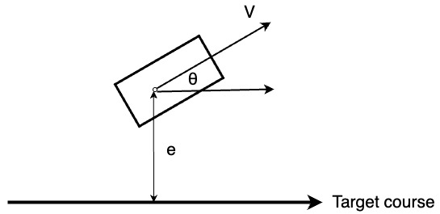

.. _linearquadratic-regulator-(lqr)-steering-control:

线性二次调节器（LQR）转向控制
-------------------------------------------------

使用线性二次调节器（LQR）转向控制与 PID 速度控制的路径跟踪仿真。

.. image:: https://github.com/AtsushiSakai/PythonRoboticsGifs/raw/master/PathTracking/lqr_steer_control/animation.gif

代码链接
~~~~~~~~~~~~~~~

.. autofunction:: PathTracking.lqr_steer_control.lqr_steer_control.lqr_steering_control

概述
~~~~~~~~

lqr_steer_control.py 中实现的线性二次调节器（LQR）转向控制模型提供一项仿真：自动驾驶车辆根据当前状态与期望轨迹的反馈调节转向角，以跟踪期望轨迹。
该模型结合 PID 速度控制与线性二次调节器（LQR）转向控制，以实现平滑且准确的轨迹跟踪。

车辆运动模型
~~~~~~~~~~~~~~~~~~~~~

下图为本仿真所用车辆的几何模型：

`e` 与 :math:`\theta` 分别表示相对于期望轨迹的横向误差与航向角误差。
:math:`\dot{e}` 与 :math:`\dot{\theta}` 表示这些误差的变化率。

:math:`e_t` 与 :math:`\theta_t` 分别是 `e` 与 :math:`\theta` 在时刻 `t` 的更新值，可由下列运动学方程计算：

.. math:: e_t = e_{t-1} + \dot{e}_{t-1} dt

.. math:: \theta_t = \theta_{t-1} + \dot{\theta}_{t-1} dt

其中 `dt` 为时间差。

`e` 的变化率可计算为：

.. math:: \dot{e}_t = V \sin(\theta_{t-1})

其中 `V` 为当前车辆速度。

若 :math:`\theta` 很小，

.. math:: \theta \approx 0

则 :math:`\sin(\theta)` 可近似为 :math:`\theta`：

.. math:: \sin(\theta) = \theta

因此，`e` 的变化率可近似为：

.. math:: \dot{e}_t = V \theta_{t-1}

:math:`\theta` 的变化率可计算为：

.. math:: \dot{\theta}_t = \frac{V}{L} \tan(\delta)

其中 `L` 为车辆轴距，:math:`\delta` 为转向角。

若 :math:`\delta` 很小，

.. math:: \delta \approx 0

则 :math:`\tan(\delta)` 可近似为 :math:`\delta`：

.. math:: \tan(\delta) = \delta

因此，:math:`\theta` 的变化率可近似为：

.. math:: \dot{\theta}_t = \frac{V}{L} \delta

上述方程可用于在每个时间步更新车辆状态。

控制模型
~~~~~~~~~~~~~~

为把车辆动力学的状态空间表示写成线性模型，状态向量 `x` 与控制输入向量 `u` 定义如下：

.. math:: x_t = [e_t, \dot{e}_t, \theta_t, \dot{\theta}_t]^T

.. math:: u_t = \delta_t

线性状态转移方程可表示为：

.. math:: x_{t+1} = A x_t + B u_t

其中：

:math:`\begin{equation*} A = \begin{bmatrix} 1 & dt & 0 & 0\\ 0 & 0 & v & 0\\ 0 & 0 & 1 & dt\\ 0 & 0 & 0 & 0 \\ \end{bmatrix} \end{equation*}`

:math:`\begin{equation*} B = \begin{bmatrix} 0\\ 0\\ 0\\ \frac{v}{L} \\ \end{bmatrix} \end{equation*}`

线性二次调节器（LQR）控制器
~~~~~~~~~~~~~~~~~~~~~~~~~~~~~~~~~~~~~~~

线性二次调节器（LQR）控制器用于计算使二次代价函数最小的最优控制输入 `u`：

:math:`J = \sum_{t=0}^{N} (x_t^T Q x_t + u_t^T R u_t)`

其中 `Q` 与 `R` 分别是状态与控制输入的加权矩阵。

对于线性模型：

:math:`x_{t+1} = A x_t + B u_t`

最优控制输入 `u` 可计算为：

:math:`u_t = -K x_t`

其中 `K` 是求解 Riccati 方程得到的反馈增益矩阵。

参考文献
~~~~~~~~~~~
-  `ApolloAuto/apollo: An open autonomous driving platform <https://github.com/ApolloAuto/apollo>`_

- `Linear Quadratic Regulator (LQR) <https://en.wikipedia.org/wiki/Linear%E2%80%93quadratic_regulator>`_

