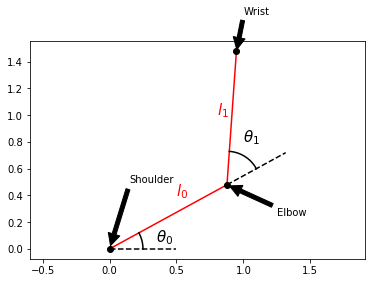
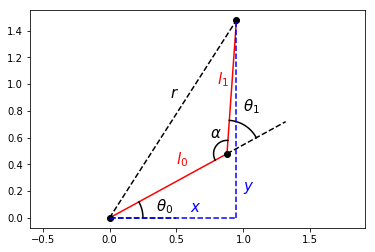
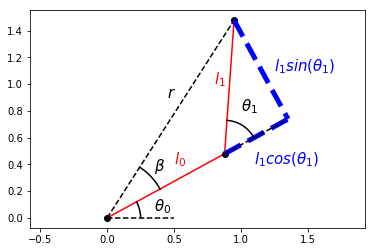
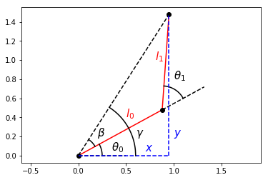

两关节机械臂到点控制
------------------------------

.. figure:: https://github.com/AtsushiSakai/PythonRoboticsGifs/raw/master/ArmNavigation/two_joint_arm_to_point_control/animation.gif
   :alt: 两关节机械臂到点控制

这是两关节机械臂到点控制仿真。

这是交互式仿真。

可在绘图区域单击鼠标左键，设置末端执行器的目标位置。

代码链接
~~~~~~~~~~~~~~~

.. autofunction:: ArmNavigation.two_joint_arm_to_point_control.two_joint_arm_to_point_control.main

平面两连杆机械臂的逆运动学
~~~~~~~~~~~~~~~~~~~~~~~~~~~~~~~~~~~~~~~~~~~~~~~~~~~~

机械臂的一个经典问题，是使末端执行器——位于臂末端、负责操作环境的机构——到达所需位置。末端执行器也许是夹爪，你也许想抓取某个物体，并且也许知道该物体相对于机器人的位置，但不能直接指定末端执行器前往何处。你必须求出能使末端执行器到达目标位置的关节角。该问题称为逆运动学。

该解法来源于：
https://robotacademy.net.au/lesson/inverse-kinematics-for-a-2-joint-robot-arm-using-geometry/

首先定义一个类，以便更容易地绘制机械臂。

.. code-block:: ipython3

    %matplotlib inline
    from math import cos, sin
    import numpy as np
    import matplotlib.pyplot as plt
    
    class TwoLinkArm:
        def __init__(self, joint_angles=[0, 0]):
            self.shoulder = np.array([0, 0])
            self.link_lengths = [1, 1]
            self.update_joints(joint_angles)
            
        def update_joints(self, joint_angles):
            self.joint_angles = joint_angles
            self.forward_kinematics()
            
        def forward_kinematics(self):
            theta0 = self.joint_angles[0]
            theta1 = self.joint_angles[1]
            l0 = self.link_lengths[0]
            l1 = self.link_lengths[1]
            self.elbow = self.shoulder + np.array([l0*cos(theta0), l0*sin(theta0)])
            self.wrist = self.elbow + np.array([l1*cos(theta0 + theta1), l1*sin(theta0 + theta1)])
            
        def plot(self):
            plt.plot([self.shoulder[0], self.elbow[0]],
                     [self.shoulder[1], self.elbow[1]],
                     'r-')
            plt.plot([self.elbow[0], self.wrist[0]],
                     [self.elbow[1], self.wrist[1]],
                     'r-')
            plt.plot(self.shoulder[0], self.shoulder[1], 'ko')
            plt.plot(self.elbow[0], self.elbow[1], 'ko')
            plt.plot(self.wrist[0], self.wrist[1], 'ko')

再定义一个函数，以便在图上画出角度。

.. code-block:: ipython3

    from math import sqrt
    
    def transform_points(points, theta, origin):
        T = np.array([[cos(theta), -sin(theta), origin[0]],
                      [sin(theta), cos(theta), origin[1]],
                      [0, 0, 1]])
        return np.matmul(T, np.array(points))
    
    def draw_angle(angle, offset=0, origin=[0, 0], r=0.5, n_points=100):
            x_start = r*cos(angle)
            x_end = r
            dx = (x_end - x_start)/(n_points-1)
            coords = [[0 for _ in range(n_points)] for _ in range(3)]
            x = x_start
            for i in range(n_points-1):
                y = sqrt(r**2 - x**2)
                coords[0][i] = x
                coords[1][i] = y
                coords[2][i] = 1
                x += dx
            coords[0][-1] = r
            coords[2][-1] = 1
            coords = transform_points(coords, offset, origin)
            plt.plot(coords[0], coords[1], 'k-')

现在有 TwoLinkArm 类帮助绘制机械臂，推导过程中会多次使用。注意其中有一个名为 forward_kinematics 的方法：正运动学根据关节角与连杆长度确定末端执行器的位置。正运动学比逆运动学更容易。

.. code-block:: ipython3

    arm = TwoLinkArm()
    
    theta0 = 0.5
    theta1 = 1
    
    arm.update_joints([theta0, theta1])
    arm.plot()
    
    def label_diagram():
        plt.plot([0, 0.5], [0, 0], 'k--')
        plt.plot([arm.elbow[0], arm.elbow[0]+0.5*cos(theta0)],
                 [arm.elbow[1], arm.elbow[1]+0.5*sin(theta0)],
                 'k--')
        
        draw_angle(theta0, r=0.25)
        draw_angle(theta1, offset=theta0, origin=[arm.elbow[0], arm.elbow[1]], r=0.25)
        
        plt.annotate("$l_0$", xy=(0.5, 0.4), size=15, color="r")
        plt.annotate("$l_1$", xy=(0.8, 1), size=15, color="r")
        
        plt.annotate(r"$\theta_0$", xy=(0.35, 0.05), size=15)
        plt.annotate(r"$\theta_1$", xy=(1, 0.8), size=15)
    
    label_diagram()
    
    plt.annotate("Shoulder", xy=(arm.shoulder[0], arm.shoulder[1]), xytext=(0.15, 0.5),
        arrowprops=dict(facecolor='black', shrink=0.05))
    plt.annotate("Elbow", xy=(arm.elbow[0], arm.elbow[1]), xytext=(1.25, 0.25),
        arrowprops=dict(facecolor='black', shrink=0.05))
    plt.annotate("Wrist", xy=(arm.wrist[0], arm.wrist[1]), xytext=(1, 1.75),
        arrowprops=dict(facecolor='black', shrink=0.05))
    
    plt.axis("equal")
    
    plt.show()

机械臂关节常按解剖学术语命名，因此有肩（Shoulder）、肘（Elbow）与腕（Wrist）。在本例中，腕本身并不是关节，但可以把它视为末端执行器。若将肩约束在原点，就可以写出肘与腕的正运动学。

| :math:`elbow_x = l_0\cos(\theta_0)`
| :math:`elbow_y = l_0\sin(\theta_0)`

| :math:`wrist_x = elbow_x + l_1\cos(\theta_0+\theta_1) = l_0\cos(\theta_0) + l_1\cos(\theta_0+\theta_1)`
| :math:`wrist_y = elbow_y + l_1\sin(\theta_0+\theta_1) = l_0\sin(\theta_0) + l_1\sin(\theta_0+\theta_1)`

由于腕是末端执行器，这里把它的坐标记为
\ :math:`x`\  与 \ :math:`y`\ 。于是末端执行器的正运动学为

| :math:`x = l_0\cos(\theta_0) + l_1\cos(\theta_0+\theta_1)`
| :math:`y = l_0\sin(\theta_0) + l_1\sin(\theta_0+\theta_1)`

要寻找能使末端执行器到达期望坐标 :math:`x` 与 :math:`y` 的关节角 :math:`\theta_0` 与
:math:`\theta_1`，第一次尝试也许是从正运动学中反解 :math:`\theta_0` 与 :math:`\theta_1`，但那是错误的做法。更简便的做法是回到机械臂的几何关系。

.. code-block:: ipython3

    from math import pi
    
    arm.plot()
    label_diagram()
    
    plt.plot([0, arm.wrist[0]],
             [0, arm.wrist[1]],
             'k--')
    
    plt.plot([arm.wrist[0], arm.wrist[0]],
             [0, arm.wrist[1]],
             'b--')
    plt.plot([0, arm.wrist[0]],
             [0, 0],
             'b--')
    
    plt.annotate("$x$", xy=(0.6, 0.05), size=15, color="b")
    plt.annotate("$y$", xy=(1, 0.2), size=15, color="b")
    plt.annotate("$r$", xy=(0.45, 0.9), size=15)
    plt.annotate(r"$\alpha$", xy=(0.75, 0.6), size=15)
    
    alpha = pi-theta1
    draw_angle(alpha, offset=theta0+theta1, origin=[arm.elbow[0], arm.elbow[1]], r=0.1)
    
    plt.axis("equal")
    plt.show()

末端执行器到机器人基座（肩关节）的距离为
:math:`r`，可用勾股定理根据末端执行器位置写成

:math:`r^2` = :math:`x^2 + y^2`

然后，由余弦定理，:math:`r`\ 2 也可写成：

:math:`r^2` = :math:`l_0^2 + l_1^2 - 2l_0l_1\cos(\alpha)`

因为 :math:`\alpha` 可以写成 :math:`\pi - \theta_1`，可以把期望的末端执行器位置与其中一个关节角
:math:`\theta_1` 联系起来。

:math:`x^2 + y^2` = :math:`l_0^2 + l_1^2 - 2l_0l_1\cos(\alpha)`

:math:`x^2 + y^2` = :math:`l_0^2 + l_1^2 - 2l_0l_1\cos(\pi-\theta_1)`

:math:`2l_0l_1\cos(\pi-\theta_1) = l_0^2 + l_1^2 - x^2 - y^2`

| :math:`\cos(\pi-\theta_1) = \frac{l_0^2 + l_1^2 - x^2 - y^2}{2l_0l_1}`
| :math:`~`
| :math:`~`
| :math:`\cos(\pi-\theta_1) = -cos(\theta_1)` 是三角恒等式，因此也可以写成

:math:`\cos(\theta_1) = \frac{x^2 + y^2 - l_0^2 - l_1^2}{2l_0l_1}`

由此得到用连杆长度与期望末端执行器位置表示 :math:`\theta_1` 的方程。

:math:`\theta_1 = \cos^{-1}(\frac{x^2 + y^2 - l_0^2 - l_1^2}{2l_0l_1})`

这实际上是 :math:`\theta_1` 的两个可能解之一，此处暂时忽略另一个解。该解对应于图中所示的“臂向下”构型。接下来推导依赖于这一 :math:`\theta_1` 取值的 :math:`\theta_0` 方程。

.. code-block:: ipython3

    from math import atan2
    
    arm.plot()
    plt.plot([0, arm.wrist[0]],
             [0, arm.wrist[1]],
             'k--')
    
    p = 1 + cos(theta1)
    plt.plot([arm.elbow[0], p*cos(theta0)],
             [arm.elbow[1], p*sin(theta0)],
             'b--', linewidth=5)
    plt.plot([arm.wrist[0], p*cos(theta0)],
             [arm.wrist[1], p*sin(theta0)],
             'b--', linewidth=5)
    
    beta = atan2(arm.wrist[1], arm.wrist[0])-theta0
    draw_angle(beta, offset=theta0, r=0.45)
    
    plt.annotate(r"$\beta$", xy=(0.35, 0.35), size=15)
    plt.annotate("$r$", xy=(0.45, 0.9), size=15)
    plt.annotate(r"$l_1sin(\theta_1)$",xy=(1.25, 1.1), size=15, color="b")
    plt.annotate(r"$l_1cos(\theta_1)$",xy=(1.1, 0.4), size=15, color="b")
    
    label_diagram()
    
    plt.axis("equal")
    
    plt.show()

考虑位移向量 :math:`r` 与第一根连杆 :math:`l_0` 之间的夹角，记为 :math:`\beta`。若延长第一根连杆，使其包含第二根连杆沿第一根连杆方向的分量，就得到一个直角三角形，两条直角边分别为
:math:`l_0+l_1cos(\theta_1)` 与 :math:`l_1sin(\theta_1)`，从而可将 :math:`\beta` 表示为

:math:`\beta = \tan^{-1}(\frac{l_1\sin(\theta_1)}{l_0+l_1\cos(\theta_1)})`

现在已有用机械臂某一关节角表示该角度 :math:`\beta` 的表达式。那么，能否将 :math:`\beta` 与
:math:`\theta_0` 联系起来？可以。

.. code-block:: ipython3

    arm.plot()
    label_diagram()
    plt.plot([0, arm.wrist[0]],
             [0, arm.wrist[1]],
             'k--')
    
    plt.plot([arm.wrist[0], arm.wrist[0]],
             [0, arm.wrist[1]],
             'b--')
    plt.plot([0, arm.wrist[0]],
             [0, 0],
             'b--')
    
    gamma = atan2(arm.wrist[1], arm.wrist[0])
    draw_angle(beta, offset=theta0, r=0.2)
    draw_angle(gamma, r=0.6)
    
    plt.annotate("$x$", xy=(0.7, 0.05), size=15, color="b")
    plt.annotate("$y$", xy=(1, 0.2), size=15, color="b")
    plt.annotate(r"$\beta$", xy=(0.2, 0.2), size=15)
    plt.annotate(r"$\gamma$", xy=(0.6, 0.2), size=15)
    
    plt.axis("equal")
    plt.show()

第一个关节角 :math:`\theta_0` 与 :math:`\beta` 相加，得到正 :math:`x` 轴与位移向量
:math:`r` 之间的夹角，将该角记为 :math:`\gamma`。

:math:`\gamma = \theta_0+\beta`

于是，剩下的关节角 :math:`\theta_0` 可以表示为

:math:`\theta_0 = \gamma-\beta`

已经知道 :math:`\beta`。:math:`\gamma` 就是 :math:`\frac{y}{x}` 的反正切，因此得到
:math:`\theta_0` 的方程。

:math:`\theta_0 = \tan^{-1}(\frac{y}{x})-\tan^{-1}(\frac{l_1\sin(\theta_1)}{l_0+l_1\cos(\theta_1)})`

至此得到平面两连杆机械臂的逆运动学。若要用编程语言实现，最好使用 atan2 函数；大多数数学库都包含该函数，并能正确处理 :math:`y` 与 :math:`x` 的符号。注意必须先计算 :math:`\theta_1`，再计算 :math:`\theta_0`。

| :math:`\theta_1 = \cos^{-1}(\frac{x^2 + y^2 - l_0^2 - l_1^2}{2l_0l_1})`
| :math:`\theta_0 = atan2(y, x)-atan2(l_1\sin(\theta_1), l_0+l_1\cos(\theta_1))`
